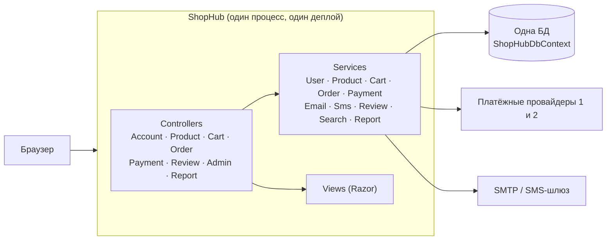
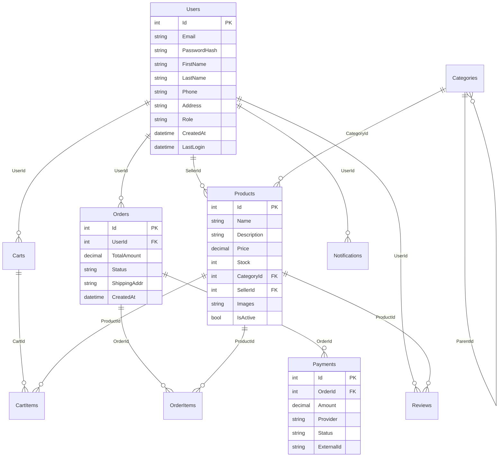
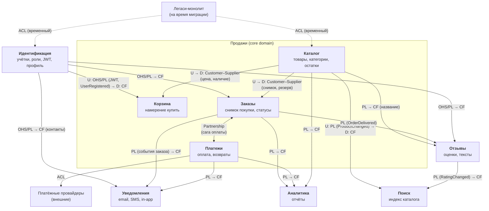
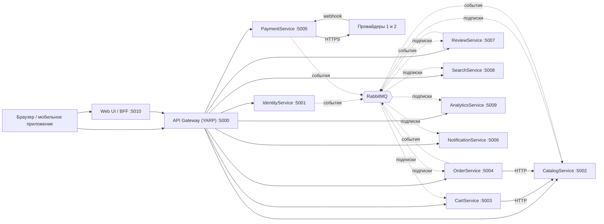
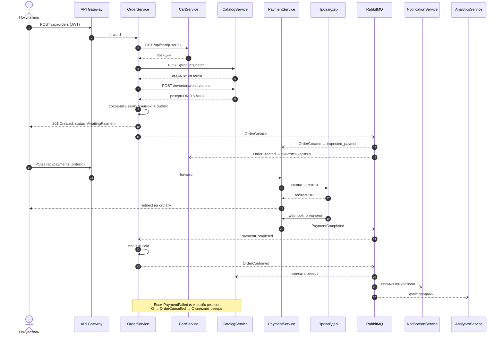
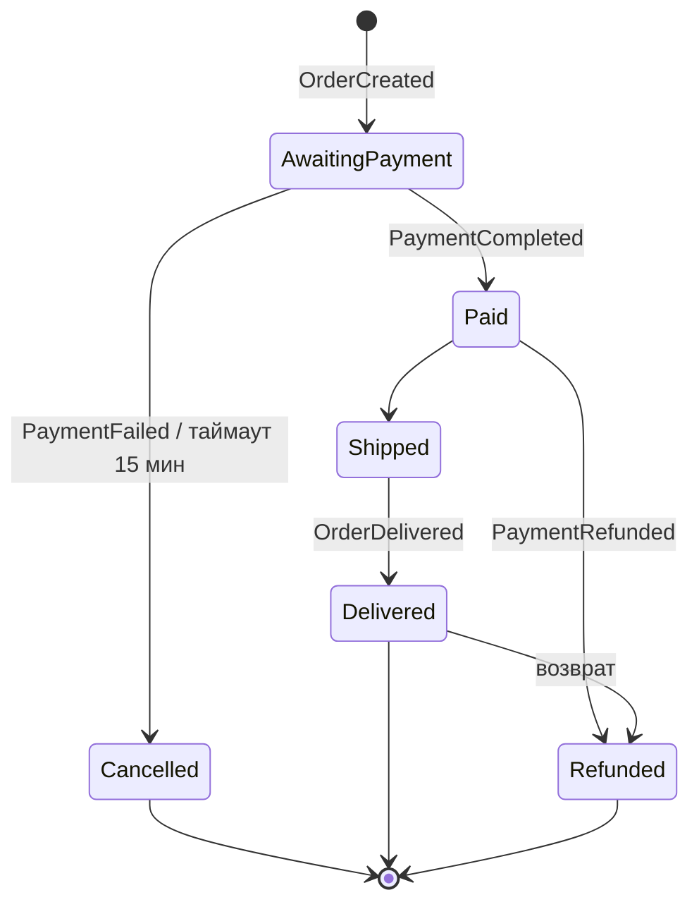
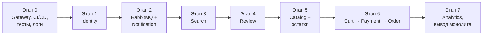
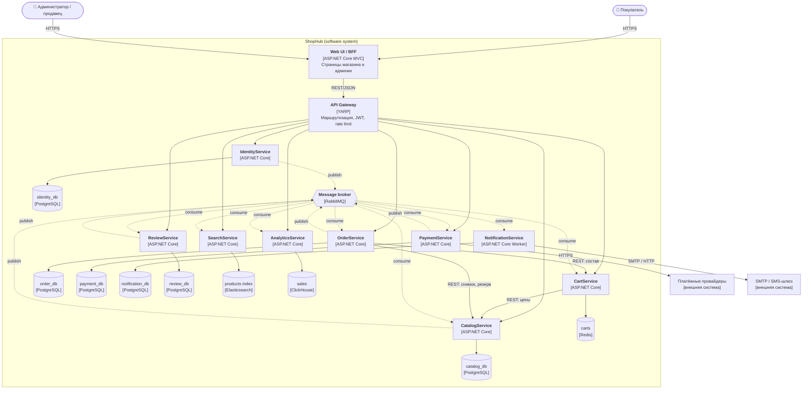

# Документ декомпозиции ShopHub

> КТ-2 · Декомпозиция монолита на микросервисы
> Подход: DDD (Bounded Context) → Database per Service → синхронные/асинхронные коммуникации → миграция по Strangler Fig.

## Содержание

1. [Текущее состояние (AS-IS) и анализ монолита](#1-текущее-состояние-as-is-и-анализ-монолита)
2. [Ограниченные контексты и Context Map](#2-ограниченные-контексты-и-context-map)
3. [Целевая архитектура (TO-BE): список сервисов](#3-целевая-архитектура-to-be-список-сервисов)
4. [Распределение данных](#4-распределение-данных)
5. [Коммуникации](#5-коммуникации)
6. [План миграции (Strangler Fig)](#6-план-миграции-strangler-fig)
7. [Риски и ограничения](#7-риски-и-ограничения)
8. [Дополнительно: стек, C4 Container, Anti-corruption Layer](#8-дополнительно-стек-c4-container-anti-corruption-layer)

---

## 1. Текущее состояние (AS-IS) и анализ монолита

### 1.1 Что такое ShopHub сейчас

Интернет-магазин на ASP.NET Core MVC. Один проект, один `ShopHubDbContext`, одна БД, Razor-представления для всех страниц. Над ним работают 8 разработчиков.



Схема единой БД (все связи — внешние ключи внутри одной базы):



### 1.2 Проблемы, которые решает декомпозиция

| # | Проблема | Корень проблемы | Как решает декомпозиция |
|---|----------|-----------------|--------------------------|
| 1 | Любое изменение требует деплоя всего магазина | Один процесс, один артефакт | Независимый деплой каждого сервиса |
| 2 | Конфликты команд в git, чужие тесты ломаются от правки `Product.cs` | Одна модель `Product` обслуживает 4 разных контекста | У каждого контекста своя модель товара (см. раздел 2) |
| 3 | В чёрную пятницу приходится масштабировать всё | Каталог, поиск и платежи — один процесс | Горизонтально масштабируем только Catalog и Search |
| 4 | Поиск (`SQL LIKE`) забивает пул соединений всей системы | Поиск ходит в ту же БД, что заказы и платежи | Отдельный SearchService с Elasticsearch, своя инфраструктура |
| 5 | Отзывы и платежи падают вместе | Разные требования к SLA в одном процессе | PaymentService — 99.99 % и изолированный деплой, ReviewService — 99.5 % |

### 1.3 Анализ монолита: бизнес-функции

Метод: для каждого контроллера и сервиса задавался вопрос «если бы это был отдельный отдел компании — как бы он назывался и за что отвечал?». Если у функции свой набор бизнес-правил, свои пользователи и своя причина для изменений — это отдельная бизнес-функция.

| # | Бизнес-функция | Что делает | Почему это отдельная функция | Текущий код и данные |
|---|----------------|------------|------------------------------|----------------------|
| 1 | **Идентификация и доступ** | Регистрация, вход, хранение пароля, роли (покупатель, продавец, админ), блокировка пользователей | Отвечает на вопрос «кто ты и что тебе можно». Правила безопасности (хэширование, токены, политика паролей) не зависят от того, что продаёт магазин | `AccountController` (вход/регистрация), `AdminController` (часть: пользователи), `UserService`, `Users` (Email, PasswordHash, Role, LastLogin) |
| 2 | **Профиль клиента** | Имя, телефон, адреса доставки | Меняется по бизнес-причинам (новые поля профиля), а не по причинам безопасности. Выделена как функция, но в сервисе объединяется с п.1 (см. 3.2) | `AccountController` (профиль), `Users` (FirstName, LastName, Phone, Address) |
| 3 | **Каталог товаров** | Товары, категории, описания, изображения, публикация (`IsActive`), администрирование каталога | Главная витрина. Меняется часто (контент-менеджеры, продавцы), имеет пиковую нагрузку на чтение | `ProductController`, `ProductService`, `AdminController` (часть: товары), `Products`, `Categories` |
| 4 | **Складские остатки** | Сколько единиц товара доступно, резервирование при заказе | Правила «можно ли продать» отличаются от правил «как показать товар». Сейчас спрятаны в поле `Products.Stock` | `Products.Stock`, логика в `OrderService`/`ProductService` |
| 5 | **Поиск** | Полнотекстовый поиск и фильтры по каталогу | Особая нагрузка и особая технология. Именно он создаёт проблему №4 | `SearchService` (SQL LIKE по `Products`) |
| 6 | **Корзина** | Хранение выбранных товаров до оформления, пересчёт суммы | Временные данные с частыми изменениями, другие требования к хранилищу. Корзина — «намерение купить», а не обязательство | `CartController`, `CartService`, `Carts`, `CartItems` |
| 7 | **Заказы** | Оформление заказа, фиксация цен и адреса, жизненный цикл статусов, история заказов | Юридически значимый документ: после оформления состав и цены не меняются. Центральный процесс магазина | `OrderController`, `OrderService`, `Orders`, `OrderItems` |
| 8 | **Платежи** | Приём оплаты через двух провайдеров, статусы платежей, возвраты | Финансы: максимальные требования к надёжности (99.99 %), аудиту и безопасности. Интеграции с внешними системами | `PaymentController`, `PaymentService`, `Payments` |
| 9 | **Уведомления** | Письма (SMTP), SMS, внутренние уведомления (`IsRead`) | Реагирует на события других функций, но сама бизнес-решений не принимает. Email и SMS — один «отдел коммуникаций» | `EmailService`, `SmsService`, `Notifications` |
| 10 | **Отзывы и рейтинги** | Отзывы покупателей, оценки, средний рейтинг товара | Пользовательский контент со своими правилами (модерация, кто может оставить отзыв). Низкие требования к надёжности | `ReviewController`, `ReviewService`, `Reviews` |
| 11 | **Аналитика и отчёты** | Отчёты по продажам для администраторов | Работает только на чтение, но тяжёлыми запросами по истории. Не должна тормозить продажи | `ReportController`, `ReportService`, `Report` |

**Разбор смешанного `AdminController`.** Это не бизнес-функция, а экран для роли «администратор». Его действия принадлежат разным функциям: управление товарами — Каталогу, управление пользователями и ролями — Идентификации, просмотр отчётов — Аналитике. Отдельного AdminService не будет. Админка станет UI, который вызывает API нужных сервисов с ролью `Admin` в JWT.

**Неочевидные находки:**
- `Products.SellerId → Users` — у товара есть продавец, то есть ShopHub уже частично маркетплейс. Роль «продавец» живёт в Идентификации, в Каталоге остаётся только `SellerId` без внешнего ключа.
- `Products.Stock` — остатки смешаны с описанием товара. Отсюда конфликты «разработчик каталога vs разработчик заказов» из проблемы №2.
- `Users.Address` и `Orders.ShippingAddr` — адрес в профиле и адрес в заказе уже сейчас разные понятия. Это подтверждает, что Заказу нужен снимок данных, а не ссылка.

---

## 2. Ограниченные контексты и Context Map

### 2.1 Одно слово — разные смыслы

**«Продукт»:**

| Контекст | Что такое «Продукт» | Ключевые поля | Главное правило |
|----------|--------------------|---------------|-----------------|
| Каталог | Карточка для витрины | Id, Name, Description, CategoryId, Images, Slug, Price, IsActive, SellerId | Полное описание для показа покупателю, может свободно редактироваться |
| Остатки (внутри Catalog) | Складская позиция | ProductId, Available, Reserved | Нельзя продать больше, чем есть; резерв на время оплаты |
| Поиск | Документ индекса | Id, Name, Description, CategoryPath, Price, Rating, InStock | Оптимизирован под чтение; может отставать от каталога на секунды |
| Корзина | Строка корзины | ProductId, Name, UnitPrice (на момент добавления), Quantity | Цена может устареть, перепроверяется при оформлении |
| Заказ | Снимок покупки | ProductId, ProductName, PriceAtPurchase, Quantity | **Неизменяем.** Смена цены в каталоге не меняет старые заказы |
| Отзывы | Объект отзыва | ProductId (+ название для показа) | Нужен только идентификатор, описание не важно |
| Аналитика | Измерение отчёта | ProductId, Name, CategoryName | Историческая версия на момент продажи |

**«Пользователь»:**

| Контекст | Что такое «Пользователь» | Ключевые поля |
|----------|-------------------------|---------------|
| Идентификация | Учётная запись | Id, Email, PasswordHash, Roles, LastLogin, IsBlocked |
| Профиль (внутри Identity) | Клиент | FirstName, LastName, Phone, Addresses[] |
| Корзина | Владелец корзины | UserId (из JWT) |
| Заказы | Покупатель | UserId + **снимок** адреса доставки и контактов на момент заказа |
| Платежи | Плательщик | UserId, OrderId (данные карты у провайдера, не у нас) |
| Уведомления | Получатель | UserId, Email, Phone, настройки каналов |
| Отзывы | Автор | UserId, DisplayName («Иван И.») |
| Каталог | Продавец | SellerId |

**«Заказ»** тоже меняет смысл. Для OrderService это агрегат со статусами и позициями, для PaymentService — сумма к оплате (`orderId + amount`), для Уведомлений — повод для письма, для Аналитики — факт продажи.

### 2.2 Context Map

Типы отношений (терминология DDD):
- **U / D** — Upstream (поставщик модели) / Downstream (потребитель).
- **OHS/PL** — Open Host Service / Published Language: сервис публикует стабильный API и схемы событий для всех.
- **CS** — Customer–Supplier: downstream-команда влияет на API upstream-команды.
- **CF** — Conformist: downstream принимает модель upstream как есть.
- **ACL** — Anti-corruption Layer: слой-переводчик защищает свою модель от чужой.



Пояснения к ключевым отношениям:
- **Идентификация → все (OHS/PL + Conformist).** Identity публикует стандартный JWT и события `UserRegistered`/`UserProfileUpdated`. Остальные контексты не спорят с его моделью, они берут `sub` (UserId) и `role` из токена.
- **Каталог → Корзина/Заказы (Customer–Supplier).** Команде заказов нужны особые данные (снимок товара, резерв остатков). Каталог развивает API с учётом их требований, но модель товара остаётся за каталогом.
- **Заказы ↔ Платежи (Partnership).** Два контекста участвуют в одной саге оформления и оплаты. Схемы событий меняются только по договорённости обеих команд.
- **Платежи → провайдеры (ACL).** У двух провайдеров разные API и статусы. ACL (`IPaymentProvider`) переводит их в единую модель `Payment`, и провайдер можно заменить, не трогая остальной ShopHub.
- **Монолит (ACL, временно).** На время миграции новые сервисы получают данные из монолита только через адаптеры и не зависят от его схемы БД (см. 8.3).

---

## 3. Целевая архитектура (TO-BE): список сервисов

### 3.1 Сервисы

| # | Сервис | Порт | Ответственность | Почему именно такие границы | Команда |
|---|--------|------|-----------------|-----------------------------|---------|
| 0 | **ApiGateway** (YARP) | 5000 | Единая точка входа, маршрутизация, проверка JWT, rate limiting | Не бизнес-сервис, инфраструктура. Нужен для Strangler Fig: переключаем маршруты с монолита на сервисы | Платформа |
| 1 | **IdentityService** | 5001 | Регистрация, вход, выдача JWT, роли, блокировка, профиль и адреса | Один контекст «кто ты». Профиль объединён с аутентификацией: они меняются вместе и имеют общий жизненный цикл. Разделение дало бы лишние вызовы | Безопасность |
| 2 | **CatalogService** | 5002 | Товары, категории, изображения, публикация, **остатки и резервы**, админка каталога | Одна модель «товар для продажи». Остатки пока внутри: их правила простые (резерв/списание). Если появится склад с несколькими точками, выделим InventoryService | Каталог |
| 3 | **CartService** | 5003 | Корзина пользователя, пересчёт суммы | Временные данные с очень частой записью, свой тип хранилища (Redis). Отказ корзины не должен мешать уже оформленным заказам | Покупки |
| 4 | **OrderService** | 5004 | Оформление заказа, снимок товаров и адреса, статусы, история, оркестрация саги оформления | Центральный агрегат `Order` с жёсткими инвариантами (сумма = сумма позиций, неизменность после оформления) | Заказы |
| 5 | **PaymentService** | 5005 | Платежи через двух провайдеров, webhooks провайдеров, возвраты | Самые высокие требования к SLA (99.99 %) и безопасности (PCI DSS). Изоляция от остальных, чтобы баг в отзывах не ронял оплату (проблема №5) | Финансы |
| 6 | **NotificationService** | 5006 | Email, SMS, in-app уведомления, шаблоны, настройки каналов | Email и SMS — один контекст «коммуникации», меняются вместе (шаблоны, согласия). Только слушает события, никого не блокирует | Коммуникации |
| 7 | **ReviewService** | 5007 | Отзывы, оценки, средний рейтинг, модерация | Свой контент и свои правила, низкий SLA. Можно деплоить часто и без риска для продаж (проблема №1) | Контент |
| 8 | **SearchService** | 5008 | Полнотекстовый поиск, фильтры, подсказки | Особая нагрузка и технология (Elasticsearch), масштабируется отдельно в чёрную пятницу (проблемы №3, №4). Только читает индекс, источник правды — Catalog | Каталог |
| 9 | **AnalyticsService** | 5009 | Отчёты по продажам, дашборды | Тяжёлые аналитические запросы уходят из операционных БД в отдельное хранилище (ClickHouse) | Данные |
| — | **Web (Razor UI / BFF)** | 5010 | Страницы магазина и админки | Остаток монолита: `Views` постепенно превращаются в тонкий UI, который ходит в API через Gateway | Фронтенд |

Команд 8, а людей в команде тоже 8, поэтому одна «команда» на практике — это 1–2 владельца сервиса. Реалистичное распределение: Identity + Notification, Catalog + Search, Cart + Order, Payment, Review + Analytics.

### 3.2 Что объединяем, что разделяем и почему

| Решение | Обоснование |
|---------|-------------|
| `AdminController` → **разносим** по Catalog / Identity / Analytics | Админка — это роль, а не контекст. Отдельный «AdminService» ходил бы в чужие данные |
| `EmailService` + `SmsService` → **один** NotificationService | Один контекст: общие шаблоны, общие настройки получателя, общий журнал. Два сервиса = нано-сервисы |
| Профиль + аутентификация → **один** IdentityService | Регистрация создаёт и учётку, и профиль. Их разделение потребовало бы распределённой транзакции |
| Остатки → **внутри** CatalogService | Сейчас это одно поле `Stock`. Отдельный сервис ради двух операций (резерв/списание) — лишний сетевой вызов. Граница заложена в модели (отдельная таблица `inventory`), выделить потом легко |
| SearchService → **отдельно** от Catalog | Та же команда, но другой профиль нагрузки и технология. Падение поиска не должно ломать карточку товара и оформление |
| Cart, Order, Payment → **три** сервиса, а не один «Checkout» | Разные данные (временные / юридические / финансовые) и разные SLA. При этом они мигрируют последними и вместе (см. раздел 6) |
| Analytics → **отдельно** | Иначе отчёты снова читали бы чужие таблицы, то есть вернулась бы общая БД |

### 3.3 Общая схема целевой архитектуры



### 3.4 Самопроверка границ

| Сервис | Независимый деплой | Одна команда | Одна ответственность | Система живёт без него | Данные только его |
|--------|:-:|:-:|:-:|---|:-:|
| Identity | ✅ | ✅ | ✅ | Частично: уже вошедшие работают до истечения JWT, новые входы недоступны | ✅ |
| Catalog | ✅ | ✅ | ✅ | Частично: поиск работает по индексу, история заказов доступна | ✅ |
| Cart | ✅ | ✅ | ✅ | ✅ Каталог, поиск, история заказов работают | ✅ |
| Order | ✅ | ✅ | ✅ | ✅ Витрина работает, оформление недоступно | ✅ |
| Payment | ✅ | ✅ | ✅ | ✅ Заказ создаётся и ждёт оплаты (`AwaitingPayment`) | ✅ |
| Notification | ✅ | ✅ | ✅ | ✅ События копятся в очереди и отправятся позже | ✅ |
| Review | ✅ | ✅ | ✅ | ✅ Карточка без блока отзывов | ✅ |
| Search | ✅ | ✅ | ✅ | ✅ Навигация по категориям через Catalog | ✅ |
| Analytics | ✅ | ✅ | ✅ | ✅ Отчёты догонят очередь позже | ✅ |

---

## 4. Распределение данных

Принцип **Database per Service**: у каждого сервиса своя БД, доступ к ней только через его API или события. Внешние ключи между сервисами исчезают и становятся **логическими ссылками** (просто ID без FK).

### 4.1 Кто чем владеет

| Сервис | Хранилище | Таблицы / структуры | Откуда в монолите |
|--------|-----------|--------------------|-------------------|
| **IdentityService** | PostgreSQL `identity_db` | `users` (Id, Email, PasswordHash, Role, IsBlocked, CreatedAt, LastLogin), `user_profiles` (UserId, FirstName, LastName, Phone), `user_addresses` (Id, UserId, Address, IsDefault), `refresh_tokens` | `Users` делится на 2 части; `Users.Address` → отдельная таблица (адресов может быть несколько) |
| **CatalogService** | PostgreSQL `catalog_db` | `products` (Id, Name, Description, Price, CategoryId, SellerId, Slug, IsActive), `categories` (Id, Name, ParentId, Slug), `product_images`, `inventory` (ProductId, Available, Reserved), `stock_reservations` (OrderId, ProductId, Qty, ExpiresAt), `outbox` | `Products`, `Categories`; `Products.Stock` → `inventory`; `Products.Images` → `product_images` |
| **CartService** | Redis (ключ `cart:{userId}`, TTL 30 дней) | Хэш: `productId → {name, unitPrice, qty, addedAt}` | `Carts`, `CartItems` |
| **OrderService** | PostgreSQL `order_db` | `orders` (Id, UserId, TotalAmount, Status, ShippingAddress-снимок, ContactEmail/Phone-снимок, CreatedAt), `order_items` (OrderId, ProductId, ProductName, PriceAtPurchase, Quantity), `order_status_history`, `outbox`, `inbox` | `Orders`, `OrderItems` |
| **PaymentService** | PostgreSQL `payment_db` (отдельный кластер) | `payments` (Id, OrderId, Amount, Provider, Status, ExternalId, CreatedAt), `expected_payments` (OrderId, Amount, UserId, ExpiresAt), `refunds`, `provider_webhook_log`, `outbox`, `inbox` | `Payments`; настройки провайдеров — в секретах, не в БД |
| **NotificationService** | PostgreSQL `notification_db` | `notifications` (Id, UserId, Type, Channel, Message, SentAt, IsRead), `templates`, `recipient_contacts` (UserId, Email, Phone — реплика), `user_notification_settings`, `inbox` | `Notifications`; контакты — копия из Identity |
| **ReviewService** | PostgreSQL `review_db` | `reviews` (Id, ProductId, UserId, AuthorName, Rating, Text, CreatedAt, Status), `product_ratings` (ProductId, Avg, Count), `verified_purchases` (UserId, ProductId), `outbox`, `inbox` | `Reviews` |
| **SearchService** | Elasticsearch | Индекс `products` (Name, Description, CategoryPath, Price, Rating, InStock, IsActive) | Нет своей таблицы, это проекция каталога |
| **AnalyticsService** | ClickHouse | `sales_facts` (OrderId, ProductId, Qty, Price, Category, UserId, PaidAt), `payment_facts`, `daily_sales` (materialized view) | `Report` + агрегаты вместо запросов по живым таблицам |

Каждый сервис владеет своей БД. Ни одна таблица не принадлежит двум сервисам.

### 4.2 Какие связи рвутся и чем заменяются

| Связь в монолите | Между сервисами | Чем заменяется |
|------------------|-----------------|----------------|
| `CartItems.ProductId → Products` | Cart → Catalog | Логическая ссылка + копия имени/цены, проверка через HTTP |
| `OrderItems.ProductId → Products` | Order → Catalog | Снимок товара в `order_items` |
| `Orders.UserId → Users` | Order → Identity | UserId из JWT + снимок адреса/контактов |
| `Payments.OrderId → Orders` | Payment → Order | Логическая ссылка; сумма приходит событием `OrderCreated` |
| `Reviews.ProductId → Products` | Review → Catalog | Логическая ссылка; существование проверяется по событиям каталога |
| `Reviews.UserId → Users` | Review → Identity | UserId из JWT + копия `AuthorName` |
| `Products.SellerId → Users` | Catalog → Identity | UserId из JWT с ролью `Seller` |
| `Notifications.UserId → Users` | Notification → Identity | Локальная реплика контактов |

### 4.3 Случаи, когда сервису нужны чужие данные

#### Случай 1. OrderService нужны данные товара → снимок при оформлении

❌ Как нельзя: `SELECT * FROM products WHERE id = @id` из OrderService (чужая БД).

✅ Решение — синхронный запрос и **копирование (snapshot)**:
1. OrderService вызывает `POST /api/catalog/products/batch` с id всех позиций корзины и получает актуальные `name`, `price`, `isActive`.
2. В том же сценарии резервирует остатки: `POST /api/inventory/reservations {orderId, items}`.
3. Сохраняет в `order_items` копию: `{productId: 42, productName: "iPhone 15", priceAtPurchase: 89990, qty: 1}`.

Результат: изменение цены или названия в каталоге не меняет исторические заказы. Это не просто техническое решение, а бизнес-требование: заказ фиксирует условия сделки.

#### Случай 2. CartService нужна цена → кэшированная копия + перепроверка

1. При добавлении в корзину: `GET /api/catalog/products/42` → сохраняем `name`, `unitPrice` в Redis.
2. Цена в корзине может устареть. Это допустимо: корзина — только намерение.
3. При открытии корзины пересчитываем цены одним batch-запросом и показываем «цена изменилась».
4. Окончательная цена фиксируется только OrderService при оформлении (случай 1).

#### Случай 3. NotificationService нужен email и телефон → локальная реплика через события

Письмо уходит по событию `OrderConfirmed`, где нет email. Ходить в Identity за контактами на каждое письмо — синхронная зависимость для асинхронного процесса.

✅ Решение: NotificationService подписан на `UserRegistered` и `UserProfileUpdated` и хранит у себя `recipient_contacts (UserId, Email, Phone)`. Это его собственная **read-модель**, источник правды остаётся в Identity. Задержка обновления — секунды, для рассылок это приемлемо.

#### Случай 4. ReviewService нужно имя автора и факт покупки → копия + проекция событий

- **Имя.** `AuthorName` копируется в отзыв при создании (из JWT claim `name`). Если пользователь сменил имя, ReviewService по событию `UserProfileUpdated` может обновить имя в отзывах фоновой задачей. Eventual consistency для отзывов приемлема.
- **«Купил ли товар»** (чтобы отзыв могли оставить только покупатели). ReviewService слушает `OrderDelivered {userId, productIds}` и заполняет `verified_purchases`. Проверка при создании отзыва — локальный запрос, без вызова OrderService.

#### Случай 5. PaymentService нужна сумма заказа → ожидаемый платёж из события

Клиенту нельзя доверять сумму, которую он передаёт в `POST /api/payments`. PaymentService слушает `OrderCreated {orderId, userId, amount}` и сохраняет `expected_payments`. При оплате сумма берётся оттуда. Если событие ещё не дошло, возвращаем `409` и клиент повторяет запрос (или делаем fallback `GET /api/orders/{id}`).

#### Случай 6. SearchService и AnalyticsService → проекции на событиях

Оба сервиса строят свои модели только из событий (`ProductCreated/Updated/Deleted`, `StockChanged`, `RatingChanged`, `OrderPaid`, `PaymentRefunded`). Первичная загрузка — одноразовый реиндекс через API каталога. В чужие БД они не ходят никогда.

### 4.4 Согласованность: остатки и оплата

В монолите «проверить остаток → создать заказ → уменьшить Stock» было одной транзакцией. Между сервисами распределённой транзакции нет, поэтому используется **сага** с компенсациями (раздел 5.3):
- резерв остатков делается синхронно при создании заказа (нельзя продать то, чего нет);
- резерв живёт 15 минут (`ExpiresAt`);
- `OrderConfirmed` → резерв списывается;
- `OrderCancelled` (оплата не прошла или истёк срок) → резерв снимается.

Для надёжной публикации событий используется **Transactional Outbox**: запись в `orders` и в `outbox` идёт в одной локальной транзакции, фоновый процесс отправляет события из `outbox` в RabbitMQ. Потребители ведут таблицу `inbox` и обрабатывают сообщения идемпотентно, по `messageId`.

---

## 5. Коммуникации

### 5.1 Правило выбора

| Синхронно (HTTP/REST через Gateway или напрямую) | Асинхронно (события в RabbitMQ) |
|--------------------------------------------------|---------------------------------|
| Вызывающему **нужен ответ прямо сейчас**, чтобы продолжить | Нужно **сообщить, что произошло**, и не ждать |
| Ответ влияет на результат запроса пользователя | Реакция может случиться через секунды |
| Пример: «товар в наличии?», «какая цена?» | Пример: «заказ оплачен — отправь письмо, обнови отчёт» |

Правило: уведомления, аналитика и поиск никогда не вызываются синхронно. Цепочка синхронных вызовов — не длиннее одного шага от сервиса, который принял запрос пользователя.

### 5.2 Синхронные взаимодействия

| Кто вызывает | Кого | Запрос | Когда | Почему синхронно | Защита |
|--------------|------|--------|-------|------------------|--------|
| Клиент (через Gateway) | Все сервисы | REST API | Действия пользователя | Пользователь ждёт ответ | JWT проверяется в Gateway |
| CartService | CatalogService | `GET /api/catalog/products/{id}`, `POST .../batch` | Добавление в корзину, открытие корзины | Нужна текущая цена и доступность, чтобы показать пользователю | Таймаут 1 с, retry, circuit breaker (Polly); при отказе — показать сохранённую цену с пометкой |
| OrderService | CatalogService | `POST /api/catalog/products/batch` | Оформление заказа | Без актуальной цены нельзя зафиксировать сумму | Таймаут, при отказе — `503`, заказ не создаётся |
| OrderService | CatalogService | `POST /api/inventory/reservations` | Оформление заказа | Нужен немедленный ответ «можно продать?», иначе overselling | Идемпотентность по `orderId` |
| OrderService | CartService | `GET /api/cart/{userId}` | Оформление заказа | Нужен состав корзины | — |
| PaymentService | Провайдеры 1/2 | HTTPS API провайдера | Оплата | Пользователь на странице оплаты ждёт редирект или результат | Таймаут, ключ идемпотентности у провайдера |
| Провайдеры | PaymentService | Webhook `POST /api/payments/webhooks/{provider}` | Изменение статуса у провайдера | Инициатор — внешняя система | Проверка подписи, идемпотентность по `ExternalId` |
| Все сервисы | IdentityService | `GET /.well-known/jwks.json` | Старт и раз в N минут | Ключи для локальной проверки JWT | Кэш ключей. **На каждый запрос Identity не вызывается** |

Отличие от примера в задании: ReviewService **не** вызывает Identity, чтобы «проверить, что пользователь реален». JWT уже подписан Identity и проверен Gateway, лишний вызов создал бы связность без пользы. Заблокированных пользователей отсекает короткий срок жизни access-токена (15 мин).

### 5.3 Асинхронные взаимодействия (события)

Брокер: RabbitMQ, topic exchange на каждый сервис-издатель (`order.events`, `payment.events`, …), у каждого подписчика своя очередь.

| Событие | Издатель | Подписчики | Что делают подписчики | Почему асинхронно |
|---------|----------|------------|-----------------------|-------------------|
| `UserRegistered` | Identity | Notification | Сохранить контакты, отправить приветственное письмо | Регистрация не должна ждать SMTP |
| `UserProfileUpdated` | Identity | Notification, Review | Обновить реплику контактов / имя автора | Допустима задержка |
| `ProductCreated/Updated/Deleted` | Catalog | Search, Analytics, Review | Обновить индекс / справочник / скрыть отзывы удалённого товара | Индекс может отставать на секунды |
| `StockChanged` | Catalog | Search | Обновить флаг `InStock` | То же |
| `OrderCreated` | Order | Payment, Cart, Analytics | Создать ожидаемый платёж / **очистить корзину** / учесть воронку | Заказ не должен падать, если Cart недоступен |
| `PaymentCompleted` | Payment | Order, Analytics | Перевести заказ в `Paid` | Результат оплаты приходит от провайдера асинхронно |
| `PaymentFailed` | Payment | Order, Notification | Отменить заказ / письмо «оплата не прошла» | Компенсация саги |
| `OrderConfirmed` | Order | Catalog, Notification, Analytics | Списать резерв / письмо с подтверждением / факт продажи | Три независимых реакции, никто не ждёт друг друга |
| `OrderCancelled` | Order | Catalog, Payment, Notification | Снять резерв / отменить ожидание или вернуть деньги / письмо | Компенсация |
| `OrderDelivered` | Order | Review, Notification | Разрешить отзыв / попросить оценить | Не влияет на заказ |
| `PaymentRefunded` | Payment | Order, Notification, Analytics | Статус `Refunded` / письмо / корректировка отчёта | — |
| `ReviewCreated` / `RatingChanged` | Review | Search, Notification (продавцу) | Обновить рейтинг в индексе | — |

Очистка корзины перенесена с синхронного `HTTP DELETE` (как в примере) на событие `OrderCreated`. Заказ уже сохранён, и сбой CartService не должен превращать успешное оформление в ошибку.

### 5.4 Сценарий «оформление и оплата заказа»



Жизненный цикл заказа:



---

## 6. План миграции (Strangler Fig)

Монолит продолжает работать. Перед ним ставится Gateway, и маршруты переключаются на новые сервисы по одному. Каждый этап заканчивается удалением старого кода из монолита, а до этого момента откат делается одной правкой маршрута в Gateway.

Порядок определяется тремя критериями:
1. **Риск.** Сначала изолированные и некритичные части, чтобы команда отработала процесс (CI/CD, мониторинг, события).
2. **Зависимости.** Сначала то, от чего зависят другие (Identity, брокер), потом потребители.
3. **Боль бизнеса.** Проблемы №3 и №4 (поиск в чёрную пятницу) решаются как можно раньше.



### Этап 0. Подготовка

**Что делаем:**
- Ставим API Gateway (YARP) перед монолитом, весь трафик `/* → монолит`.
- Пишем интеграционные (end-to-end) тесты ключевых сценариев: регистрация, поиск, корзина → заказ → оплата, отзыв.
- Настраиваем централизованные логи и трейсинг (Serilog + Seq/ELK, OpenTelemetry с `correlationId`), метрики и алерты.
- Настраиваем CI/CD-шаблон «один сервис — один pipeline», контейнеры (Docker), окружение для сервисов.
- Внутри монолита **разводим код по модулям** (папки/проекты по контекстам, запрет перекрёстных обращений к чужим таблицам). Это modular monolith как промежуточный шаг.

**Почему первым:** без Gateway нельзя переключать трафик постепенно, без тестов и трейсинга нельзя доказать, что после переноса ничего не сломалось.

### Этап 1. IdentityService

| Шаг | Действие |
|-----|----------|
| 1.1 | Поднять IdentityService с БД `identity_db` |
| 1.2 | Скопировать `Users` → `users` + `user_profiles` + `user_addresses` (Id сохраняем, чтобы ссылки в других таблицах монолита остались валидными) |
| 1.3 | Временная синхронизация монолит → Identity (CDC/триггер или фоновая задача) на период переключения |
| 1.4 | Gateway: `/api/auth/*`, `/api/users/*` → IdentityService; остальное → монолит |
| 1.5 | Монолит перестаёт проверять пароли и доверяет JWT от Identity (JWT middleware). Данные пользователя монолит получает через ACL `IUserServiceClient` (см. 8.3) |
| 1.6 | Отключить синхронизацию, удалить auth-логику и колонки `PasswordHash`, `LastLogin`, `Role` из монолита |

**Почему первым:** не зависит ни от кого, а все остальные сервисы зависят от него (JWT с `UserId` и ролью). Пока нет единой аутентификации, выносить остальные сервисы бессмысленно.
**Откат:** маршрут `/api/auth/*` обратно на монолит, пока идёт синхронизация.

### Этап 2. RabbitMQ + NotificationService

| Шаг | Действие |
|-----|----------|
| 2.1 | Поднять RabbitMQ, общую библиотеку контрактов событий (MassTransit) |
| 2.2 | Добавить в монолит Transactional Outbox |
| 2.3 | Поднять NotificationService, перенести таблицу `Notifications` и шаблоны писем |
| 2.4 | В монолите заменить `EmailService.Send(...)` / `SmsService.Send(...)` на публикацию событий (`OrderConfirmed`, `PaymentFailed`, …) |
| 2.5 | NotificationService получает контакты из `UserRegistered`/`UserProfileUpdated` (Identity) |
| 2.6 | Удалить `EmailService`, `SmsService` из монолита |

**Почему вторым:** у сервиса нет входящих синхронных вызовов, он только слушает. Это самый безопасный способ ввести в систему брокер и outbox, на которых дальше будут построены все остальные сервисы. Если сервис упадёт, письма задержатся, но не потеряются.

### Этап 3. SearchService

| Шаг | Действие |
|-----|----------|
| 3.1 | Поднять Elasticsearch и SearchService |
| 3.2 | Первичная индексация из монолита (одноразовая выгрузка `Products` + `Categories`) |
| 3.3 | Монолит публикует `ProductCreated/Updated/Deleted`, `StockChanged` через outbox, SearchService обновляет индекс |
| 3.4 | Gateway: `/api/search/*` → SearchService. Переключаем постепенно (canary 10 % → 50 % → 100 %) и сравниваем выдачу |
| 3.5 | Удалить `SearchService.cs` (SQL LIKE) из монолита |

**Почему третьим, раньше каталога:** это главная боль из проблем №3 и №4. `LIKE`-запросы душат общий пул соединений, и их вынос сразу разгружает БД монолита перед чёрной пятницей. Поиск только читает данные, поэтому ему не нужен вынесенный каталог: достаточно событий из монолита. Позже, на этапе 5, источником этих событий станет CatalogService, и для SearchService ничего не изменится.

### Этап 4. ReviewService

| Шаг | Действие |
|-----|----------|
| 4.1 | Поднять ReviewService с `review_db` |
| 4.2 | Мигрировать `Reviews` (+ заполнить `AuthorName` копией имени из `Users`) и посчитать `product_ratings` |
| 4.3 | Заполнить `verified_purchases` по истории заказов из монолита, дальше — по событию `OrderDelivered` |
| 4.4 | Gateway: `/api/reviews/*` → ReviewService |
| 4.5 | Удалить `ReviewController`, `ReviewService`, таблицу `Reviews` из монолита |

**Почему здесь:** низкий риск и низкий SLA — хорошая тренировка полного цикла «перенос данных + переключение + удаление». Сразу решает проблему №5 для отзывов: их можно деплоить хоть каждый день, не трогая платежи.

### Этап 5. CatalogService (с остатками)

| Шаг | Действие |
|-----|----------|
| 5.1 | Поднять CatalogService с `catalog_db` |
| 5.2 | Мигрировать `Products`, `Categories`; `Products.Stock` → `inventory`; `Images` → `product_images` |
| 5.3 | Gateway: `/api/catalog/*`, `/api/categories/*`, `/api/admin/products/*` → CatalogService |
| 5.4 | Монолит (корзина и заказы ещё там) обращается к товарам только через ACL-клиент `ICatalogClient` (HTTP), а не через `DbContext.Products` |
| 5.5 | Публикацию событий для Search и Review переводим с монолита на CatalogService |
| 5.6 | Удалить `ProductController`, `ProductService`, админку каталога и таблицы из монолита |

**Почему после Review и Search:** каталог — ядро, от него зависят корзина и заказы. К этому этапу у команды уже отработаны события, outbox и ACL. Нагрузка на чтение каталога масштабируется отдельно (проблема №3), конфликты вокруг `Product.cs` исчезают (проблема №2).

### Этап 6. Cart → Payment → Order (критичный путь)

Три сервиса связаны одним сценарием, поэтому они идут одним этапом, но **переключаются по одному**, с интервалом в несколько дней и под feature-флагами:

| Шаг | Действие | Почему в этом порядке |
|-----|----------|----------------------|
| 6.1 | **CartService** (Redis). Корзины мигрируем или просто начинаем с пустых для новых сессий, старые дочитываем из монолита через fallback | Наименее критичный из трёх: временные данные, потеря корзины не является финансовой ошибкой |
| 6.2 | **PaymentService.** Сначала ACL для двух провайдеров, webhooks переводим на новый URL. Монолит вызывает оплату через `IPaymentClient` и слушает `PaymentCompleted`. Старые платежи остаются в монолите read-only до сверки | Выносим раньше Order, чтобы как можно скорее изолировать 99.99 %-SLA (проблема №5). Интерфейс оплаты узкий, его легко вынести за ACL |
| 6.3 | **OrderService.** Новые заказы создаются в OrderService (сага, резервы в Catalog). Старые заказы переносятся батчем, история читается из нового сервиса | Самый связанный сервис, поэтому последним, когда все его зависимости уже вынесены |
| 6.4 | Удалить `CartController`, `OrderController`, `PaymentController` и их таблицы из монолита | — |

**Почему предпоследним:** это деньги. Ошибка здесь стоит дороже всего, поэтому к этому моменту должны быть отлажены Gateway, брокер, outbox, мониторинг, и уже вынесены все сервисы, от которых зависит заказ. Переключаем в спокойный период (не перед распродажей), с процентным canary-роутингом и ежедневной сверкой платежей.

### Этап 7. AnalyticsService и вывод монолита из эксплуатации

| Шаг | Действие |
|-----|----------|
| 7.1 | Поднять ClickHouse и AnalyticsService, подписать на события всех сервисов |
| 7.2 | Загрузить историю продаж из OrderService и PaymentService (одноразовый backfill) |
| 7.3 | Gateway: `/api/reports/*` → AnalyticsService. До этого момента `ReportService` монолита читает реплику БД, а не основную базу |
| 7.4 | От монолита остаются `Views`. Превращаем их в Web UI / BFF, который работает только через Gateway, без собственной БД |
| 7.5 | Удалить `ShopHubDbContext` и старую базу (после архивирования) |

**Почему последним:** аналитике нужны события **всех** сервисов, а полный набор событий появляется только после этапа 6. Если сделать её раньше, пришлось бы дважды переписывать источники данных.

### Сводка: маршруты Gateway по этапам

| Маршрут | Э0 | Э1 | Э2 | Э3 | Э4 | Э5 | Э6 | Э7 |
|---------|----|----|----|----|----|----|----|----|
| `/api/auth`, `/api/users` | M | **Identity** | Identity | Identity | Identity | Identity | Identity | Identity |
| уведомления | M | M | **Notification** (события) | ✓ | ✓ | ✓ | ✓ | ✓ |
| `/api/search` | M | M | M | **Search** | ✓ | ✓ | ✓ | ✓ |
| `/api/reviews` | M | M | M | M | **Review** | ✓ | ✓ | ✓ |
| `/api/catalog`, `/api/admin/products` | M | M | M | M | M | **Catalog** | ✓ | ✓ |
| `/api/cart`, `/api/payments`, `/api/orders` | M | M | M | M | M | M | **Cart, Payment, Order** | ✓ |
| `/api/reports` | M | M | M | M | M | M | M | **Analytics** |

M — монолит, **жирным** — этап переключения, ✓ — уже в новом сервисе.

---

## 7. Риски и ограничения

| Риск | Последствия | Что делаем |
|------|-------------|------------|
| Распределённый монолит: сервисы слишком часто вызывают друг друга синхронно | Каскадные отказы, латентность | Правило «максимум один синхронный шаг», события по умолчанию, circuit breaker |
| Потеря или дублирование событий | Не ушло письмо, списан лишний остаток | Transactional Outbox + идемпотентные потребители (`inbox`), dead-letter очереди, алерты на их рост |
| Расхождение данных при двойной записи во время миграции | Разные данные в монолите и сервисе | Один источник правды на каждом шаге, синхронизация в одну сторону, скрипты сверки |
| Overselling при недоступности CatalogService | Продали отсутствующий товар | Заказ без резерва не создаётся (`503`), честная деградация вместо риска |
| Сага оставила «висящий» резерв | Товар «пропал» из продажи | TTL резерва 15 минут + фоновая очистка |
| Рост операционной сложности (9 сервисов на 8 человек) | Время уходит на инфраструктуру | Шаблон сервиса, общий CI/CD, общий мониторинг; при нехватке людей Cart+Order или Review+Analytics можно держать в одном деплое до роста команды |
| Проблемы с версионированием контрактов | Одна команда ломает другую (проблема №2 на уровне API) | Версии API (`/v1`), обратно совместимые изменения событий, consumer-driven contract tests (Pact) |
| Стоимость инфраструктуры (Elasticsearch, ClickHouse, RabbitMQ, Redis) | Рост затрат | Managed-сервисы, начальные конфигурации небольшого размера |

**Что остаётся нерешённым:**
- **Отчёты между сервисами в реальном времени.** Аналитика отстаёт от операций на секунды или минуты. Для финансовой сверки «до копейки» нужен отдельный процесс в PaymentService.
- **Доставка/логистика.** Статусы `Shipped/Delivered` пока меняет админ вручную в OrderService. Когда появится интеграция со службами доставки, понадобится отдельный контекст Shipping.
- **Маркетплейс.** `SellerId` намекает на продавцов. Выплаты продавцам, их кабинеты и комиссии — будущий контекст, в текущей декомпозиции не проектируется.
- **Удаление пользователя (GDPR/152-ФЗ).** Копии имени и контактов разнесены по Review, Notification, Order. Нужен сценарий `UserDeleted` с анонимизацией во всех сервисах.
- **Views.** Переход Razor → SPA не входит в эту декомпозицию. UI остаётся отдельным развёртываемым приложением.

---

## 8. Дополнительно: стек, C4 Container, Anti-corruption Layer

### 8.1 Технологический стек сервисов

| Сервис | Порт | БД | Почему такая БД | Брокер | SLA |
|--------|------|----|-----------------|--------|-----|
| ApiGateway | 5000 | — | — | — | 99.99 % |
| IdentityService | 5001 | PostgreSQL | Реляционные данные, уникальность email, ACID | Публикует | 99.99 % |
| CatalogService | 5002 | PostgreSQL (+ Redis-кэш на чтение) | Иерархия категорий, транзакции по остаткам; кэш под пиковое чтение | Публикует + слушает | 99.95 % |
| CartService | 5003 | Redis | Временные данные, очень частая запись, TTL из коробки | Слушает | 99.9 % |
| OrderService | 5004 | PostgreSQL | Строгие инварианты заказа, outbox в той же транзакции | Публикует + слушает | 99.95 % |
| PaymentService | 5005 | PostgreSQL (отдельный кластер, репликация) | ACID, аудит, финансы | Публикует + слушает | 99.99 % |
| NotificationService | 5006 | PostgreSQL | Журнал отправок, шаблоны, настройки | Слушает | 99.5 % |
| ReviewService | 5007 | PostgreSQL | Простые реляционные данные; при росте объёма — MongoDB | Публикует + слушает | 99.5 % |
| SearchService | 5008 | Elasticsearch | Полнотекстовый поиск, морфология русского языка, фасеты | Слушает | 99.9 % (в пиках масштабируется) |
| AnalyticsService | 5009 | ClickHouse | Колоночное хранилище для агрегатов по большим объёмам | Слушает | 99 % |

Общая платформа: .NET 10 / ASP.NET Core, YARP, RabbitMQ + MassTransit, Polly, OpenTelemetry, Docker + Kubernetes.

### 8.2 C4 Model — уровень Container



### 8.3 Anti-corruption Layer: переход CartService от таблицы `Users` к IdentityService

**Было (монолит):** корзина напрямую читает чужую таблицу, и любая правка `User.cs` ломает корзину.

```csharp
// CartService в монолите
var user = await _dbContext.Users.FindAsync(userId);
if (user is null || user.Role == "Blocked")
    throw new UnauthorizedAccessException();
cart.ShippingHint = user.Address;
```

**Стало:** CartService зависит от своего интерфейса, сформулированного в своих терминах. Как именно получаются данные (из БД монолита, по HTTP, из JWT), знает только адаптер.

```csharp
// Модель корзины: только то, что нужно корзине, а не весь User
public sealed record CartOwner(int UserId, bool CanPurchase, string? DefaultAddress);

// Порт (интерфейс ACL) — принадлежит CartService
public interface IUserServiceClient
{
    Task<CartOwner?> GetCartOwnerAsync(int userId, CancellationToken ct = default);
    Task<bool> ValidateTokenAsync(string token, CancellationToken ct = default);
}

// DTO внешнего контракта IdentityService — не просачивается дальше адаптера
internal sealed record IdentityUserDto(
    int Id, string Email, string[] Roles, bool IsBlocked,
    IdentityAddressDto[] Addresses);
internal sealed record IdentityAddressDto(string Value, bool IsDefault);

// Адаптер этапа миграции 1: ходит в IdentityService по HTTP
public sealed class HttpUserServiceClient(
    HttpClient http,
    IJwtValidator jwt,
    ILogger<HttpUserServiceClient> log) : IUserServiceClient
{
    public async Task<CartOwner?> GetCartOwnerAsync(int userId, CancellationToken ct = default)
    {
        using var response = await http.GetAsync($"/api/users/{userId}", ct);
        if (response.StatusCode == HttpStatusCode.NotFound)
            return null;
        response.EnsureSuccessStatusCode();

        var dto = await response.Content.ReadFromJsonAsync<IdentityUserDto>(ct);
        return dto is null ? null : Translate(dto);
    }

    // Токен проверяется локально по публичным ключам Identity (JWKS), без сетевого вызова
    public Task<bool> ValidateTokenAsync(string token, CancellationToken ct = default)
        => jwt.IsValidAsync(token, ct);

    // Перевод чужой модели в свою — главная задача ACL
    private static CartOwner Translate(IdentityUserDto dto) => new(
        UserId: dto.Id,
        CanPurchase: !dto.IsBlocked && dto.Roles.Contains("Customer"),
        DefaultAddress: dto.Addresses.FirstOrDefault(a => a.IsDefault)?.Value);
}

// Адаптер на время миграции (до этапа 1.6): те же данные, но из старой БД монолита
public sealed class LegacyDbUserServiceClient(ShopHubDbContext db, IJwtValidator jwt) : IUserServiceClient
{
    public async Task<CartOwner?> GetCartOwnerAsync(int userId, CancellationToken ct = default)
    {
        var u = await db.Users.AsNoTracking().FirstOrDefaultAsync(x => x.Id == userId, ct);
        return u is null ? null : new CartOwner(u.Id, u.Role != "Blocked", u.Address);
    }

    public Task<bool> ValidateTokenAsync(string token, CancellationToken ct = default)
        => jwt.IsValidAsync(token, ct);
}
```

Регистрация с переключением через конфигурацию (feature flag), чтобы откатиться без передеплоя:

```csharp
if (builder.Configuration.GetValue<bool>("Features:UseIdentityService"))
{
    builder.Services.AddHttpClient<IUserServiceClient, HttpUserServiceClient>(c =>
            c.BaseAddress = new Uri(builder.Configuration["Services:Identity"]!))
        .AddStandardResilienceHandler(); // retry, timeout, circuit breaker (Polly)
}
else
{
    builder.Services.AddScoped<IUserServiceClient, LegacyDbUserServiceClient>();
}
```

**Что даёт ACL:**
1. Бизнес-код корзины использует `CartOwner` и не знает ни о `User`, ни об `IdentityUserDto`. Изменения в Identity правятся в одном методе `Translate`.
2. Миграция идёт в два шага: сначала `LegacyDbUserServiceClient` (поведение не меняется, но зависимость уже изолирована), затем переключение флага на `HttpUserServiceClient`.
3. Когда Identity отдаёт нужные claims в JWT (`sub`, `role`, `blocked`), вызов `GetCartOwnerAsync` можно заменить чтением токена, и интерфейс для корзины при этом не меняется.
