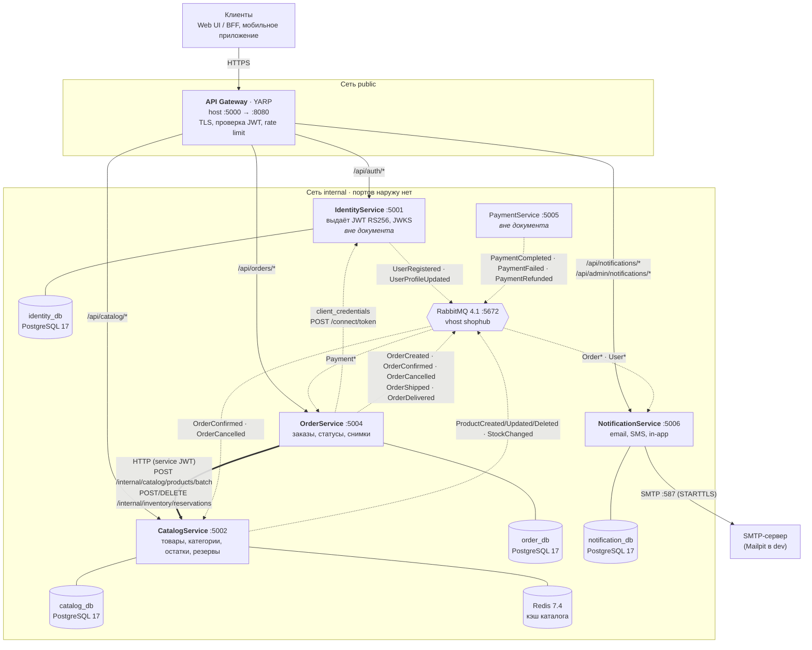
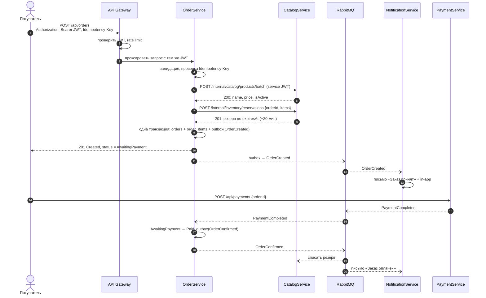
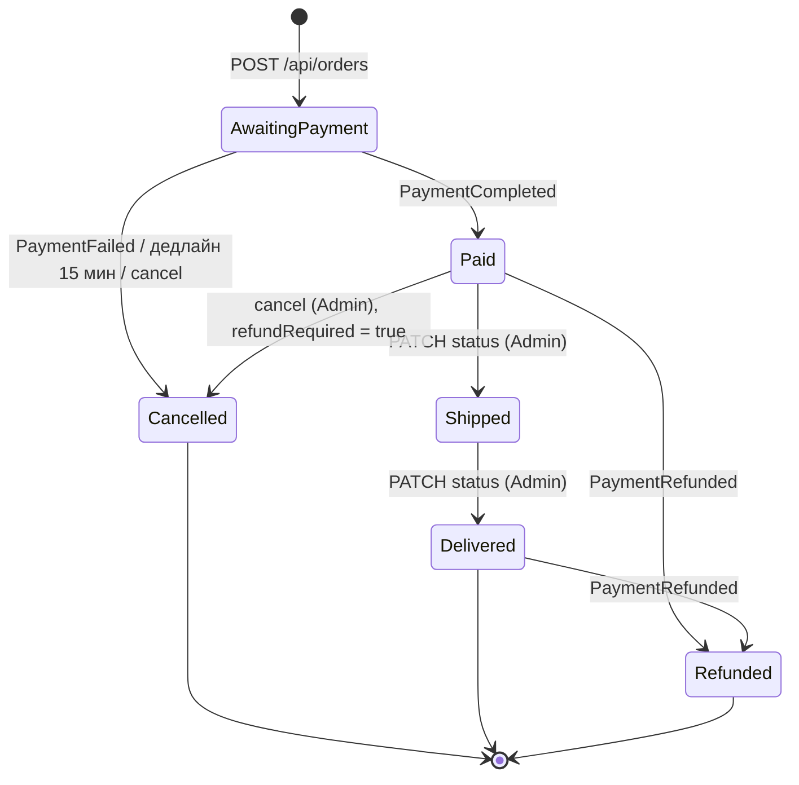
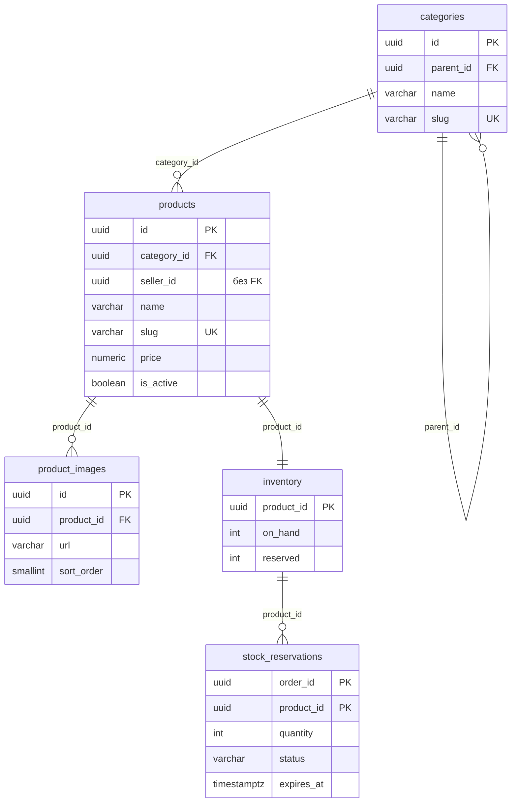
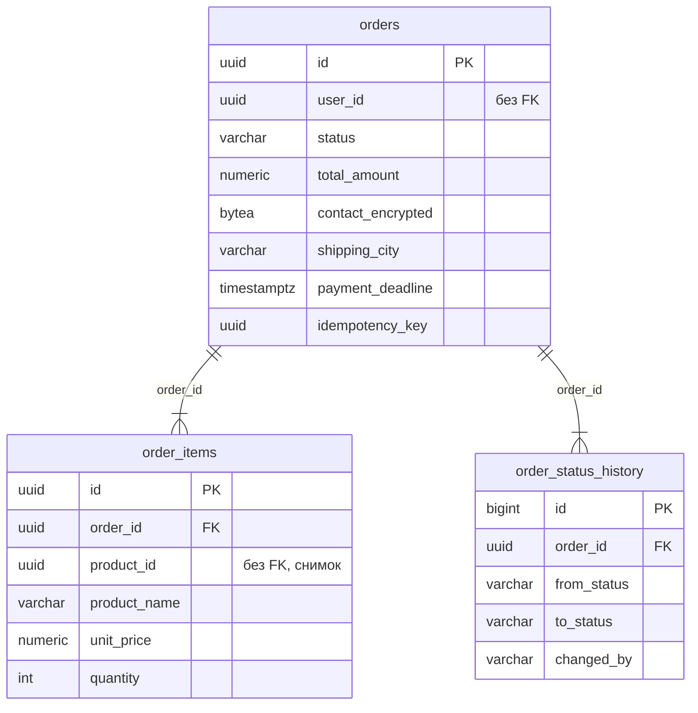
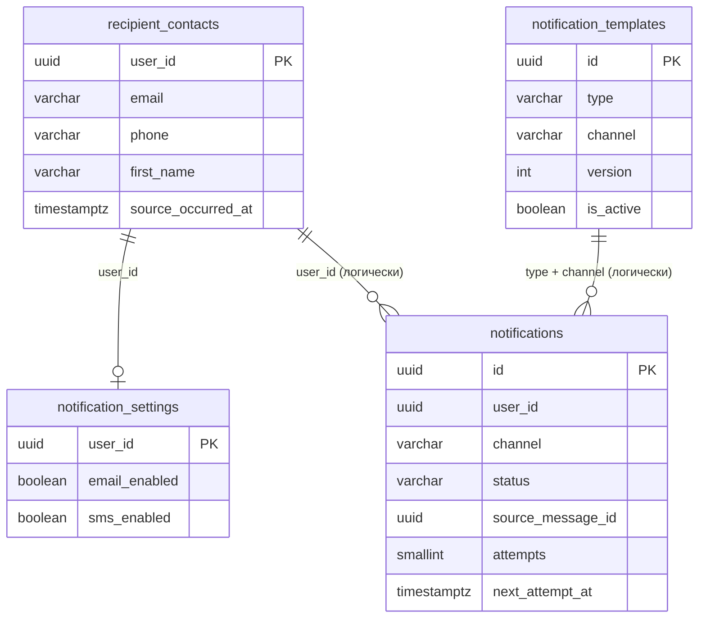
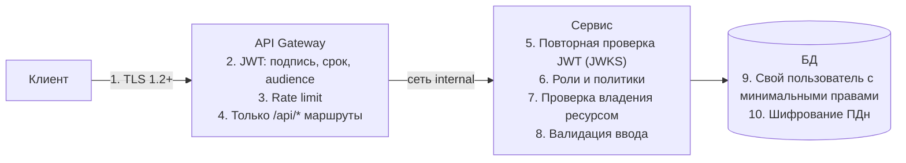
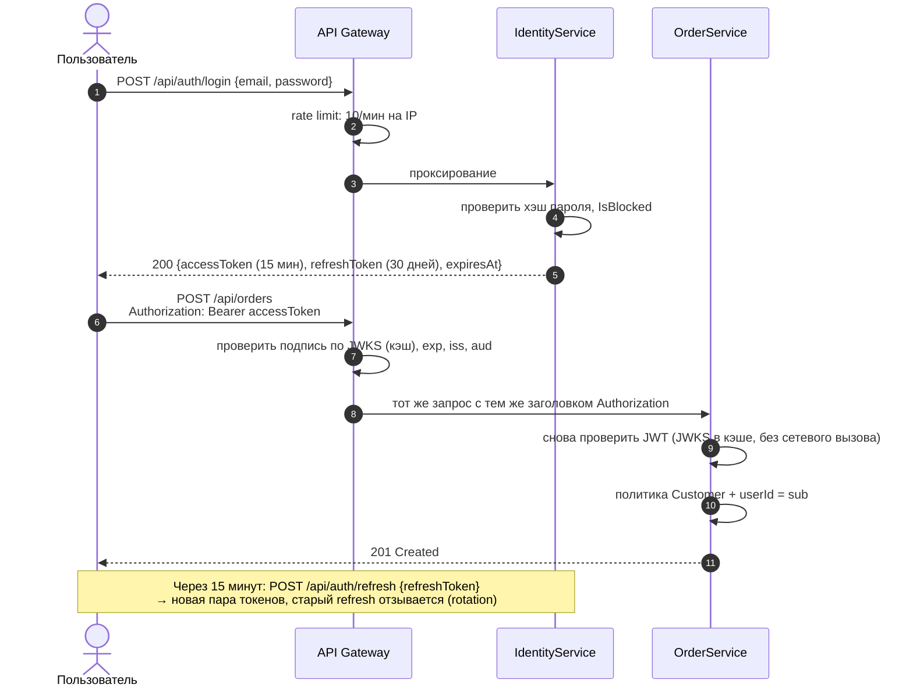
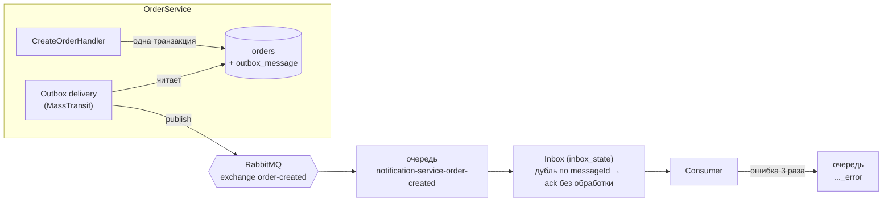
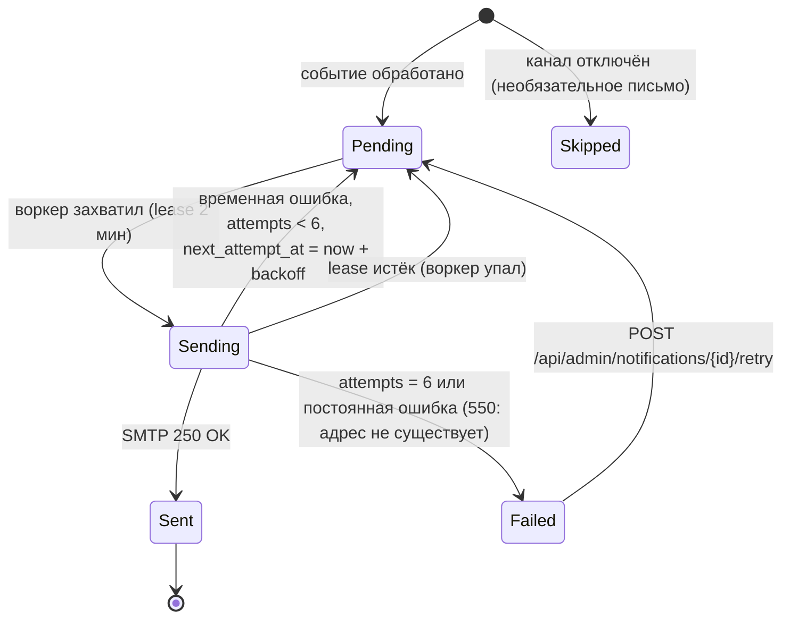

# Детальное проектирование ShopHub: CatalogService, OrderService, NotificationService

> КТ-3 · Продолжение декомпозиции [КТ-2](../KT-2/ShopHub-decomposition.md).
> Документ написан так, чтобы разработчик мог начать реализацию без дополнительных вопросов: здесь зафиксированы контракты, схемы, политики и конфигурация.
> Машиночитаемые артефакты лежат рядом: [openapi/](openapi/) (OpenAPI 3.0) и [deploy/](deploy/) (docker-compose, `.env.example`).

## Содержание

0. [О документе и общие соглашения](#0-о-документе-и-общие-соглашения)
1. [Общая схема](#1-общая-схема)
2. [API-контракты](#2-api-контракты)
3. [Схемы баз данных](#3-схемы-баз-данных)
4. [Безопасность](#4-безопасность)
5. [Масштабируемость](#5-масштабируемость)
6. [Надёжность](#6-надёжность)
7. [Инфраструктура](#7-инфраструктура)
8. [ADR: архитектурные решения](#8-adr-архитектурные-решения)
9. [План реализации и Definition of Done](#9-план-реализации-и-definition-of-done)

**Где что искать по критериям оценки:**

| Критерий | Вес | Разделы |
|----------|:---:|---------|
| Общая схема: сервисы, связи, технологии, порты | 10 | 1.1–1.5 |
| API-контракты: методы, URL, тела, коды ошибок | 20 | 0.3, 2.1–2.4, [openapi/](openapi/) |
| Схемы БД: таблицы, типы, индексы, обоснование | 15 | 3.1–3.4 |
| Безопасность: JWT, матрица доступа, защита данных | 20 | 4.1–4.8 |
| Масштабируемость: кэш, stateless, индексы | 15 | 5.1–5.8 |
| Надёжность: health checks, retry/CB, деградация | 15 | 6.1–6.8 |
| Оформление | 5 | схемы Mermaid, ADR (8), docker-compose (7) |

---

## 0. О документе и общие соглашения

### 0.1 Почему эти три сервиса

Catalog, Order и Notification образуют законченный сценарий: **покупатель смотрит товар → оформляет заказ → получает письмо**. В нём есть оба типа взаимодействия из КТ-2:

- **синхронное HTTP:** OrderService → CatalogService (актуальные цены и резерв остатков);
- **асинхронное через RabbitMQ:** OrderService → NotificationService (письма), OrderService → CatalogService (списание и снятие резерва), IdentityService → NotificationService (контакты).

IdentityService и PaymentService в этом документе не проектируются. От них используются только контракты, перечисленные в 1.3.

### 0.2 Соглашения для всех API

| Тема | Правило |
|------|---------|
| Формат | JSON в UTF-8, имена полей в `camelCase`, `Content-Type: application/json` |
| Идентификаторы | UUID v7 (`Guid.CreateVersion7()` в .NET 9+). Генерирует приложение, а не БД: id известен до вставки и монотонно растёт, поэтому B-tree индекс не фрагментируется |
| Деньги | `number` с 2 знаками после запятой, в C# — `decimal`, в БД — `NUMERIC(12,2)`. Рядом всегда поле `currency` (пока только `RUB`) |
| Время | ISO 8601 в UTC: `2026-09-24T11:45:19Z`. В БД — `TIMESTAMPTZ` |
| Перечисления | Строки в PascalCase: `AwaitingPayment`, `Email` |
| Пагинация | Параметры `page` (с 1) и `pageSize`. Ответ: `{ "items": [...], "totalCount": 0, "page": 1, "pageSize": 20 }` |
| Версия API | Текущая версия v1 используется без префикса. Несовместимые изменения публикуются параллельно под `/api/v2/...`, старая версия живёт минимум 3 месяца |
| Трассировка | Заголовок W3C `traceparent` пробрасывается через Gateway и RabbitMQ (OpenTelemetry). В каждой ошибке есть `traceId` |
| Идемпотентность | Создающие запросы с деньгами (`POST /api/orders`) требуют заголовок `Idempotency-Key: <uuid>` |
| Оптимистичная блокировка | Изменяемые ресурсы каталога отдают `ETag`, а `PUT` требует `If-Match` |

### 0.3 Единый формат ошибки

Все сервисы возвращают ошибки в формате Problem Details (RFC 9457) с двумя расширениями: `code` (машиночитаемый код) и `traceId`. В ASP.NET Core это `builder.Services.AddProblemDetails()` плюс свой `IExceptionHandler`, который сопоставляет доменные исключения с кодами из таблицы ниже.

```json
{
  "type": "https://docs.shophub.ru/errors/out-of-stock",
  "title": "Недостаточно товара на складе",
  "status": 409,
  "code": "OUT_OF_STOCK",
  "detail": "Для 1 позиции заказа недостаточно остатков",
  "traceId": "00-4bf92f3577b34da6a3ce929d0e0e4736-00f067aa0ba902b7-01",
  "items": [
    { "productId": "0192a5c4-7b1e-7c3a-9f10-3e5d2c1b0a01", "requested": 3, "available": 1 }
  ]
}
```

Ошибка валидации (400) дополнительно содержит словарь `errors` в формате `ValidationProblemDetails`:

```json
{
  "type": "https://docs.shophub.ru/errors/validation-failed",
  "title": "Запрос содержит ошибки",
  "status": 400,
  "code": "VALIDATION_FAILED",
  "traceId": "00-...-01",
  "errors": {
    "price": ["Цена должна быть больше 0"],
    "name": ["Название должно содержать от 3 до 200 символов"]
  }
}
```

**Справочник кодов ошибок** (общий для всех трёх сервисов):

| HTTP | `code` | Когда возникает |
|------|--------|-----------------|
| 400 | `VALIDATION_FAILED` | Нарушены правила валидации тела или параметров |
| 400 | `IDEMPOTENCY_KEY_REQUIRED` | Нет заголовка `Idempotency-Key` или он не UUID |
| 401 | `UNAUTHORIZED` | Нет токена, токен просрочен или подпись неверна. Тело пустое, есть заголовок `WWW-Authenticate: Bearer` |
| 403 | `FORBIDDEN` | Токен валиден, но роли или владения недостаточно |
| 404 | `PRODUCT_NOT_FOUND` · `CATEGORY_NOT_FOUND` · `ORDER_NOT_FOUND` · `NOTIFICATION_NOT_FOUND` | Ресурс не существует или скрыт от текущего пользователя |
| 409 | `OUT_OF_STOCK` | Для позиции не хватает свободного остатка |
| 409 | `PRODUCT_UNAVAILABLE` | Товар не существует или снят с продажи (`isActive = false`) |
| 409 | `INVALID_STATUS_TRANSITION` | Переход статуса заказа запрещён машиной состояний (2.2.3) |
| 409 | `SLUG_TAKEN` | `slug` товара или категории уже занят |
| 409 | `CATEGORY_NOT_EMPTY` | У удаляемой категории есть товары или подкатегории |
| 409 | `STOCK_BELOW_RESERVED` | Новый остаток меньше уже зарезервированного |
| 412 | `PRECONDITION_FAILED` | `If-Match` не совпал с текущим `ETag`: ресурс уже изменил кто-то другой |
| 422 | `IDEMPOTENCY_KEY_REUSED` | Тот же `Idempotency-Key` пришёл с другим телом запроса |
| 428 | `PRECONDITION_REQUIRED` | `PUT` без заголовка `If-Match` |
| 429 | `RATE_LIMITED` | Превышен лимит запросов (ставит Gateway, есть заголовок `Retry-After`) |
| 500 | `INTERNAL_ERROR` | Непредвиденная ошибка. Детали только в логах, наружу уходит `traceId` |
| 503 | `DEPENDENCY_UNAVAILABLE` | Недоступна зависимость (например, CatalogService для OrderService). Есть `Retry-After` |

---

## 1. Общая схема

### 1.1 Сервисы и связи



Сплошная стрелка — синхронный HTTP, пунктир — асинхронные события или фоновые вызовы. Каждый сервис скачивает публичные ключи Identity (JWKS) при старте и кэширует их. Эти стрелки не нарисованы, чтобы не загромождать схему.

### 1.2 Компоненты, технологии и порты

| Компонент | Технологии | Порт `dotnet run` | Порт в контейнере | Порт на хосте (docker) | Хранилище |
|-----------|-----------|:-----------------:|:-----------------:|:----------------------:|-----------|
| API Gateway | ASP.NET Core 10, YARP 2.x, RateLimiter | 5000 | 8080 | **5000** (единственный публичный) | — |
| IdentityService | ASP.NET Core 10 | 5001 | 8080 | — | `identity_db` |
| CatalogService | ASP.NET Core 10 Minimal API, EF Core 10 + Npgsql, HybridCache, MassTransit 8 | 5002 | 8080 | — | `catalog_db`, Redis |
| OrderService | ASP.NET Core 10 Minimal API, EF Core 10 + Npgsql, MassTransit 8, Microsoft.Extensions.Http.Resilience | 5004 | 8080 | — | `order_db` |
| NotificationService | ASP.NET Core 10 (API + BackgroundService), EF Core 10, MassTransit 8, MailKit, Fluid (шаблоны) | 5006 | 8080 | — | `notification_db` |
| PostgreSQL × 4 | `postgres:17-alpine` | — | 5432 | — | тома `*-db-data` |
| Redis | `redis:7.4-alpine` | — | 6379 | — | без persistence (только кэш) |
| RabbitMQ | `rabbitmq:4.1-management-alpine` | — | 5672, 15672 | 127.0.0.1:15672 (UI, только dev) | том `rabbitmq-data` |
| Mailpit (dev SMTP) | `axllent/mailpit` | — | 1025, 8025 | 127.0.0.1:8025 (UI, только dev) | — |
| Jaeger (трейсы) | `jaegertracing/jaeger` | — | 4317, 16686 | 127.0.0.1:16686 (UI, только dev) | — |

Порты 5001–5006 совпадают с КТ-2 и используются при запуске сервиса из IDE. В контейнерах все .NET-сервисы слушают стандартный `8080` (значение по умолчанию `ASPNETCORE_HTTP_PORTS` в образах .NET 8+).

### 1.3 Внешние контракты, на которые опирается документ

| Сервис | Что используем | Контракт |
|--------|----------------|----------|
| IdentityService | Вход пользователя | `POST /api/auth/login` → `{ accessToken, refreshToken, expiresAt }` (4.2) |
| IdentityService | Метаданные и ключи для проверки JWT | `GET /.well-known/openid-configuration`, `GET /.well-known/jwks.json` |
| IdentityService | Токен для межсервисных вызовов | `POST /connect/token` с `grant_type=client_credentials` (4.3) |
| IdentityService | События | `UserRegistered`, `UserProfileUpdated` (2.4) |
| PaymentService | События оплаты | `PaymentCompleted`, `PaymentFailed`, `PaymentRefunded` (2.4) |
| PaymentService | Оплата заказа клиентом | `POST /api/payments { orderId }`. Клиент вызывает его после `201` от OrderService |

### 1.4 Сквозной сценарий: оформление заказа



### 1.5 Карта взаимодействий

| Откуда | Куда | Тип | Что передаётся | Раздел |
|--------|------|-----|----------------|--------|
| Клиент | Gateway | HTTPS | Все публичные API, JWT в `Authorization` | 2, 4.4 |
| Gateway | Catalog / Order / Notification | HTTP | Тот же запрос и тот же JWT | 7.5 |
| Order | Catalog | HTTP, синхронно | Batch-чтение товаров, создание и снятие резерва | 2.1.3 |
| Order | Identity | HTTP | Получение service-токена (кэшируется до истечения) | 4.3 |
| Order | Catalog, Notification | RabbitMQ | `OrderConfirmed`, `OrderCancelled` (+ `OrderCreated`, `OrderShipped`, `OrderDelivered` → Notification) | 2.4 |
| Payment | Order | RabbitMQ | `PaymentCompleted`, `PaymentFailed`, `PaymentRefunded` | 2.4 |
| Identity | Notification | RabbitMQ | `UserRegistered`, `UserProfileUpdated` | 2.4 |
| Catalog | Search, Analytics, Review (вне документа) | RabbitMQ | `ProductCreated/Updated/Deleted`, `StockChanged` | 2.4 |
| Notification | SMTP | SMTP + STARTTLS | Письма | 6.5 |

---

## 2. API-контракты

Полные спецификации OpenAPI 3.0: [catalog-api.yaml](openapi/catalog-api.yaml), [order-api.yaml](openapi/order-api.yaml), [notification-api.yaml](openapi/notification-api.yaml). Их можно открыть в [editor.swagger.io](https://editor.swagger.io). Ниже приведены те же контракты в читаемом виде. Если текст и YAML расходятся, источником правды считается YAML.

### 2.1 CatalogService

Все публичные маршруты начинаются с `/api/catalog`. Маршруты `/internal/*` не публикуются через Gateway и доступны только из сети `internal` по service-токену.

#### 2.1.1 Сводная таблица эндпоинтов

| Метод | URL | Доступ | Назначение | Успех | Ошибки |
|-------|-----|--------|-----------|:-----:|--------|
| GET | `/api/catalog/products` | Публичный | Список товаров с фильтрами | 200 | 400 |
| GET | `/api/catalog/products/{id}` | Публичный. Неактивные видят только Admin и владелец | Карточка товара | 200 | 404 |
| GET | `/api/catalog/products/by-slug/{slug}` | Как у предыдущего | Карточка по ЧПУ-адресу | 200 | 404 |
| POST | `/api/catalog/products` | Seller, Admin | Создать товар | 201 | 400, 401, 403, 404 (категория), 409 |
| PUT | `/api/catalog/products/{id}` | Admin или Seller-владелец | Полностью обновить товар | 200 | 400, 401, 403, 404, 409, 412, 428 |
| DELETE | `/api/catalog/products/{id}` | Admin или Seller-владелец | Снять с продажи (мягкое удаление) | 204 | 401, 403, 404 |
| GET | `/api/catalog/products/{id}/stock` | Admin или Seller-владелец | Остатки: на складе, в резерве, доступно | 200 | 401, 403, 404 |
| PUT | `/api/catalog/products/{id}/stock` | Admin или Seller-владелец | Установить остаток на складе | 200 | 400, 401, 403, 404, 409 |
| GET | `/api/catalog/categories` | Публичный | Дерево категорий | 200 | — |
| POST | `/api/catalog/categories` | Admin | Создать категорию | 201 | 400, 401, 403, 404 (родитель), 409 |
| PUT | `/api/catalog/categories/{id}` | Admin | Изменить категорию | 200 | 400, 401, 403, 404, 409 |
| DELETE | `/api/catalog/categories/{id}` | Admin | Удалить пустую категорию | 204 | 401, 403, 404, 409 |
| POST | `/internal/catalog/products/batch` | Service (`scope=catalog.internal`) | Актуальные данные товаров для заказа | 200 | 400, 401, 403 |
| POST | `/internal/inventory/reservations` | Service (`scope=catalog.internal`) | Зарезервировать остатки под заказ | 201 / 200 | 400, 401, 403, 409 |
| DELETE | `/internal/inventory/reservations/{orderId}` | Service (`scope=catalog.internal`) | Снять активный резерв заказа | 204 | 401, 403 |
| GET | `/health/live`, `/health/ready` | Только внутренняя сеть | Health checks (6.1) | 200 | 503 |

#### 2.1.2 Публичные эндпоинты

**`GET /api/catalog/products`** — список активных товаров.

| Параметр | Тип | По умолчанию | Правила |
|----------|-----|--------------|---------|
| `categoryId` | uuid | — | Включает все подкатегории |
| `sellerId` | uuid | — | — |
| `minPrice`, `maxPrice` | decimal | — | `≥ 0`, `minPrice ≤ maxPrice` |
| `inStock` | bool | — | `true` — только товары со свободным остатком |
| `sort` | enum | `newest` | `newest` · `price_asc` · `price_desc` · `rating` |
| `page` | int | 1 | `≥ 1` |
| `pageSize` | int | 20 | `1..100`; `page × pageSize ≤ 10 000` (защита от глубокой пагинации) |

Полнотекстового параметра `q` здесь нет: поиск по тексту — ответственность SearchService (КТ-2, раздел 3.2).

Ответ `200 OK`, заголовок `Cache-Control: public, max-age=60`:

```json
{
  "items": [
    {
      "id": "0192a5c4-7b1e-7c3a-9f10-3e5d2c1b0a01",
      "name": "iPhone 15 Pro 256 ГБ",
      "slug": "iphone-15-pro-256",
      "price": 109990.00,
      "currency": "RUB",
      "category": { "id": "0192a5c4-1111-7000-8000-000000000001", "name": "Смартфоны", "slug": "smartfony" },
      "mainImageUrl": "https://cdn.shophub.ru/products/iphone15pro/1.jpg",
      "inStock": true,
      "rating": { "average": 4.8, "count": 312 }
    }
  ],
  "totalCount": 142,
  "page": 1,
  "pageSize": 20
}
```

Ошибки: `400 VALIDATION_FAILED` (например, `pageSize = 500` или `minPrice > maxPrice`).

---

**`GET /api/catalog/products/{id}`** — карточка товара. Ответ содержит заголовок `ETag: "<версия>"`.

```json
{
  "id": "0192a5c4-7b1e-7c3a-9f10-3e5d2c1b0a01",
  "name": "iPhone 15 Pro 256 ГБ",
  "slug": "iphone-15-pro-256",
  "description": "Титановый корпус, чип A17 Pro...",
  "price": 109990.00,
  "currency": "RUB",
  "category": { "id": "0192a5c4-1111-7000-8000-000000000001", "name": "Смартфоны", "slug": "smartfony" },
  "images": [
    { "url": "https://cdn.shophub.ru/products/iphone15pro/1.jpg", "sortOrder": 0 },
    { "url": "https://cdn.shophub.ru/products/iphone15pro/2.jpg", "sortOrder": 1 }
  ],
  "sellerId": "0192a5c4-2222-7000-8000-000000000042",
  "inStock": true,
  "rating": { "average": 4.8, "count": 312 },
  "isActive": true,
  "createdAt": "2026-09-01T10:30:00Z",
  "updatedAt": "2026-09-20T08:12:44Z"
}
```

Ошибки: `404 PRODUCT_NOT_FOUND` — товара нет или он снят с продажи, а запрашивает не Admin и не владелец. Для неактивного товара отдаётся 404, а не 403: покупателю не нужно знать, что товар существует.

---

**`POST /api/catalog/products`** — создание товара. Заголовок `Authorization: Bearer <jwt>`.

```json
{
  "name": "iPhone 15 Pro 256 ГБ",
  "slug": "iphone-15-pro-256",
  "description": "Титановый корпус, чип A17 Pro...",
  "price": 109990.00,
  "categoryId": "0192a5c4-1111-7000-8000-000000000001",
  "initialStock": 15,
  "images": [
    "https://cdn.shophub.ru/products/iphone15pro/1.jpg",
    "https://cdn.shophub.ru/products/iphone15pro/2.jpg"
  ],
  "sellerId": null
}
```

| Поле | Правила |
|------|---------|
| `name` | Обязательно, 3–200 символов после `Trim` |
| `slug` | Необязательно. Если не передан, генерируется из `name` (транслитерация). Формат `^[a-z0-9]+(-[a-z0-9]+)*$`, до 220 символов, уникален |
| `description` | До 20 000 символов, простой текст. HTML-теги удаляются (4.6) |
| `price` | Обязательно, `0 < price ≤ 99 999 999.99`, не более 2 знаков после запятой |
| `categoryId` | Обязательно, категория должна существовать → иначе `404 CATEGORY_NOT_FOUND` |
| `initialStock` | Обязательно, `0..1 000 000`. Создаёт строку в `inventory` |
| `images` | До 10 URL, только `https://cdn.shophub.ru/...`. Порядок в массиве задаёт `sortOrder` |
| `sellerId` | **Seller:** поле игнорируется, берётся `sub` из JWT. **Admin:** обязательно (товар создаётся от имени продавца) |

Ответ `201 Created`, заголовки `Location: /api/catalog/products/{id}` и `ETag`. Тело — как у `GET /api/catalog/products/{id}`.
Ошибки: `400 VALIDATION_FAILED`, `401`, `403 FORBIDDEN` (роль Customer), `404 CATEGORY_NOT_FOUND`, `409 SLUG_TAKEN`.
Побочный эффект: в outbox записывается событие `ProductCreated`.

---

**`PUT /api/catalog/products/{id}`** — полное обновление. Тело — как у `POST` без `initialStock` и `sellerId`: остатки меняются отдельным эндпоинтом, а владелец не меняется. Все поля обязательны.

Обязательный заголовок `If-Match: "<ETag из GET>"`. Если с момента чтения товар кто-то изменил, запрос вернёт `412`, и чужие правки не будут молча перезаписаны.

Ответ `200 OK` с новым `ETag`, тело — как у `GET`.
Ошибки: `400`, `401`, `403` (чужой товар у Seller), `404`, `409 SLUG_TAKEN`, `412 PRECONDITION_FAILED`, `428 PRECONDITION_REQUIRED`.
Побочные эффекты: событие `ProductUpdated`, удаление ключа кэша `catalog:product:{id}`.

---

**`DELETE /api/catalog/products/{id}`** — мягкое удаление: `is_active = false`, данные не стираются, потому что на товар ссылаются старые заказы, отзывы и аналитика. Повторный вызов тоже вернёт `204`.
Ответ `204 No Content`. Ошибки: `401`, `403`, `404`.
Побочные эффекты: событие `ProductDeleted`, сброс кэша. Активные резервы не трогаются: уже оформленные заказы будут выполнены.

---

**`GET /api/catalog/products/{id}/stock`** и **`PUT /api/catalog/products/{id}/stock`**

```json
// PUT — тело запроса: сколько единиц физически есть на складе
{ "onHand": 120 }

// 200 OK — ответ обоих методов
{ "productId": "0192a5c4-7b1e-7c3a-9f10-3e5d2c1b0a01", "onHand": 120, "reserved": 3, "available": 117 }
```

Правила: `onHand` в диапазоне `0..1 000 000`. Если `onHand < reserved`, возвращается `409 STOCK_BELOW_RESERVED`: нельзя «отнять» уже зарезервированные под заказы единицы. После изменения публикуется `StockChanged`.

---

**`GET /api/catalog/categories`** — всё дерево одним ответом (категорий сотни, а не тысячи). `Cache-Control: public, max-age=300`.

```json
[
  {
    "id": "0192a5c4-1111-7000-8000-000000000010",
    "name": "Электроника",
    "slug": "elektronika",
    "children": [
      { "id": "0192a5c4-1111-7000-8000-000000000001", "name": "Смартфоны", "slug": "smartfony", "children": [] }
    ]
  }
]
```

**`POST /api/catalog/categories`** · **`PUT /api/catalog/categories/{id}`** (только Admin)

```json
{ "name": "Смартфоны", "slug": "smartfony", "parentId": "0192a5c4-1111-7000-8000-000000000010", "sortOrder": 0 }
```

Правила: `name` 2–100 символов, `slug` уникален и соответствует тому же формату, что у товара, `parentId` должен существовать и не может образовать цикл (нельзя сделать категорию потомком самой себя). Ответ `201` с `Location` (POST) или `200` (PUT), тело — узел без `children`.
**`DELETE /api/catalog/categories/{id}`** → `204` или `409 CATEGORY_NOT_EMPTY`.

#### 2.1.3 Внутренние эндпоинты (для OrderService)

**`POST /internal/catalog/products/batch`** — актуальные данные товаров для фиксации цены. Кэш здесь **не используется**, данные читаются из БД: цена в заказе должна быть точной.

```json
// Запрос: 1–50 уникальных id
{ "ids": ["0192a5c4-7b1e-7c3a-9f10-3e5d2c1b0a01", "0192a5c4-7b1e-7c3a-9f10-3e5d2c1b0a02"] }

// 200 OK: найденные товары (включая неактивные) + список ненайденных id
{
  "items": [
    {
      "id": "0192a5c4-7b1e-7c3a-9f10-3e5d2c1b0a01",
      "name": "iPhone 15 Pro 256 ГБ",
      "price": 109990.00,
      "currency": "RUB",
      "isActive": true,
      "available": 117
    }
  ],
  "notFound": ["0192a5c4-7b1e-7c3a-9f10-3e5d2c1b0a02"]
}
```

---

**`POST /internal/inventory/reservations`** — атомарный резерв всех позиций заказа: либо резервируются все, либо ни одна.

```json
// Запрос
{
  "orderId": "0192a5d0-aaaa-7bbb-8ccc-000000000777",
  "items": [
    { "productId": "0192a5c4-7b1e-7c3a-9f10-3e5d2c1b0a01", "quantity": 2 }
  ],
  "ttlSeconds": 1200
}

// 201 Created (новый резерв) или 200 OK (резерв с таким orderId уже есть — идемпотентный повтор)
{
  "orderId": "0192a5d0-aaaa-7bbb-8ccc-000000000777",
  "status": "Active",
  "expiresAt": "2026-09-24T12:05:19Z",
  "items": [ { "productId": "0192a5c4-7b1e-7c3a-9f10-3e5d2c1b0a01", "quantity": 2 } ]
}
```

Правила: 1–50 позиций, `quantity` в диапазоне `1..99`, `ttlSeconds` в диапазоне `60..3600` (по умолчанию 1200). Ключ идемпотентности — `orderId`, поэтому клиент может безопасно повторять запрос при таймауте.
Ошибки: `409 OUT_OF_STOCK` со списком `items: [{productId, requested, available}]`; `409 PRODUCT_UNAVAILABLE`, если товар неактивен или не найден.

**`DELETE /internal/inventory/reservations/{orderId}`** — снять активный резерв (компенсация, если заказ не удалось сохранить). Всегда возвращает `204`, даже если резерва нет. Это позволяет безопасно повторять запрос.

#### 2.1.4 События CatalogService

| Направление | Событие | Реакция / смысл |
|-------------|---------|-----------------|
| Публикует | `ProductCreated`, `ProductUpdated`, `ProductDeleted` | Для SearchService, AnalyticsService, ReviewService (КТ-2) |
| Публикует | `StockChanged` | Изменилось свободное количество: `{ productId, available, inStock }` |
| Слушает | `OrderConfirmed` | Резерв `Active → Committed`: `on_hand -= q`, `reserved -= q` |
| Слушает | `OrderCancelled` | `Active → Released` (`reserved -= q`). Если заказ был оплачен (`Committed`) — `Committed → Returned` (`on_hand += q`) |
| Слушает | `RatingChanged` (ReviewService) | Обновить `rating_avg`, `rating_count` и сбросить кэш карточки |

### 2.2 OrderService

#### 2.2.1 Сводная таблица эндпоинтов

| Метод | URL | Доступ | Назначение | Успех | Ошибки |
|-------|-----|--------|-----------|:-----:|--------|
| POST | `/api/orders` | Customer | Оформить заказ | 201 (200 при повторе) | 400, 401, 403, 409, 422, 503 |
| GET | `/api/orders` | Customer — свои; Admin — все | Список заказов | 200 | 400, 401 |
| GET | `/api/orders/{id}` | Владелец или Admin | Полный заказ | 200 | 401, 404 |
| GET | `/api/orders/{id}/history` | Владелец или Admin | История статусов | 200 | 401, 404 |
| POST | `/api/orders/{id}/cancel` | Владелец (только `AwaitingPayment`), Admin (`AwaitingPayment`, `Paid`) | Отменить заказ | 200 | 401, 404, 409 |
| PATCH | `/api/orders/{id}/status` | Admin | Отметить отгрузку или доставку | 200 | 400, 401, 403, 404, 409 |
| GET | `/health/live`, `/health/ready` | Только внутренняя сеть | Health checks | 200 | 503 |

#### 2.2.2 Эндпоинты

**`POST /api/orders`** — оформить заказ.

Заголовки: `Authorization: Bearer <jwt>`, `Idempotency-Key: <uuid>` (обязательный; клиент генерирует его один раз на нажатие кнопки «Оформить» и повторяет при ретраях).

```json
{
  "items": [
    { "productId": "0192a5c4-7b1e-7c3a-9f10-3e5d2c1b0a01", "quantity": 2 }
  ],
  "shippingAddress": {
    "recipientName": "Иван Петров",
    "phone": "+79161234567",
    "city": "Москва",
    "street": "ул. Пушкина",
    "building": "10",
    "apartment": "15",
    "zipCode": "101000"
  },
  "comment": "Позвонить за час до доставки"
}
```

| Поле | Правила |
|------|---------|
| `items` | 1–50 позиций, `productId` не повторяются, `quantity` в диапазоне `1..99` |
| `shippingAddress.recipientName` | 2–100 символов |
| `shippingAddress.phone` | E.164, `^\+7\d{10}$` (доставка пока только по РФ) |
| `shippingAddress.city`, `street` | 2–100 и 2–200 символов |
| `shippingAddress.building` | 1–20 символов; `apartment` необязателен, до 20 символов |
| `shippingAddress.zipCode` | `^\d{6}$` |
| `comment` | До 500 символов, необязателен |

Цену и сумму клиент **не передаёт**: их берёт сервер из CatalogService. Email для писем берётся из claim `email` в JWT, `userId` — из claim `sub`.

**Алгоритм обработки** (реализуется в `CreateOrderHandler`):

1. Валидация тела → `400 VALIDATION_FAILED`. Нет или неверный `Idempotency-Key` → `400 IDEMPOTENCY_KEY_REQUIRED`.
2. Считаем `requestHash = SHA-256(канонический JSON тела)`. Ищем заказ по `(user_id, idempotency_key)`:
   - найден и хэш совпадает → `200 OK` с тем же телом и заголовком `Idempotent-Replayed: true`;
   - найден и хэш другой → `422 IDEMPOTENCY_KEY_REUSED`.
3. `orderId = Guid.CreateVersion7()`.
4. `POST /internal/catalog/products/batch`. Если есть `notFound` или `isActive = false` → `409 PRODUCT_UNAVAILABLE` со списком `productId`.
5. `POST /internal/inventory/reservations { orderId, items, ttlSeconds: 1200 }` → при нехватке `409 OUT_OF_STOCK` (тело Catalog пробрасывается клиенту).
6. Формируем снимок: `order_items(productId, productName, unitPrice, quantity)`, `totalAmount = Σ unitPrice × quantity`, `paymentDeadline = now + 15 мин`. В **одной транзакции** сохраняем `orders`, `order_items`, `order_status_history` и публикуем `OrderCreated` через outbox MassTransit.
   - Нарушение уникальности `(user_id, idempotency_key)` (параллельный дубль) → снимаем свой резерв (`DELETE /internal/inventory/reservations/{orderId}`) и возвращаем результат шага 2.
   - Любая другая ошибка БД → снимаем резерв (best-effort) → `500`. Если снять не удалось, резерв истечёт сам через 20 минут.
7. Ответ `201 Created`, `Location: /api/orders/{id}`.

Если на шагах 4–5 CatalogService недоступен или открыт circuit breaker, возвращается `503 DEPENDENCY_UNAVAILABLE` с `Retry-After: 15`. Если шаг 5 упал по таймауту (неизвестно, создан ли резерв), перед ответом выполняется best-effort `DELETE` резерва.

Ответ `201 Created`:

```json
{
  "id": "0192a5d0-aaaa-7bbb-8ccc-000000000777",
  "status": "AwaitingPayment",
  "totalAmount": 219980.00,
  "currency": "RUB",
  "paymentDeadline": "2026-09-24T12:00:19Z",
  "items": [
    {
      "productId": "0192a5c4-7b1e-7c3a-9f10-3e5d2c1b0a01",
      "productName": "iPhone 15 Pro 256 ГБ",
      "unitPrice": 109990.00,
      "quantity": 2,
      "lineTotal": 219980.00
    }
  ],
  "shippingAddress": {
    "recipientName": "Иван Петров",
    "phone": "+79161234567",
    "city": "Москва",
    "street": "ул. Пушкина",
    "building": "10",
    "apartment": "15",
    "zipCode": "101000"
  },
  "comment": "Позвонить за час до доставки",
  "createdAt": "2026-09-24T11:45:19Z",
  "updatedAt": "2026-09-24T11:45:19Z"
}
```

Ошибки: `400`, `401`, `403` (service-токен или нет роли Customer), `409 PRODUCT_UNAVAILABLE`, `409 OUT_OF_STOCK`, `422 IDEMPOTENCY_KEY_REUSED`, `503 DEPENDENCY_UNAVAILABLE`.

---

**`GET /api/orders`** — список заказов (краткое представление).

| Параметр | Тип | Правила |
|----------|-----|---------|
| `status` | enum | Необязателен, один из статусов 2.2.3 |
| `from`, `to` | date-time | Фильтр по `createdAt`, `from ≤ to` |
| `userId` | uuid | **Только Admin.** Customer, передавший этот параметр, получит `400` |
| `page`, `pageSize` | int | `page ≥ 1`, `pageSize` в диапазоне `1..50` (по умолчанию 20) |

Customer всегда видит только свои заказы (фильтр `user_id = sub` добавляется сервером). Сортировка — `createdAt` по убыванию.

```json
{
  "items": [
    {
      "id": "0192a5d0-aaaa-7bbb-8ccc-000000000777",
      "status": "Paid",
      "totalAmount": 219980.00,
      "currency": "RUB",
      "itemsCount": 2,
      "createdAt": "2026-09-24T11:45:19Z"
    }
  ],
  "totalCount": 7,
  "page": 1,
  "pageSize": 20
}
```

**`GET /api/orders/{id}`** → `200` с полным объектом (как ответ `POST`). Если заказ чужой, а запрашивает не Admin, возвращается **`404 ORDER_NOT_FOUND`**, а не 403: так нельзя проверить, существует ли чужой заказ (ADR-007).

**`GET /api/orders/{id}/history`**

```json
[
  { "fromStatus": null,              "toStatus": "AwaitingPayment", "reason": null, "changedBy": "user",   "changedAt": "2026-09-24T11:45:19Z" },
  { "fromStatus": "AwaitingPayment", "toStatus": "Paid",            "reason": null, "changedBy": "system", "changedAt": "2026-09-24T11:47:02Z" }
]
```

Покупателю поле `changedBy` отдаётся обобщённо (`user`, `admin`, `system`). Admin видит полное значение (`admin:<id>`, `event:PaymentCompleted`).

**`POST /api/orders/{id}/cancel`**

```json
{ "reason": "Передумал" }
```

Ответ `200` с заказом в статусе `Cancelled`. Ошибка `409 INVALID_STATUS_TRANSITION`, если, например, Customer отменяет уже оплаченный заказ (это может сделать только Admin, и тогда `OrderCancelled.refundRequired = true`).

**`PATCH /api/orders/{id}/status`** (Admin)

```json
{ "status": "Shipped", "comment": "СДЭК, трек 1234567890" }
```

Допустимые значения — только `Shipped` и `Delivered`: остальные статусы меняются событиями и командами выше. Ответ `200` с заказом, ошибки `400`, `403`, `404`, `409 INVALID_STATUS_TRANSITION`.

#### 2.2.3 Машина состояний заказа

Статусы согласованы с КТ-2 (раздел 5.4).



| Из \ В | Paid | Shipped | Delivered | Cancelled | Refunded |
|--------|:----:|:-------:|:---------:|:---------:|:--------:|
| AwaitingPayment | событие `PaymentCompleted` | — | — | `PaymentFailed`, таймаут, cancel (владелец/Admin) | — |
| Paid | — | Admin | — | cancel (Admin) | `PaymentRefunded` |
| Shipped | — | — | Admin | — | — |
| Delivered | — | — | — | — | `PaymentRefunded` |

Любой другой переход → `409 INVALID_STATUS_TRANSITION` для API. Для событий такой переход логируется и игнорируется, потому что сообщение могло прийти повторно или не по порядку. Например, `PaymentCompleted` для уже отменённого заказа статус не меняет, а возврат денег инициирует PaymentService, который сам слушает `OrderCancelled`.

#### 2.2.4 События OrderService

| Направление | Событие | Когда / реакция |
|-------------|---------|-----------------|
| Публикует | `OrderCreated` | Заказ сохранён → Notification (письмо «Заказ принят»), Payment (ожидаемый платёж), Cart (очистка) |
| Публикует | `OrderConfirmed` | После `PaymentCompleted` → Catalog (списание), Notification |
| Публикует | `OrderCancelled` | Любая отмена → Catalog (снять или вернуть резерв), Payment (вернуть деньги, если `refundRequired`), Notification |
| Публикует | `OrderShipped`, `OrderDelivered` | Изменение статуса админом → Notification, Review (КТ-2) |
| Слушает | `PaymentCompleted` | `AwaitingPayment → Paid`, публикация `OrderConfirmed` |
| Слушает | `PaymentFailed` | `AwaitingPayment → Cancelled` (reason `PaymentFailed`) |
| Слушает | `PaymentRefunded` | `Paid/Delivered → Refunded` |

### 2.3 NotificationService

У сервиса нет публичных портов. Основная работа — обработка событий. Небольшой REST API нужен для in-app уведомлений в личном кабинете и для поддержки. Gateway публикует только `/api/notifications/*` и `/api/admin/notifications/*`.

#### 2.3.1 REST-эндпоинты

| Метод | URL | Доступ | Назначение | Успех | Ошибки |
|-------|-----|--------|-----------|:-----:|--------|
| GET | `/api/notifications` | Customer — свои | In-app уведомления (`?unreadOnly=true&page&pageSize`) | 200 | 401 |
| GET | `/api/notifications/unread-count` | Customer | Счётчик для «колокольчика» | 200 | 401 |
| POST | `/api/notifications/{id}/read` | Владелец | Отметить прочитанным (идемпотентно) | 204 | 401, 404 |
| POST | `/api/notifications/read-all` | Customer | Отметить все прочитанными | 204 | 401 |
| GET | `/api/notifications/settings` | Customer | Настройки каналов | 200 | 401 |
| PUT | `/api/notifications/settings` | Customer | Изменить настройки каналов | 200 | 400, 401 |
| GET | `/api/admin/notifications` | Admin | Журнал отправок (`?status&userId&type&page&pageSize`) | 200 | 401, 403 |
| POST | `/api/admin/notifications/{id}/retry` | Admin | Повторить отправку `Failed` | 202 | 401, 403, 404, 409 |
| GET | `/health/live`, `/health/ready` | Только внутренняя сеть | Health checks | 200 | 503 |

```json
// GET /api/notifications → 200
{
  "items": [
    {
      "id": "0192a5d1-0000-7000-8000-00000000abcd",
      "type": "OrderConfirmed",
      "title": "Заказ оплачен",
      "text": "Заказ №…0777 на сумму 219 980 ₽ оплачен и передан в сборку.",
      "link": "/orders/0192a5d0-aaaa-7bbb-8ccc-000000000777",
      "isRead": false,
      "createdAt": "2026-09-24T11:47:03Z"
    }
  ],
  "totalCount": 12, "page": 1, "pageSize": 20
}

// GET /api/notifications/unread-count → 200
{ "count": 3 }

// PUT /api/notifications/settings — тело и ответ 200
{ "emailEnabled": true, "smsEnabled": false }
```

Транзакционные письма о заказе отправляются всегда, даже при `emailEnabled = false`: это обязательное информирование покупателя. Настройка отключает только необязательные письма (приветствие, «оцените покупку»). Правило задаётся полем `mandatory` у шаблона.

`POST /api/admin/notifications/{id}/retry` переводит запись `Failed → Pending` и обнуляет счётчик попыток. Для записи в другом статусе возвращается `409 INVALID_STATUS_TRANSITION`.

#### 2.3.2 Обрабатываемые события

| Событие | Издатель | Очередь | Действие | Каналы |
|---------|----------|---------|----------|--------|
| `UserRegistered` | Identity | `notification-service-user-registered` | Upsert в `recipient_contacts`, создать настройки по умолчанию, приветственное письмо | Email |
| `UserProfileUpdated` | Identity | `notification-service-user-profile-updated` | Upsert в `recipient_contacts`, если событие новее сохранённого (`occurredAt`) | — |
| `OrderCreated` | Order | `notification-service-order-created` | «Заказ принят, оплатите до {deadline}» | Email, InApp |
| `OrderConfirmed` | Order | `notification-service-order-confirmed` | «Заказ оплачен» | Email, InApp |
| `OrderCancelled` | Order | `notification-service-order-cancelled` | «Заказ отменён: {причина}», при `refundRequired` — «деньги вернутся в течение…» | Email, InApp |
| `OrderShipped` | Order | `notification-service-order-shipped` | «Заказ передан в доставку» | Email, InApp, SMS |
| `OrderDelivered` | Order | `notification-service-order-delivered` | «Оцените покупку» (ссылка на отзыв) | Email (необязательное) |

`PaymentFailed` NotificationService не слушает, в отличие от таблицы КТ-2: неудачная оплата всегда приводит к `OrderCancelled` с `reason = PaymentFailed`, и покупатель получает одно письмо, а не два.

**Обработка события** (одинаковая для всех типов, класс `NotificationRequestConsumer<T>`):

1. Inbox MassTransit отбрасывает дубль по `MessageId`.
2. Загружаем `recipient_contacts` и `notification_settings` по `userId`. Для писем о заказе адрес берётся из `contactEmail` в событии (это снимок из заказа), поэтому данные из Identity для них не нужны.
3. Берём активный шаблон `(type, channel, 'ru-RU')` и рендерим его через Fluid с HTML-экранированием переменных.
4. В **одной транзакции** вставляем строки `notifications`: для InApp со статусом `Sent`, для Email/SMS со статусом `Pending` (или `Skipped`, если канал отключён и письмо необязательное). Уникальный ключ `(source_message_id, channel)` не даёт создать дубль.
5. Подтверждаем сообщение (ack). Отправку по SMTP выполняет отдельный фоновый `NotificationDispatcher` (6.5), поэтому медленный SMTP не задерживает очередь.

### 2.4 Контракты событий

Общие правила:
- Контракты лежат в общем проекте `ShopHub.Contracts` (namespace по издателю: `ShopHub.Contracts.Orders`, `...Catalog`, `...Identity`, `...Payments`). Это единственный общий код между сервисами.
- Транспорт — MassTransit 8 поверх RabbitMQ. Каждый тип события публикуется в свой fanout-exchange с именем из атрибута `[EntityName]`, например `order-created`. У каждого подписчика своя durable-очередь `<сервис>-<событие>`.
- Конверт MassTransit добавляет `messageId` (ключ дедупликации), `correlationId` (= `orderId` для событий заказа), `sentTime`, `messageType`. Поле `occurredAt` в теле — момент бизнес-события.
- Эволюция: в существующие события можно только добавлять необязательные поля. Несовместимое изменение — новый тип (`OrderCreatedV2`), старый публикуется параллельно, пока его не перестанут слушать.

```csharp
namespace ShopHub.Contracts.Orders;

[EntityName("order-created")]
public sealed record OrderCreated(
    Guid OrderId, Guid UserId, string ContactEmail, string RecipientName,
    decimal TotalAmount, string Currency, DateTimeOffset PaymentDeadline,
    IReadOnlyList<OrderLine> Items, DateTimeOffset OccurredAt);

public sealed record OrderLine(Guid ProductId, string ProductName, int Quantity, decimal UnitPrice);
```

| Событие | Exchange | Тело (JSON) | Подписчики в документе |
|---------|----------|-------------|------------------------|
| `OrderCreated` | `order-created` | `{ orderId, userId, contactEmail, recipientName, totalAmount, currency, paymentDeadline, items: [{ productId, productName, quantity, unitPrice }], occurredAt }` | Notification |
| `OrderConfirmed` | `order-confirmed` | `{ orderId, userId, contactEmail, totalAmount, currency, paidAt, items: [{ productId, quantity }], occurredAt }` | Catalog, Notification |
| `OrderCancelled` | `order-cancelled` | `{ orderId, userId, contactEmail, previousStatus, reason: "PaymentFailed" \| "PaymentTimeout" \| "CancelledByCustomer" \| "CancelledByAdmin", refundRequired, items: [{ productId, quantity }], occurredAt }` | Catalog, Notification |
| `OrderShipped` | `order-shipped` | `{ orderId, userId, contactEmail, comment, occurredAt }` | Notification |
| `OrderDelivered` | `order-delivered` | `{ orderId, userId, contactEmail, productIds: [], occurredAt }` | Notification |
| `ProductCreated` / `ProductUpdated` | `product-created` / `product-updated` | `{ productId, name, slug, price, currency, categoryId, sellerId, isActive, version, occurredAt }` | вне документа |
| `ProductDeleted` | `product-deleted` | `{ productId, occurredAt }` | вне документа |
| `StockChanged` | `stock-changed` | `{ productId, available, inStock, occurredAt }` | вне документа |
| `UserRegistered` | `user-registered` | `{ userId, email, firstName, phone, occurredAt }` | Notification |
| `UserProfileUpdated` | `user-profile-updated` | `{ userId, email, firstName, phone, occurredAt }` | Notification |
| `PaymentCompleted` | `payment-completed` | `{ paymentId, orderId, amount, currency, paidAt }` | Order |
| `PaymentFailed` | `payment-failed` | `{ paymentId, orderId, reason, occurredAt }` | Order |
| `PaymentRefunded` | `payment-refunded` | `{ paymentId, orderId, amount, refundedAt }` | Order |
| `RatingChanged` | `rating-changed` | `{ productId, average, count, occurredAt }` | Catalog |

Пример сообщения `OrderCreated` в очереди (тело внутри конверта MassTransit):

```json
{
  "messageId": "0192a5d0-bbbb-7000-8000-000000000001",
  "correlationId": "0192a5d0-aaaa-7bbb-8ccc-000000000777",
  "messageType": ["urn:message:ShopHub.Contracts.Orders:OrderCreated"],
  "sentTime": "2026-09-24T11:45:19.412Z",
  "message": {
    "orderId": "0192a5d0-aaaa-7bbb-8ccc-000000000777",
    "userId": "0192a5c4-2222-7000-8000-000000000042",
    "contactEmail": "ivan@example.com",
    "recipientName": "Иван Петров",
    "totalAmount": 219980.00,
    "currency": "RUB",
    "paymentDeadline": "2026-09-24T12:00:19Z",
    "items": [ { "productId": "0192a5c4-7b1e-7c3a-9f10-3e5d2c1b0a01", "productName": "iPhone 15 Pro 256 ГБ", "quantity": 2, "unitPrice": 109990.00 } ],
    "occurredAt": "2026-09-24T11:45:19Z"
  }
}
```

---

## 3. Схемы баз данных

Общие решения для всех трёх БД:

| Решение | Почему |
|---------|--------|
| PostgreSQL 17, отдельный инстанс и отдельный пользователь на сервис | Database per Service из КТ-2: ни один сервис не может прочитать чужую БД даже по ошибке |
| Имена в `snake_case` | Стандарт PostgreSQL. EF Core: пакет `EFCore.NamingConventions`, `UseSnakeCaseNamingConvention()` |
| Ключи `UUID` (v7 из приложения) | Нет конфликтов при миграции из монолита и слиянии данных; v7 сортируется по времени, поэтому вставки идут в конец индекса |
| Статусы — `VARCHAR` + `CHECK`, а не `ENUM` | Добавить значение в `CHECK` проще, чем менять тип `ENUM` в миграции |
| Ссылки на чужие сущности (`seller_id`, `user_id`, `product_id` в заказе) — **без FK** | Данные в другой БД. Целостность обеспечивается снимками и событиями (КТ-2, 4.2) |
| Оптимистичная блокировка через системный столбец `xmin` | Не нужен отдельный столбец версии. В EF Core: `builder.Property<uint>("Version").IsRowVersion()` (Npgsql сопоставляет его с `xmin`) |
| Схема создаётся миграциями EF Core; при старте в dev они применяются автоматически, в prod — отдельной job | Воспроизводимость, а при нескольких репликах миграции не запускаются параллельно |
| Таблицы MassTransit `inbox_state`, `outbox_message`, `outbox_state` | Создаются миграцией из `modelBuilder.AddTransactionalOutboxEntities()`. Нужны для outbox/inbox (6.3) |

**Ожидаемые объёмы**, на которые рассчитаны индексы:

| Таблица | Сейчас | Через 3 года | Профиль |
|---------|--------|--------------|---------|
| `products` | 50 тыс. | 500 тыс. | ≈ 99 % чтений |
| `inventory`, `stock_reservations` | 50 тыс. / 3 тыс. в день | 500 тыс. / 20 тыс. в день | Частые точечные `UPDATE` |
| `orders` | 3 тыс. в день | ≈ 20 млн всего | Вставка + чтение своих заказов |
| `order_items` | ≈ 2.5 позиции на заказ | ≈ 50 млн | Только вместе с заказом |
| `notifications` | 15 тыс. в день | ≈ 30 млн (с учётом очистки) | Вставка + очередь отправки |

### 3.1 CatalogService — `catalog_db`



```sql
CREATE TABLE categories (
    id          UUID         PRIMARY KEY,
    parent_id   UUID         REFERENCES categories(id) ON DELETE RESTRICT,
    name        VARCHAR(100) NOT NULL,
    slug        VARCHAR(100) NOT NULL,
    sort_order  INT          NOT NULL DEFAULT 0,
    created_at  TIMESTAMPTZ  NOT NULL DEFAULT now(),
    updated_at  TIMESTAMPTZ  NOT NULL DEFAULT now(),
    CONSTRAINT uq_categories_slug UNIQUE (slug),
    CONSTRAINT ck_categories_parent CHECK (parent_id IS NULL OR parent_id <> id)
);

CREATE TABLE products (
    id            UUID          PRIMARY KEY,
    legacy_id     INT           UNIQUE,          -- Products.Id монолита; нужен только на время миграции (КТ-2, этап 5)
    category_id   UUID          NOT NULL REFERENCES categories(id) ON DELETE RESTRICT,
    seller_id     UUID          NOT NULL,        -- пользователь из IdentityService, логическая ссылка без FK
    name          VARCHAR(200)  NOT NULL,
    slug          VARCHAR(220)  NOT NULL,
    description   TEXT          NOT NULL DEFAULT '' CHECK (char_length(description) <= 20000),
    price         NUMERIC(12,2) NOT NULL CHECK (price > 0),
    currency      CHAR(3)       NOT NULL DEFAULT 'RUB',
    is_active     BOOLEAN       NOT NULL DEFAULT TRUE,
    rating_avg    NUMERIC(3,2)  CHECK (rating_avg BETWEEN 1 AND 5),  -- кэш из ReviewService (RatingChanged)
    rating_count  INT           NOT NULL DEFAULT 0,
    created_by    UUID          NOT NULL,        -- аудит: кто создал (sub из JWT)
    updated_by    UUID          NOT NULL,
    created_at    TIMESTAMPTZ   NOT NULL DEFAULT now(),
    updated_at    TIMESTAMPTZ   NOT NULL DEFAULT now(),
    CONSTRAINT uq_products_slug UNIQUE (slug)
);

CREATE TABLE product_images (
    id          UUID         PRIMARY KEY,
    product_id  UUID         NOT NULL REFERENCES products(id) ON DELETE CASCADE,
    url         VARCHAR(500) NOT NULL CHECK (url LIKE 'https://cdn.shophub.ru/%'),
    sort_order  SMALLINT     NOT NULL,
    CONSTRAINT uq_product_images_order UNIQUE (product_id, sort_order)
);

-- Остатки отделены от описания товара: разные правила и разная частота изменений (КТ-2, 3.2)
CREATE TABLE inventory (
    product_id  UUID        PRIMARY KEY REFERENCES products(id) ON DELETE RESTRICT,
    on_hand     INT         NOT NULL CHECK (on_hand >= 0),          -- физически на складе
    reserved    INT         NOT NULL DEFAULT 0 CHECK (reserved >= 0),-- под неоплаченные заказы
    updated_at  TIMESTAMPTZ NOT NULL DEFAULT now(),
    CONSTRAINT ck_inventory_reserved CHECK (reserved <= on_hand)    -- БД сама не даст продать больше, чем есть
);

CREATE TABLE stock_reservations (
    order_id    UUID        NOT NULL,             -- заказ из OrderService, без FK; он же ключ идемпотентности
    product_id  UUID        NOT NULL REFERENCES inventory(product_id),
    quantity    INT         NOT NULL CHECK (quantity BETWEEN 1 AND 99),
    status      VARCHAR(10) NOT NULL DEFAULT 'Active'
                CHECK (status IN ('Active', 'Committed', 'Released', 'Returned')),
    expires_at  TIMESTAMPTZ NOT NULL,
    created_at  TIMESTAMPTZ NOT NULL DEFAULT now(),
    updated_at  TIMESTAMPTZ NOT NULL DEFAULT now(),
    PRIMARY KEY (order_id, product_id)
);

-- Индексы
CREATE INDEX ix_categories_parent        ON categories (parent_id);
CREATE INDEX ix_products_cat_price       ON products (category_id, price)                         WHERE is_active;
CREATE INDEX ix_products_cat_newest      ON products (category_id, created_at DESC)               WHERE is_active;
CREATE INDEX ix_products_cat_rating      ON products (category_id, rating_avg DESC NULLS LAST)    WHERE is_active;
CREATE INDEX ix_products_active_newest   ON products (created_at DESC)                            WHERE is_active;
CREATE INDEX ix_products_seller          ON products (seller_id, created_at DESC);
CREATE INDEX ix_reservations_expiring    ON stock_reservations (expires_at)                       WHERE status = 'Active';
```

**Обоснование индексов:**

| Индекс | Какой запрос обслуживает | Почему именно так |
|--------|--------------------------|-------------------|
| `uq_products_slug`, `uq_categories_slug` | `GET .../by-slug/{slug}`, проверка уникальности | Уникальность проверяет БД, а не код, поэтому нет гонки при параллельном создании |
| `ix_products_cat_price` | Главный запрос витрины: категория + диапазон цен + сортировка по цене | Составной `(category_id, price)`: равенство по первому столбцу, диапазон и сортировка по второму. **Частичный** (`WHERE is_active`): неактивные товары в витрину не попадают, индекс меньше |
| `ix_products_cat_newest`, `ix_products_cat_rating` | Та же витрина с `sort=newest` / `sort=rating` | Без них PostgreSQL сортировал бы в памяти все товары категории |
| `ix_products_active_newest` | Витрина без фильтра по категории (главная страница) | — |
| `ix_products_seller` | Кабинет продавца: «мои товары, новые сверху» | Включает неактивные товары, поэтому не частичный |
| `ix_reservations_expiring` | Фоновая задача снятия просроченных резервов (6.6) | Частичный: в индексе только активные резервы (единицы тысяч строк), а не вся история |
| PK `stock_reservations (order_id, product_id)` | Идемпотентность резерва и поиск резерва по заказу | Повторный резерв того же заказа упирается в PK |

**Почему такая структура:**
- **Нет полнотекстового GIN-индекса** (в отличие от шаблона задания): текстовый поиск вынесен в SearchService + Elasticsearch (КТ-2, проблема №4). Лишний GIN-индекс замедлял бы каждую запись товара.
- **Подкатегории** выбираются без рекурсивного SQL: дерево категорий маленькое и лежит в кэше (5.4), сервис вычисляет список id потомков в памяти и передаёт его как `category_id = ANY(@ids)`. Индексы `ix_products_cat_*` при этом используются.
- **`inStock`** в списке вычисляется через `EXISTS (SELECT 1 FROM inventory i WHERE i.product_id = p.id AND i.on_hand - i.reserved > 0)` по PK `inventory`.
- **Изображения** хранятся в отдельной таблице, а не строкой `Images`, как в монолите: у каждого изображения есть порядок, и его можно добавить без перезаписи всего товара.

### 3.2 OrderService — `order_db`



```sql
CREATE TABLE orders (
    id                  UUID          PRIMARY KEY,
    user_id             UUID          NOT NULL,          -- sub из JWT, логическая ссылка
    status              VARCHAR(20)   NOT NULL
                        CHECK (status IN ('AwaitingPayment','Paid','Shipped','Delivered','Cancelled','Refunded')),
    total_amount        NUMERIC(12,2) NOT NULL CHECK (total_amount > 0),
    currency            CHAR(3)       NOT NULL DEFAULT 'RUB',
    items_count         INT           NOT NULL CHECK (items_count > 0),
    -- Снимок контактов и адреса. Персональные данные зашифрованы AES-256-GCM (4.6):
    -- JSON { contactEmail, recipientName, phone, street, building, apartment, zipCode }
    contact_encrypted   BYTEA         NOT NULL,
    encryption_key_id   VARCHAR(32)   NOT NULL,          -- id ключа, нужен для ротации
    shipping_city       VARCHAR(100)  NOT NULL,          -- открыто: нужно логистике и отчётам, само по себе не ПДн
    comment             VARCHAR(500),
    payment_deadline    TIMESTAMPTZ   NOT NULL,
    cancel_reason       VARCHAR(30)
                        CHECK (cancel_reason IN ('PaymentFailed','PaymentTimeout','CancelledByCustomer','CancelledByAdmin')),
    idempotency_key     UUID          NOT NULL,
    request_hash        CHAR(64)      NOT NULL,          -- SHA-256 тела запроса (hex)
    created_at          TIMESTAMPTZ   NOT NULL DEFAULT now(),
    updated_at          TIMESTAMPTZ   NOT NULL DEFAULT now(),
    paid_at             TIMESTAMPTZ,
    CONSTRAINT uq_orders_idempotency UNIQUE (user_id, idempotency_key),
    CONSTRAINT ck_orders_cancel_reason CHECK ((status = 'Cancelled') = (cancel_reason IS NOT NULL))
);

-- Позиции — неизменяемый снимок товара на момент покупки (КТ-2, 4.3, случай 1)
CREATE TABLE order_items (
    id            UUID          PRIMARY KEY,
    order_id      UUID          NOT NULL REFERENCES orders(id) ON DELETE CASCADE,
    product_id    UUID          NOT NULL,              -- логическая ссылка на CatalogService
    product_name  VARCHAR(200)  NOT NULL,              -- снимок названия
    unit_price    NUMERIC(12,2) NOT NULL CHECK (unit_price > 0),   -- снимок цены
    quantity      INT           NOT NULL CHECK (quantity BETWEEN 1 AND 99),
    line_total    NUMERIC(12,2) GENERATED ALWAYS AS (unit_price * quantity) STORED,
    CONSTRAINT uq_order_items_product UNIQUE (order_id, product_id)
);

CREATE TABLE order_status_history (
    id           BIGINT       GENERATED ALWAYS AS IDENTITY PRIMARY KEY,
    order_id     UUID         NOT NULL REFERENCES orders(id) ON DELETE CASCADE,
    from_status  VARCHAR(20),                       -- NULL для первой записи
    to_status    VARCHAR(20)  NOT NULL,
    reason       VARCHAR(500),
    changed_by   VARCHAR(64)  NOT NULL,             -- 'user:<id>' | 'admin:<id>' | 'event:PaymentCompleted' | 'job:payment-timeout'
    changed_at   TIMESTAMPTZ  NOT NULL DEFAULT now()
);

-- Индексы
CREATE INDEX ix_orders_user_created      ON orders (user_id, created_at DESC);
CREATE INDEX ix_orders_status_created    ON orders (status, created_at DESC);
CREATE INDEX ix_orders_payment_deadline  ON orders (payment_deadline) WHERE status = 'AwaitingPayment';
CREATE INDEX ix_order_history_order      ON order_status_history (order_id, changed_at);
```

**Обоснование индексов:**

| Индекс | Запрос | Почему |
|--------|--------|--------|
| `ix_orders_user_created` | «Мои заказы» (`WHERE user_id = @sub ORDER BY created_at DESC LIMIT 20`) — самый частый запрос | Составной индекс отдаёт строки уже отсортированными, без сортировки в памяти. Одиночного индекса по `user_id` недостаточно |
| `ix_orders_status_created` | Админка: «все оплаченные, новые сверху» | Статусов мало, поэтому одиночный индекс по `status` малоселективен. Вторая колонка даёт сортировку |
| `ix_orders_payment_deadline` | Фоновая задача отмены неоплаченных заказов (каждую минуту) | Частичный: в индексе только заказы в `AwaitingPayment` (сотни строк), а не миллионы |
| `uq_orders_idempotency` | Проверка `Idempotency-Key` | Уникальность на уровне БД ловит и параллельные дубли, а не только последовательные |
| `uq_order_items_product` | Чтение позиций заказа + запрет дублей товара | Покрывает поиск по `order_id` (левый столбец), отдельный индекс по `order_id` не нужен |
| `ix_order_history_order` | `GET /api/orders/{id}/history` | — |

**Почему такая структура:**
- **Снимок, а не ссылка.** `product_name` и `unit_price` копируются: заказ — юридический документ, изменение цены в каталоге не должно его менять.
- **Адрес и контакты — одним зашифрованным JSON**, а не отдельными столбцами. Искать по ним не нужно, а для шифрования так проще: один вызов, один nonce. Открытым оставлен только город для логистики и отчётов.
- **`line_total` вычисляется в БД** (`GENERATED`), поэтому сумма строки не может разойтись с ценой и количеством.
- **Idempotency-ключ хранится прямо в `orders`**, без отдельной таблицы: нужен ровно один ключ на один созданный заказ, и уникальность проверяется в той же транзакции.

### 3.3 NotificationService — `notification_db`



```sql
-- Локальная read-модель контактов из IdentityService (КТ-2, 4.3, случай 3)
CREATE TABLE recipient_contacts (
    user_id             UUID         PRIMARY KEY,
    email               VARCHAR(254) NOT NULL,
    phone               VARCHAR(16),
    first_name          VARCHAR(100),
    source_occurred_at  TIMESTAMPTZ  NOT NULL,   -- occurredAt последнего применённого события: защита от старых событий
    updated_at          TIMESTAMPTZ  NOT NULL DEFAULT now()
);

CREATE TABLE notification_settings (
    user_id        UUID        PRIMARY KEY,
    email_enabled  BOOLEAN     NOT NULL DEFAULT TRUE,
    sms_enabled    BOOLEAN     NOT NULL DEFAULT FALSE,
    updated_at     TIMESTAMPTZ NOT NULL DEFAULT now()
);

CREATE TABLE notification_templates (
    id          UUID         PRIMARY KEY,
    type        VARCHAR(50)  NOT NULL,   -- OrderCreated, OrderConfirmed, ..., Welcome
    channel     VARCHAR(10)  NOT NULL CHECK (channel IN ('Email', 'Sms', 'InApp')),
    locale      VARCHAR(5)   NOT NULL DEFAULT 'ru-RU',
    subject     VARCHAR(200),            -- для Email и InApp (заголовок)
    body        TEXT         NOT NULL,   -- шаблон Liquid (Fluid), переменные: {{ order_id }}, {{ total_amount }}...
    mandatory   BOOLEAN      NOT NULL DEFAULT FALSE,  -- транзакционное: отправлять даже при отключённом канале
    version     INT          NOT NULL,
    is_active   BOOLEAN      NOT NULL DEFAULT FALSE,
    updated_at  TIMESTAMPTZ  NOT NULL DEFAULT now(),
    CONSTRAINT uq_templates_version UNIQUE (type, channel, locale, version)
);
-- Ровно одна активная версия шаблона на (type, channel, locale)
CREATE UNIQUE INDEX uq_templates_active ON notification_templates (type, channel, locale) WHERE is_active;

-- Журнал и одновременно очередь отправки
CREATE TABLE notifications (
    id                 UUID          PRIMARY KEY,
    user_id            UUID          NOT NULL,
    type               VARCHAR(50)   NOT NULL,
    channel            VARCHAR(10)   NOT NULL CHECK (channel IN ('Email', 'Sms', 'InApp')),
    source_message_id  UUID          NOT NULL,   -- messageId события → идемпотентность
    correlation_id     UUID,                     -- orderId, для поиска в поддержке
    recipient          VARCHAR(254),             -- email или телефон на момент отправки; NULL для InApp
    subject            VARCHAR(200),
    body               TEXT,                     -- очищается через 90 дней (4.6)
    link               VARCHAR(300),             -- для InApp
    status             VARCHAR(10)   NOT NULL
                       CHECK (status IN ('Pending', 'Sending', 'Sent', 'Failed', 'Skipped')),
    attempts           SMALLINT      NOT NULL DEFAULT 0,
    next_attempt_at    TIMESTAMPTZ,              -- когда можно брать в работу (Pending)
    lease_until        TIMESTAMPTZ,              -- до какого момента запись «захвачена» воркером (Sending)
    last_error         VARCHAR(1000),
    created_at         TIMESTAMPTZ   NOT NULL DEFAULT now(),
    sent_at            TIMESTAMPTZ,
    read_at            TIMESTAMPTZ,              -- для InApp
    CONSTRAINT uq_notifications_source UNIQUE (source_message_id, channel)
);

-- Индексы
CREATE INDEX ix_notifications_dispatch  ON notifications (next_attempt_at)          WHERE status IN ('Pending', 'Sending');
CREATE INDEX ix_notifications_inapp     ON notifications (user_id, created_at DESC) WHERE channel = 'InApp';
CREATE INDEX ix_notifications_unread    ON notifications (user_id)                  WHERE channel = 'InApp' AND read_at IS NULL;
CREATE INDEX ix_notifications_admin     ON notifications (status, created_at DESC);
```

**Обоснование индексов:**

| Индекс | Запрос | Почему |
|--------|--------|--------|
| `ix_notifications_dispatch` | Воркер отправки каждые 5 с: `WHERE status IN (...) AND next_attempt_at <= now() ORDER BY next_attempt_at LIMIT 50 FOR UPDATE SKIP LOCKED` | Частичный: в «живой» очереди десятки строк, а в таблице миллионы. Без него воркер делал бы seq scan каждые 5 секунд |
| `ix_notifications_inapp` | Лента уведомлений в кабинете | Частичный по каналу: email-записи в ленту не попадают |
| `ix_notifications_unread` | Счётчик `unread-count` (вызывается на каждой странице) | Содержит только непрочитанные, поэтому `COUNT(*)` быстрый и не растёт с историей |
| `ix_notifications_admin` | Поддержка: «все Failed за сегодня» | — |
| `uq_notifications_source` | Защита от дублей при повторной доставке события | Второй слой поверх inbox MassTransit |
| `uq_templates_active` | Выбор шаблона при рендеринге | Частичный уникальный индекс гарантирует одну активную версию |

**Почему такая структура:**
- **Таблица `notifications` одновременно журнал и очередь отправки.** Статус, счётчик попыток и время следующей попытки хранятся вместе с письмом. Повторы SMTP не зависят от брокера (ADR-005), а поддержка видит всю историю в одном месте.
- **Шаблоны версионируются.** Новая версия создаётся с `is_active = false`, проверяется и включается переключением флага. Откатиться можно, включив предыдущую.
- **`recipient_contacts` — копия, а не источник правды.** Порядок событий не гарантирован, поэтому обновление применяется только если `occurredAt` события новее `source_occurred_at`.

### 3.4 Сводка: что где хранится

| Данные | Владелец | Копии у других | Как синхронизируются |
|--------|----------|----------------|----------------------|
| Товар (имя, цена) | Catalog `products` | Order `order_items` (снимок) | Копируется при оформлении, дальше не меняется |
| Остатки | Catalog `inventory` | — | Меняются только через Catalog API и события заказа |
| Email, имя, телефон | Identity | Notification `recipient_contacts`; Order `contact_encrypted` (снимок) | События `User*`; снимок при оформлении |
| Статус заказа | Order `orders` | — | Notification узнаёт о нём из событий, но не хранит |

---

## 4. Безопасность

### 4.1 Уровни защиты



| Уровень | Где | От чего защищает |
|---------|-----|------------------|
| Сеть | Docker-сети / Kubernetes NetworkPolicy | Сервисы, БД и брокер недоступны снаружи, открыт только Gateway |
| Транспорт | TLS на Gateway; в prod mTLS внутри кластера (service mesh) | Перехват трафика и токенов |
| Аутентификация | JWT RS256, проверка на Gateway **и** в каждом сервисе | Поддельные и просроченные токены, обход Gateway (ADR-001) |
| Авторизация | Политики ASP.NET Core + проверка владельца в обработчике | Доступ к чужим заказам и товарам |
| Данные | Шифрование ПДн, маскирование логов, хэширование паролей в Identity | Утечка из бэкапа, логов, дампа БД |
| Ввод | FluentValidation, лимиты размеров, allowlist URL, санитизация HTML | Инъекции, XSS, SSRF, DoS большими запросами |

### 4.2 JWT: как пользователь получает и использует токен



**Параметры токенов** (выдаёт IdentityService, остальные сервисы только проверяют):

| Параметр | Access token | Refresh token |
|----------|--------------|---------------|
| Формат | JWT, подпись **RS256** (асимметричная: сервисы знают только публичный ключ) | Непрозрачная случайная строка 256 бит; в БД Identity хранится её SHA-256 |
| Срок жизни | 15 минут | 30 дней, одноразовый (rotation при каждом обновлении) |
| Где хранит клиент | В памяти SPA / secure storage мобильного приложения | Cookie `HttpOnly; Secure; SameSite=Strict; Path=/api/auth` |
| Отзыв | Не отзывается, живёт до `exp`. Поэтому срок короткий | Отзывается при выходе, блокировке и смене пароля |
| Ротация ключа подписи | Каждые 90 дней. В JWKS одновременно публикуются старый и новый ключ (`kid`) | — |

**Содержимое access-токена пользователя:**

```json
{
  "iss": "https://id.shophub.ru",
  "aud": "shophub-api",
  "sub": "0192a5c4-2222-7000-8000-000000000042",
  "email": "ivan@example.com",
  "name": "Иван П.",
  "role": ["Customer", "Seller"],
  "jti": "0192a5d0-cccc-7000-8000-000000000001",
  "iat": 1790250319,
  "nbf": 1790250319,
  "exp": 1790251219
}
```

**Роли.** Каждая учётная запись человека получает `Customer` при регистрации. `Seller` и `Admin` добавляются поверх неё. Роль `Service` бывает только у машинных токенов (4.3) и никогда не выдаётся людям.

**Проверка JWT в каждом сервисе** (одинаковый код в `ShopHub.ServiceDefaults`):

```csharp
builder.Services
    .AddAuthentication(JwtBearerDefaults.AuthenticationScheme)
    .AddJwtBearer(options =>
    {
        // Ключи скачиваются из JWKS Identity и кэшируются (обновление раз в 12 часов или при неизвестном kid)
        options.MetadataAddress = builder.Configuration["Jwt:MetadataAddress"]; // http://identity-service:8080/.well-known/openid-configuration
        options.RequireHttpsMetadata = builder.Configuration.GetValue("Jwt:RequireHttpsMetadata", true);
        options.MapInboundClaims = false;                  // оставить "sub" и "role" как есть
        options.TokenValidationParameters = new TokenValidationParameters
        {
            ValidIssuer = builder.Configuration["Jwt:Issuer"],       // https://id.shophub.ru
            ValidAudiences = builder.Configuration.GetSection("Jwt:Audiences").Get<string[]>(),
            ValidAlgorithms = [SecurityAlgorithms.RsaSha256],        // запрет alg=none и HS256
            NameClaimType = "sub",
            RoleClaimType = "role",
            ClockSkew = TimeSpan.FromSeconds(30)
        };
    });

builder.Services.AddAuthorizationBuilder()
    .AddPolicy("Customer",        p => p.RequireRole("Customer"))
    .AddPolicy("SellerOrAdmin",   p => p.RequireRole("Seller", "Admin"))
    .AddPolicy("Admin",           p => p.RequireRole("Admin"))
    .AddPolicy("CatalogInternal", p => p.RequireRole("Service").RequireClaim("scope", "catalog.internal"));
```

### 4.3 Идентификация между сервисами

| Вызов | Как передаётся идентичность | Почему так |
|-------|------------------------------|------------|
| Клиент → Gateway → сервис | Исходный JWT пользователя в `Authorization` | Сервис знает, **кто** делает запрос, и сам проверяет подпись |
| Order → Catalog (`/internal/*`) | **Service JWT** (OAuth 2.0 client credentials): `sub = order-service`, `role = Service`, `scope = catalog.internal`, `aud = catalog-internal`, срок 10 минут | Внутренние операции (резерв) выполняются не от имени пользователя. Catalog проверяет, что вызывает именно доверенный сервис с нужным scope |
| Событие в RabbitMQ | `userId` в теле события. Публиковать в exchange может только пользователь RabbitMQ сервиса-издателя | Доверие обеспечивается правами брокера (4.6): Order не может опубликовать `UserRegistered` |

Заголовки вида `X-User-Id` от Gateway **не используются**: любой, кто попал во внутреннюю сеть, мог бы их подделать. Подпись JWT подделать нельзя (ADR-001).

**Получение service-токена в OrderService** — `DelegatingHandler`, который кэширует токен до истечения срока минус 60 секунд:

```csharp
// POST http://identity-service:8080/connect/token
// grant_type=client_credentials&client_id=order-service&client_secret=***&scope=catalog.internal
public sealed class ServiceTokenHandler(IServiceTokenProvider tokens) : DelegatingHandler
{
    protected override async Task<HttpResponseMessage> SendAsync(HttpRequestMessage request, CancellationToken ct)
    {
        var token = await tokens.GetTokenAsync("catalog.internal", ct); // из кэша или новый запрос к Identity
        request.Headers.Authorization = new AuthenticationHeaderValue("Bearer", token);
        return await base.SendAsync(request, ct);
    }
}
```

### 4.4 Что делает API Gateway

| Функция | Реализация |
|---------|------------|
| Терминирование TLS | Kestrel с сертификатом (в dev — HTTP на 5000) + HSTS |
| Проверка JWT | Тот же `AddJwtBearer`, что и в сервисах. Маршруты с `AuthorizationPolicy: "authenticated"` без валидного токена получают `401` ещё на Gateway |
| Маршрутизация | Только префиксы `/api/*` из 7.5. Пути `/internal/*`, `/health/*` сервисов, `/metrics` снаружи недоступны: для них просто нет маршрутов |
| Rate limiting | `Microsoft.AspNetCore.RateLimiting`, политики из 4.7 |
| Заголовки | Удаляет входящие `X-Forwarded-*` от клиента и ставит свои; добавляет `X-Content-Type-Options: nosniff`, `Referrer-Policy: no-referrer` |
| CORS | Разрешён только origin веб-приложения (`https://shophub.ru`) |
| Лимит тела | 1 МБ на запрос (Kestrel `MaxRequestBodySize`); сервисы задают свои лимиты ниже |

### 4.5 Матрица доступа

Обозначения: ✅ — разрешено, ❌ — запрещено (401 для анонима, 403 или 404 для остальных), **свои** — только ресурсы, где пользователь владелец (`seller_id` или `user_id` = `sub`).

| Эндпоинт | Аноним | Customer | Seller | Admin | Service |
|----------|:------:|:--------:|:------:|:-----:|:-------:|
| **CatalogService** | | | | | |
| `GET /api/catalog/products`, `/categories` | ✅ | ✅ | ✅ | ✅ | ❌ |
| `GET /api/catalog/products/{id}` (активный) | ✅ | ✅ | ✅ | ✅ | ❌ |
| `GET /api/catalog/products/{id}` (неактивный) | ❌ 404 | ❌ 404 | свои | ✅ | ❌ |
| `POST /api/catalog/products` | ❌ | ❌ | ✅ (sellerId = sub) | ✅ (от имени продавца) | ❌ |
| `PUT`, `DELETE /api/catalog/products/{id}` | ❌ | ❌ | свои | ✅ | ❌ |
| `GET`, `PUT /api/catalog/products/{id}/stock` | ❌ | ❌ | свои | ✅ | ❌ |
| `POST`, `PUT`, `DELETE /api/catalog/categories` | ❌ | ❌ | ❌ | ✅ | ❌ |
| `POST /internal/catalog/products/batch` | ❌ | ❌ | ❌ | ❌ | ✅ `catalog.internal` |
| `POST`, `DELETE /internal/inventory/reservations` | ❌ | ❌ | ❌ | ❌ | ✅ `catalog.internal` |
| **OrderService** | | | | | |
| `POST /api/orders` | ❌ | ✅ | ✅ | ✅ | ❌ |
| `GET /api/orders` | ❌ | свои | свои | ✅ все (+ `userId`) | ❌ |
| `GET /api/orders/{id}`, `/history` | ❌ | свои | свои | ✅ | ❌ |
| `POST /api/orders/{id}/cancel` | ❌ | свои, `AwaitingPayment` | свои, `AwaitingPayment` | ✅ `AwaitingPayment`, `Paid` | ❌ |
| `PATCH /api/orders/{id}/status` | ❌ | ❌ | ❌ | ✅ | ❌ |
| **NotificationService** | | | | | |
| `GET /api/notifications`, `/unread-count`, `/settings` | ❌ | свои | свои | свои | ❌ |
| `POST /api/notifications/{id}/read`, `/read-all`, `PUT /settings` | ❌ | свои | свои | свои | ❌ |
| `GET /api/admin/notifications`, `POST .../{id}/retry` | ❌ | ❌ | ❌ | ✅ | ❌ |
| **Все сервисы** | | | | | |
| `GET /health/live`, `/health/ready` | только из сети internal (оркестратор, docker healthcheck), через Gateway не публикуются | | | | |

**Проверка владения** выполняется в обработчике после загрузки ресурса. Одной политики на эндпоинте для этого недостаточно:

```csharp
// CatalogService: PUT /api/catalog/products/{id}
var product = await db.Products.FindAsync([id], ct);
if (product is null)
    return Errors.ProductNotFound();                 // 404
if (!CanManage(user, product))
    return product.IsActive
        ? Errors.Forbidden()                         // 403: товар публичный, его существование не секрет
        : Errors.ProductNotFound();                  // 404: чужой неактивный товар скрываем

static bool CanManage(ClaimsPrincipal user, Product p) =>
    user.IsInRole("Admin") || (user.IsInRole("Seller") && p.SellerId == user.GetUserId());

// OrderService: чужой заказ неотличим от несуществующего (ADR-007)
var order = await db.Orders.FirstOrDefaultAsync(o => o.Id == id && (isAdmin || o.UserId == userId), ct);
if (order is null) return OrderNotFound();
```

### 4.6 Защита данных

| Данные | Где | Защита |
|--------|-----|--------|
| Пароли | Identity | Только хэш: **Argon2id** (или BCrypt с work factor 12, как в методичке). Никогда не логируются и не возвращаются |
| Email, ФИО, телефон, адрес в заказе | Order `contact_encrypted` | **AES-256-GCM** на уровне приложения (`System.Security.Cryptography.AesGcm`): формат `nonce(12) ‖ ciphertext ‖ tag(16)`, ключ из секрета `ORDER_PII_ENCRYPTION_KEY` (в prod — Vault/KMS), `encryption_key_id` для ротации. Дамп или бэкап БД без ключа бесполезен |
| Контакты получателей | Notification `recipient_contacts`, `notifications.recipient` | Шифрование диска и бэкапов на уровне инфраструктуры. Столбцы в открытом виде, потому что по ним нужна отправка. Доступ только у пользователя БД сервиса |
| Тексты писем | Notification `notifications.body` | Очищаются через 90 дней (`body = NULL`), сами записи удаляются через 1 год |
| Платёжные данные | — | В этих сервисах их нет вообще. Карта вводится на стороне провайдера (КТ-2) |
| Токены | Везде | Заголовок `Authorization` не логируется. Refresh token хранится в Identity только как SHA-256 |
| Секреты | Конфигурация | Не в git: `.env` в `.gitignore`, в репозитории только `.env.example`. В prod — Kubernetes Secrets / Vault. Каждый сервис знает только свои секреты |

**Маскирование в логах** (Serilog, destructuring policy в `ShopHub.ServiceDefaults`):

| Поле | В логе |
|------|--------|
| email | `iva***@example.com` |
| телефон | `+7916*****67` |
| адрес, ФИО | не логируются (DTO помечены атрибутом `[LogMasked]`) |
| `Authorization`, `Cookie`, `client_secret` | удаляются из логов HTTP-запросов |

**Минимальные права в инфраструктуре:**
- **PostgreSQL:** у каждого сервиса своя роль (`catalog_app`, `order_app`, `notification_app`) с правами `SELECT/INSERT/UPDATE/DELETE` только на свою схему. Миграции выполняются отдельной ролью `*_migrator` с правами DDL.
- **RabbitMQ:** отдельный пользователь на сервис в vhost `shophub`. Права `write` только на свои exchanges (например, `order_service` → `^order-.*`), `read` только на свои очереди (`^order-service-.*`). В dev для простоты используется один пользователь.
- **Redis:** пароль (`requirepass`), в prod — ACL-пользователь с доступом только к префиксу ключей `catalog:*`.

**Валидация ввода и защита от инъекций:**
- SQL — только EF Core / параметризованные запросы. Сырой SQL (атомарный резерв, 5.7) пишется с параметрами, конкатенация строк запрещена code review.
- Лимиты тела: 64 КБ для `POST /api/orders`, 256 КБ для товаров (`[RequestSizeLimit]`).
- `description` товара — простой текст. Теги вырезаются `HtmlSanitizer` с пустым allowlist, а на витрине текст выводится с экранированием.
- URL изображений — только `https://cdn.shophub.ru/`. Это защищает от SSRF и подмены картинок на чужие домены. Файлы загружаются в объектное хранилище отдельно (вне документа).
- Шаблоны писем — Fluid с `HtmlEncoder.Default`: имя получателя `<script>` станет текстом, а не кодом.

### 4.7 Rate limiting (на Gateway)

| Политика | Маршруты | Ключ | Лимит | Алгоритм |
|----------|----------|------|-------|----------|
| `login` | `POST /api/auth/login` | IP | 10 в минуту | Fixed window |
| `orders-create` | `POST /api/orders` | `sub` из JWT | 5 в минуту | Token bucket |
| `public-read` | `GET /api/catalog/*` | IP | 300 в минуту | Sliding window (6 сегментов) |
| `authenticated` | Остальные `/api/*` | `sub` | 120 в минуту | Sliding window |

```csharp
builder.Services.AddRateLimiter(o =>
{
    o.RejectionStatusCode = StatusCodes.Status429TooManyRequests;
    o.AddPolicy("login", ctx => RateLimitPartition.GetFixedWindowLimiter(
        ctx.Connection.RemoteIpAddress?.ToString() ?? "unknown",
        _ => new FixedWindowRateLimiterOptions { PermitLimit = 10, Window = TimeSpan.FromMinutes(1) }));
    o.AddPolicy("orders-create", ctx => RateLimitPartition.GetTokenBucketLimiter(
        ctx.User.FindFirst("sub")?.Value ?? "anonymous",
        _ => new TokenBucketRateLimiterOptions
        {
            TokenLimit = 5, TokensPerPeriod = 5, ReplenishmentPeriod = TimeSpan.FromMinutes(1), QueueLimit = 0
        }));
    // public-read и authenticated аналогично
});
```

IP клиента берётся из `X-Forwarded-For` только от доверенного балансировщика (`ForwardedHeadersOptions.KnownProxies`). Лимиты считаются в памяти каждой реплики Gateway, поэтому при N репликах фактический лимит примерно в N раз выше. Для входа это приемлемо. Если понадобится точный глобальный лимит, счётчики переносятся в Redis.

### 4.8 Сетевая изоляция

```yaml
# фрагмент deploy/docker-compose.yml
api-gateway:
  ports: ["5000:8080"]          # единственный порт, опубликованный на хост
  networks: [public, internal]

order-service:
  networks: [internal]          # нет блока ports: снаружи не достучаться
  expose: ["8080"]              # доступен только соседям по сети internal
```

В Kubernetes то же самое реализуется через NetworkPolicy: входящий трафик в `catalog-service` разрешён только от `api-gateway` и `order-service`, в `*-db` — только от своего сервиса.

---

## 5. Масштабируемость

### 5.1 Целевая нагрузка

| Показатель | Обычный день | Пик (чёрная пятница) | Цель по задержке |
|------------|--------------|----------------------|------------------|
| Чтение каталога (`GET /api/catalog/*`) | 300 RPS | 3 000 RPS | p95 < 100 мс |
| Оформление заказов (`POST /api/orders`) | 2 RPS | 50 RPS | p95 < 800 мс |
| События в RabbitMQ | 20 msg/s | 500 msg/s | Задержка письма < 1 мин |
| Письма | 15 тыс. в день | 150 тыс. в день | — |

### 5.2 Stateless-дизайн

Ни один экземпляр сервиса не хранит состояние, которое нужно другому экземпляру. Поэтому любую реплику можно убить или добавить в любой момент.

| Состояние | Где хранится | Почему не в памяти процесса |
|-----------|--------------|-----------------------------|
| Идентичность пользователя | JWT у клиента | Нет серверных сессий: запрос может попасть на любую реплику |
| Товары, заказы, уведомления | PostgreSQL | Источник правды |
| Кэш каталога | Redis (L2) + память (L1, 30 с) | L1 — только ускоритель, его потеря не ломает логику (5.4) |
| Идемпотентность заказов | `orders.idempotency_key` в БД | Повтор может прийти на другую реплику |
| Service-токен | Память процесса | Каждая реплика получает свой токен, это корректно |
| Лимиты rate limit | Память Gateway | Допустимая неточность (4.7) |
| Ключи ASP.NET Data Protection | Не используются: нет cookie-аутентификации в сервисах | — |

Запрещено: статические коллекции с данными (`static List<Order>`), `AddSession()` с памятью, `AddDistributedMemoryCache()` в prod, локальные файлы как хранилище.

### 5.3 Горизонтальное масштабирование

| Сервис | Реплики (обычно → пик) | Триггер (HPA в Kubernetes) | Узкое место и что делаем |
|--------|:----------------------:|---------------------------|--------------------------|
| API Gateway | 2 → 4 | CPU > 60 % | — |
| CatalogService | 2 → 8 | CPU > 60 % или p95 > 150 мс | Чтение: кэш (5.4) + read-реплика PostgreSQL для списков. Запись остатков — только primary |
| OrderService | 2 → 4 | CPU > 60 % | Вызовы Catalog; пул соединений БД |
| NotificationService | 1 → 3 | Длина очередей > 1 000 сообщений (KEDA) | SMTP-провайдер: ограничение 20 писем/с на реплику |

**Фоновые задачи при нескольких репликах.** Задачи выполняются во всех репликах одновременно, и дубли исключены на уровне БД:
- выборка через `FOR UPDATE SKIP LOCKED`: каждая реплика берёт свою пачку строк, заблокированные другими пропускаются;
- outbox MassTransit сам использует блокировки и безопасен для нескольких экземпляров.

Отдельный leader election не нужен.

**Соединения с БД.** Npgsql по умолчанию держит пул `Maximum Pool Size=100` на реплику. При 8 репликах Catalog это до 800 соединений, а у PostgreSQL по умолчанию `max_connections = 100`. Поэтому явно задаём `Maximum Pool Size=20` в строке подключения, а в prod перед PostgreSQL ставим **PgBouncer** (transaction pooling).

### 5.4 Кэширование

| Что | Где | TTL | Ключ | Инвалидация | Почему |
|-----|-----|-----|------|-------------|--------|
| Дерево категорий | HybridCache: L1 память + L2 Redis | L1 5 мин, L2 1 ч | `catalog:categories:tree` | Удаление ключа при любом изменении категории | Меняется раз в недели, нужен на каждый запрос списка (подкатегории) |
| Карточка товара (публичная) | HybridCache | L1 30 с, L2 5 мин | `catalog:product:{id}` | `RemoveAsync` при PUT, DELETE, изменении остатка и рейтинга | 80 % просмотров приходится на 5 % товаров |
| Страница списка товаров | HybridCache | L1 30 с, L2 60 с | `catalog:list:{sha1(нормализованные параметры)}` | Не инвалидируется, живёт 60 с | Комбинаций фильтров слишком много для точечной инвалидации; отставание на минуту для витрины допустимо |
| Публичные ключи JWT (JWKS) | Память каждого сервиса и Gateway | 12 ч (или до неизвестного `kid`) | — | Автоматически в `JwtBearer` | Проверка токена без сетевого вызова |
| Service-токен Order → Catalog | Память OrderService | Срок токена − 60 с | — | По истечении | Не ходить в Identity на каждый вызов |
| HTTP-кэш у клиента и CDN | `Cache-Control` | 60 с (товары), 300 с (категории) | — | — | Часть трафика не доходит даже до Gateway |

**Что не кэшируется и почему:**
- `/internal/catalog/products/batch` и резервы: цена и остаток в заказе должны быть точными.
- Заказы и уведомления: персональные данные, читаются редко и только владельцем. Кэш дал бы риск показать чужие данные при ошибке в ключе.

**Реализация (CatalogService):** `HybridCache` из .NET 9+ даёт двухуровневый кэш и **защиту от stampede**: при промахе только один запрос идёт в БД, остальные ждут его результат.

```csharp
builder.Services.AddStackExchangeRedisCache(o =>
    o.Configuration = builder.Configuration["Redis:ConnectionString"]); // становится L2 для HybridCache
builder.Services.AddHybridCache(o => o.DefaultEntryOptions = new HybridCacheEntryOptions
{
    Expiration = TimeSpan.FromMinutes(5),            // L2 (Redis)
    LocalCacheExpiration = TimeSpan.FromSeconds(30)  // L1 (память процесса)
});

// GET /api/catalog/products/{id}
app.MapGet("/api/catalog/products/{id:guid}", async (Guid id, HybridCache cache, ProductQueries q, ClaimsPrincipal user, CancellationToken ct) =>
{
    var card = await cache.GetOrCreateAsync(
        $"catalog:product:{id}",
        async token => await q.GetPublicCardAsync(id, token),   // null тоже кэшируется: защита от перебора несуществующих id
        cancellationToken: ct);

    if (card is null || (!card.IsActive && !CanSeeInactive(user, card)))
        return Results.Problem(statusCode: 404, extensions: new Dictionary<string, object?> { ["code"] = "PRODUCT_NOT_FOUND" });

    return Results.Ok(card);
});

// После успешного PUT/DELETE/изменения остатка
await cache.RemoveAsync($"catalog:product:{id}", ct);
```

L1 на других репликах может отдавать старую карточку до 30 секунд после изменения. Это допустимо: окончательная цена берётся из БД при оформлении заказа.

**Redis недоступен** → HybridCache продолжает работать только с L1, а промахи идут в БД. Читать будет медленнее, но без ошибок (6.4).

### 5.5 Индексы для производительности

Полный список с обоснованием — в разделе 3. Ключевые решения:

| Приём | Где | Эффект |
|-------|-----|--------|
| Составной индекс «фильтр + сортировка» | `products (category_id, price)`, `orders (user_id, created_at DESC)` | Запрос читает ровно `pageSize` строк из индекса, без сортировки в памяти |
| Частичный индекс | `WHERE is_active`, `WHERE status = 'AwaitingPayment'`, `WHERE status IN ('Pending','Sending')` | Индекс в десятки раз меньше таблицы и помещается в память |
| Уникальный индекс как бизнес-правило | `slug`, `(user_id, idempotency_key)`, `(source_message_id, channel)` | Правило соблюдается даже при гонке параллельных запросов |
| Ограничение глубокой пагинации | `page × pageSize ≤ 10 000` | `OFFSET 100000` на больших таблицах не допускается |

Проверка: каждый запрос из раздела 2 перед релизом прогоняется через `EXPLAIN (ANALYZE, BUFFERS)` на наборе данных объёма «через 3 года» (3, таблица объёмов). Seq scan по таблицам `products`, `orders`, `notifications` считается дефектом.

### 5.6 Масштабирование чтения БД

- **CatalogService:** `GET /api/catalog/products` при промахе кэша читает из **read-реплики** (вторая строка подключения `ConnectionStrings__CatalogDbReadOnly`, отдельный `DbContext` с `QueryTrackingBehavior.NoTracking`). Записи, резервы и `/internal/*` работают только с primary.
- **OrderService:** чтений мало, реплика не нужна. При росте `order_items` больше 100 млн строк таблицы партиционируются по `created_at` по месяцам.
- **NotificationService:** рост ограничивается очисткой (4.6). Если этого перестанет хватать, `notifications` партиционируется по месяцам, а старые партиции удаляются через `DROP PARTITION`.

### 5.7 Конкурентный доступ к остаткам

Резерв в чёрную пятницу — самое «горячее» место: сотни покупателей берут один и тот же товар. Используется **атомарный условный `UPDATE`** без предварительного `SELECT`, поэтому гонки «проверил → списал» нет:

```sql
-- Для каждой позиции, в порядке возрастания product_id (единый порядок блокировок исключает deadlock)
UPDATE inventory
SET    reserved = reserved + @quantity,
       updated_at = now()
WHERE  product_id = @productId
  AND  on_hand - reserved >= @quantity;
-- 0 изменённых строк → не хватает остатка: ROLLBACK всей транзакции, ответ 409 OUT_OF_STOCK

INSERT INTO stock_reservations (order_id, product_id, quantity, status, expires_at)
VALUES (@orderId, @productId, @quantity, 'Active', now() + make_interval(secs => @ttlSeconds));
-- нарушение PK (order_id, product_id) → параллельный повтор того же резерва: ROLLBACK и ответ 200 с существующим резервом
```

Блокировка строки держится миллисекунды (одна транзакция на запрос). Ограничение `CHECK (reserved <= on_hand)` — последняя линия защиты от overselling, если в коде появится ошибка.

### 5.8 Масштабирование обработки событий

- **Competing consumers:** все реплики сервиса читают одну очередь, RabbitMQ распределяет сообщения между ними. Чтобы увеличить пропускную способность, достаточно добавить реплики.
- `PrefetchCount = 16`, `ConcurrentMessageLimit = 8` на реплику: сообщения не копятся на одной медленной реплике.
- Порядок сообщений не гарантируется, и обработчики на него не полагаются: машина состояний заказа отбрасывает недопустимые переходы (2.2.3), а контакты обновляются по `occurredAt` (3.3).
- Очереди durable, в prod — **quorum queues** (репликация на 3 узла RabbitMQ).

---

## 6. Надёжность

### 6.1 Health checks

Каждый сервис отдаёт два эндпоинта с разным смыслом:

| Эндпоинт | Вопрос | Что проверяет | Кто использует |
|----------|--------|---------------|----------------|
| `/health/live` | «Процесс жив?» | Только сам процесс, без зависимостей | Liveness probe: при отказе контейнер перезапускается |
| `/health/ready` (и алиас `/health`) | «Можно слать трафик?» | Свои зависимости: БД, кэш, брокер | Readiness probe: при `Unhealthy` реплика убирается из балансировки; `depends_on` в docker-compose |

Liveness **не проверяет** БД. Иначе при сбое PostgreSQL оркестратор начал бы перезапускать все реплики по кругу, хотя проблема не в них.

| Сервис | Проверка | Статус при отказе | Почему такой статус |
|--------|----------|-------------------|---------------------|
| CatalogService | PostgreSQL (`SELECT 1`) | **Unhealthy** | Без БД сервис бесполезен |
| | Redis (`PING`) | Degraded | Работаем без кэша, медленнее (5.4) |
| | RabbitMQ (шина MassTransit) | Degraded | События копятся в outbox и уйдут позже |
| OrderService | PostgreSQL | **Unhealthy** | — |
| | RabbitMQ | Degraded | Заказы принимаются, события ждут в outbox |
| | CatalogService | **не проверяется** | Проверка соседей в readiness приводит к каскаду: упал Catalog → Order «не готов» → Gateway отдаёт 503 даже на `GET /api/orders`. Недоступность Catalog обрабатывает circuit breaker (6.2) |
| NotificationService | PostgreSQL | **Unhealthy** | — |
| | RabbitMQ | **Unhealthy** | Получать события — основная работа сервиса |
| | SMTP (TCP-подключение, результат кэшируется 60 с) | Degraded | Письма остаются в `Pending` и уйдут после восстановления |

Статус `Degraded` отвечает HTTP 200: реплика остаётся в балансировке. `Unhealthy` отвечает 503.

```csharp
// ShopHub.ServiceDefaults — общий код; зависимости добавляет каждый сервис
builder.Services.AddHealthChecks()
    .AddCheck("self", () => HealthCheckResult.Healthy(), tags: ["live"])
    .AddNpgSql(builder.Configuration.GetConnectionString("CatalogDb")!, name: "postgres", tags: ["ready"])
    .AddRedis(builder.Configuration["Redis:ConnectionString"]!, name: "redis",
              failureStatus: HealthStatus.Degraded, tags: ["ready"]);
// Проверку шины MassTransit регистрирует сам (тег "ready"). Статус при отказе задаётся так:
// x.ConfigureHealthCheckOptions(o => o.MinimalFailureStatus = HealthStatus.Degraded);

app.MapHealthChecks("/health/live",  new HealthCheckOptions { Predicate = r => r.Tags.Contains("live") });
app.MapHealthChecks("/health/ready", new HealthCheckOptions
{
    Predicate = r => r.Tags.Contains("ready"),
    ResponseWriter = UIResponseWriter.WriteHealthCheckUIResponse   // JSON с деталями по каждой проверке
});
app.MapHealthChecks("/health", new HealthCheckOptions { Predicate = r => r.Tags.Contains("ready") });
```

Пакеты: `AspNetCore.HealthChecks.NpgSql`, `AspNetCore.HealthChecks.Redis`, `AspNetCore.HealthChecks.UI.Client`.

Ответ `/health/ready`:

```json
{
  "status": "Degraded",
  "totalDuration": "00:00:00.0153",
  "entries": {
    "postgres":   { "status": "Healthy",  "duration": "00:00:00.0121" },
    "redis":      { "status": "Degraded", "duration": "00:00:00.0020", "description": "It was not possible to connect to the redis server." },
    "masstransit-bus": { "status": "Healthy", "duration": "00:00:00.0001" }
  }
}
```

### 6.2 Таймауты, retry и circuit breaker (Order → Catalog)

Пакет `Microsoft.Extensions.Http.Resilience` (основан на Polly v8). Параметры рассчитаны так, чтобы оформление заказа укладывалось в бюджет пользователя (≈ 2 × 3 с на два вызова Catalog + сохранение):

| Стратегия | Параметры | Зачем |
|-----------|-----------|-------|
| Общий таймаут вызова | 3 с | Верхняя граница, включая все повторы |
| Retry | 2 повтора, экспоненциальная задержка 200 мс → 400 мс, с jitter | Переживает кратковременные сбои (перезапуск пода, обрыв соединения). Jitter разносит повторы разных клиентов во времени |
| На что делается retry | `HttpRequestException`, таймаут попытки, `408`, `429`, `5xx` | На `4xx` (например, `409 OUT_OF_STOCK`) повтор бессмысленен |
| Можно ли повторять POST | **Да, для этих эндпоинтов**: `batch` — чтение, резерв идемпотентен по `orderId` | Без идемпотентности повтор POST мог бы создать двойной резерв |
| Circuit breaker | Открывается при доле ошибок ≥ 50 % за 30 с (минимум 10 вызовов), закрыт 15 с, потом пробный запрос | Если Catalog лежит, не тратим 3 с каждого пользователя и не добиваем Catalog повторами |
| Таймаут одной попытки | 1 с | Зависший ответ не съедает весь бюджет |

```csharp
builder.Services.AddTransient<ServiceTokenHandler>();
builder.Services
    .AddHttpClient<ICatalogClient, CatalogClient>(c =>
        c.BaseAddress = new Uri(builder.Configuration["Services:Catalog:BaseUrl"]!)) // http://catalog-service:8080
    .AddHttpMessageHandler<ServiceTokenHandler>()
    .AddResilienceHandler("catalog", pipeline =>
    {
        pipeline.AddTimeout(TimeSpan.FromSeconds(3));                    // 1. общий бюджет
        pipeline.AddRetry(new HttpRetryStrategyOptions                   // 2. повторы
        {
            MaxRetryAttempts = 2,
            Delay = TimeSpan.FromMilliseconds(200),
            BackoffType = DelayBackoffType.Exponential,
            UseJitter = true
        });
        pipeline.AddCircuitBreaker(new HttpCircuitBreakerStrategyOptions // 3. предохранитель
        {
            FailureRatio = 0.5,
            MinimumThroughput = 10,
            SamplingDuration = TimeSpan.FromSeconds(30),
            BreakDuration = TimeSpan.FromSeconds(15)
        });
        pipeline.AddTimeout(TimeSpan.FromSeconds(1));                    // 4. таймаут одной попытки
    });
```

Сопоставление исключений с ответом клиенту (в `CatalogClient`):

| Что произошло | Ответ OrderService |
|---------------|--------------------|
| `BrokenCircuitException` (предохранитель открыт) | `503 DEPENDENCY_UNAVAILABLE`, `Retry-After: 15` |
| `TimeoutRejectedException` / `HttpRequestException` после повторов | `503 DEPENDENCY_UNAVAILABLE`, `Retry-After: 5` + best-effort снятие резерва |
| Catalog ответил `409` | Пробросить `409` клиенту (`OUT_OF_STOCK` / `PRODUCT_UNAVAILABLE`) |
| Catalog ответил `401/403` | `500 INTERNAL_ERROR` + алерт: сломана настройка service-токена, пользователь тут ни при чём |

Для NotificationService → SMTP используется отдельная логика повторов через БД (6.5), а не Polly: письмо должно пережить перезапуск процесса.

### 6.3 Надёжная доставка событий: Outbox и Inbox



| Механизм | Как работает | Что гарантирует |
|----------|--------------|-----------------|
| **Transactional Outbox** (Catalog, Order) | `AddEntityFrameworkOutbox<TDbContext>(o => { o.UsePostgres(); o.UseBusOutbox(); })`. `IPublishEndpoint.Publish()` внутри обработчика пишет в `outbox_message` в той же транзакции, что и бизнес-данные. Фоновая доставка отправляет в RabbitMQ и помечает отправленное | Заказ сохранён ⇔ событие будет опубликовано. Нет ситуации «заказ есть, письма нет» при падении брокера |
| **Inbox** (все потребители) | `cfg.UseEntityFrameworkOutbox<TDbContext>(context)` на endpoint'е: `messageId` записывается в `inbox_state` в транзакции обработчика | Повторная доставка (at-least-once) не выполнит действие дважды: не спишет остаток повторно и не отправит второе письмо |
| **Retry потребителя** | `UseMessageRetry(r => r.Intervals(1000, 5000, 15000))` | Переживает кратковременные ошибки (deadlock, конфликт `xmin`) |
| **Error queue** | После исчерпания повторов сообщение уходит в `<очередь>_error` (стандарт MassTransit) | Сообщение не теряется и не блокирует очередь. Алерт при `_error > 0`, разбор вручную и повторная отправка через Management UI |
| **Персистентность** | Durable exchanges и очереди, persistent messages, publisher confirms (по умолчанию в MassTransit) | Сообщения переживают перезапуск RabbitMQ |

```csharp
// OrderService — Program.cs
builder.Services.AddMassTransit(x =>
{
    x.SetEndpointNameFormatter(new KebabCaseEndpointNameFormatter("order-service", includeNamespace: false));
    x.AddConsumer<PaymentCompletedConsumer>();
    x.AddConsumer<PaymentFailedConsumer>();
    x.AddConsumer<PaymentRefundedConsumer>();

    x.AddEntityFrameworkOutbox<OrderDbContext>(o =>
    {
        o.UsePostgres();
        o.UseBusOutbox();                            // Publish из API-обработчиков → outbox
        o.QueryDelay = TimeSpan.FromSeconds(1);
    });

    x.AddConfigureEndpointsCallback((context, _, cfg) =>
    {
        cfg.UseMessageRetry(r => r.Intervals(1000, 5000, 15000));
        cfg.UseEntityFrameworkOutbox<OrderDbContext>(context);   // inbox + outbox для потребителей
    });

    x.UsingRabbitMq((context, cfg) =>
    {
        cfg.Host(builder.Configuration["RabbitMq:Host"], "shophub", h =>
        {
            h.Username(builder.Configuration["RabbitMq:Username"]!);
            h.Password(builder.Configuration["RabbitMq:Password"]!);
        });
        cfg.PrefetchCount = 16;
        cfg.ConcurrentMessageLimit = 8;
        cfg.ConfigureEndpoints(context);
    });
});
```

### 6.4 Graceful degradation

| Сервис | Зависимость недоступна | Что видит пользователь | Поведение сервиса |
|--------|------------------------|------------------------|-------------------|
| CatalogService | Redis | Ничего, страницы чуть медленнее | HybridCache работает на L1 и БД, `/health/ready` = Degraded, алерт |
| CatalogService | PostgreSQL primary | Витрина работает, изменения товаров недоступны | Чтение списков — с read-реплики и из кэша; запись → `503`; `/health/ready` = Unhealthy только если недоступна и реплика |
| CatalogService | RabbitMQ | Ничего | Изменения товаров сохраняются, события ждут в outbox; резервы не страдают; `OrderConfirmed/Cancelled` обработаются после восстановления |
| OrderService | CatalogService | «Оформление временно недоступно, попробуйте через минуту» | `503` + `Retry-After`; заказ **не создаётся** (без резерва нельзя, иначе overselling — КТ-2, 7). Просмотр своих заказов работает |
| OrderService | RabbitMQ | Ничего: заказ создан, письмо придёт позже | Outbox копит события; статусы от PaymentService применятся с задержкой |
| OrderService | IdentityService (выдача service-токена) | Как при недоступном Catalog | Кэшированный токен живёт до 10 мин; если его нет → `503` |
| OrderService | PostgreSQL | Ошибка оформления | `503`, `/health/ready` = Unhealthy |
| NotificationService | SMTP | Письмо приходит позже | `Pending`, повторы 1 → 5 → 15 → 60 → 360 мин, после 6 попыток `Failed` + алерт; in-app уведомления работают |
| NotificationService | Весь сервис | Писем нет какое-то время | События копятся в durable-очередях RabbitMQ и обрабатываются после запуска. Остальные сервисы не замечают отказа |
| Все | IdentityService (JWKS) | Ничего | Ключи в кэше на 12 ч; новые входы невозможны, но выданные токены работают |
| Gateway | Один из сервисов | Ошибка только в функциях этого сервиса | YARP возвращает `502/503` для маршрутов упавшего сервиса, остальные маршруты работают. В prod — активные health checks YARP исключают упавшую реплику |

### 6.5 Отказоустойчивость отправки писем



- `NotificationDispatcher` (BackgroundService) каждые 5 секунд захватывает пачку атомарным запросом:
  `UPDATE notifications SET status='Sending', lease_until=now()+interval '2 minutes' WHERE id IN (SELECT id FROM notifications WHERE (status='Pending' AND next_attempt_at<=now()) OR (status='Sending' AND lease_until<now()) ORDER BY next_attempt_at LIMIT 50 FOR UPDATE SKIP LOCKED) RETURNING *`.
- Задержки повторов: 1, 5, 15, 60, 360 минут. Коды SMTP `4xx` считаются временными ошибками, `5xx` — постоянными (сразу `Failed`).
- Гарантия — **at-least-once**: если процесс упал после отправки, но до записи `Sent`, письмо уйдёт повторно после истечения lease. Заголовок `Message-ID: <{notification.id}@shophub.ru>` позволяет почтовым клиентам склеить дубль.

### 6.6 Фоновые задачи

| Сервис | Задача | Период | Что делает | Защита от дублей между репликами |
|--------|--------|--------|-----------|----------------------------------|
| Catalog | `ExpiredReservationsJob` | 1 мин | Резервы `Active` с `expires_at < now()` → `Released`, `reserved -= quantity`, событие `StockChanged` | `FOR UPDATE SKIP LOCKED`, пачки по 100 |
| Order | `PaymentTimeoutJob` | 1 мин | Заказы `AwaitingPayment` с `payment_deadline < now()` → `Cancelled` (`PaymentTimeout`) + `OrderCancelled` в outbox | `FOR UPDATE SKIP LOCKED`, пачки по 100 |
| Notification | `NotificationDispatcher` | 5 с | Отправка `Pending` (6.5) | Lease + `SKIP LOCKED` |
| Notification | `RetentionJob` | раз в сутки, 03:00 | `body = NULL` старше 90 дней, удаление записей старше 1 года | Advisory lock PostgreSQL |

**Согласование таймаутов:** дедлайн оплаты (15 мин) < TTL резерва (20 мин). Заказ всегда отменяется раньше, чем истекает его резерв. Поэтому не бывает ситуации «заказ ещё ждёт оплаты, а товар уже продан другому». Если `OrderConfirmed` всё же придёт после снятия резерва (например, брокер лежал больше 5 минут), Catalog пытается списать товар из свободного остатка. Если остатка нет, публикуется метрика `catalog_oversold_total` и срабатывает алерт для ручного решения.

### 6.7 Наблюдаемость

| Сигнал | Инструмент | Что собираем |
|--------|-----------|--------------|
| Логи | Serilog → JSON в stdout → Loki/ELK (в dev — консоль) | Уровень, `traceId`, `spanId`, сервис, маскированные ПДн (4.6) |
| Трейсы | OpenTelemetry → OTLP → Jaeger | HTTP (входящие и исходящие), EF Core, MassTransit (трейс проходит через RabbitMQ от Order до письма) |
| Метрики | OpenTelemetry → Prometheus (`/metrics` только во внутренней сети) | RED-метрики HTTP, `resilience_*` из Polly, длина очередей и `_error`, размер outbox, `notifications_pending`, `catalog_oversold_total` |

**Алерты:**

| Условие | Важность |
|---------|----------|
| `/health/ready` = Unhealthy дольше 1 мин | Critical |
| Circuit breaker Order → Catalog открыт | Critical |
| Сообщения в любой `*_error`-очереди | Warning |
| Неотправленных записей в outbox больше 1 000 или самой старой больше 5 мин | Warning |
| `notifications` в `Failed` больше 50 за час | Warning |
| p95 `POST /api/orders` больше 1.5 с 5 мин подряд | Warning |

### 6.8 Корректное завершение (graceful shutdown)

- `HostOptions.ShutdownTimeout = 30 с`. При `SIGTERM` сервис перестаёт принимать новые HTTP-запросы и дорабатывает текущие.
- MassTransit перестаёт забирать новые сообщения и дожидается обработки текущих. Неподтверждённые сообщения RabbitMQ вернёт в очередь.
- Воркеры получают `CancellationToken` и отпускают lease (в худшем случае lease истечёт сам).
- В Kubernetes `preStop: sleep 5` даёт балансировщику время убрать под из ротации до остановки.

---

## 7. Инфраструктура

### 7.1 Структура репозитория

```
shophub/
├── src/
│   ├── ApiGateway/                  # YARP
│   ├── IdentityService/             # вне документа, нужен для запуска
│   ├── CatalogService/
│   │   ├── Api/                     # endpoints, DTO, валидация
│   │   ├── Domain/                  # Product, Category, Inventory, правила
│   │   ├── Infrastructure/          # CatalogDbContext, миграции, кэш, consumers
│   │   └── Dockerfile
│   ├── OrderService/                # та же структура + Clients/CatalogClient
│   ├── NotificationService/         # та же структура + Dispatcher, Templates
│   ├── ShopHub.Contracts/           # события (2.4) — единственный общий код предметной области
│   └── ShopHub.ServiceDefaults/     # общие настройки: JWT, логи, OTel, health checks, ProblemDetails
├── deploy/
│   ├── docker-compose.yml
│   └── .env.example
├── docs/                            # этот документ и openapi/
└── tests/                           # unit, integration (Testcontainers), contract (Pact)
```

### 7.2 docker-compose.yml

Полный файл: [deploy/docker-compose.yml](deploy/docker-compose.yml). Ключевые решения:

| Решение | Как |
|---------|-----|
| Один публичный вход | `ports` есть только у `api-gateway` (`5000:8080`). UI инструментов разработки опубликованы только на `127.0.0.1` |
| Две сети | `public` — только Gateway; `internal` — все сервисы, БД, брокер |
| Порядок запуска | `depends_on: condition: service_healthy`: сервис стартует, когда его БД и брокер прошли healthcheck |
| Healthcheck .NET-сервисов | Образы на Alpine, проверка `wget -qO- http://localhost:8080/health/live` (в Alpine есть `wget` из BusyBox) |
| Секреты | Только через переменные из `.env`, в файле compose нет ни одного пароля |
| Ресурсы | `deploy.resources.limits` на каждый сервис, чтобы одна утечка памяти не положила машину разработчика |
| Масштабирование | `docker compose up -d --scale catalog-service=3`. DNS Docker отдаёт адреса всех реплик, но распределение получается грубым (по соединениям). Для демонстрации stateless этого достаточно, точную балансировку в prod делает Kubernetes Service |

Фрагмент для OrderService (остальные сервисы устроены так же):

```yaml
order-service:
  build:
    context: ..
    dockerfile: src/OrderService/Dockerfile
  environment:
    ASPNETCORE_ENVIRONMENT: Development
    ConnectionStrings__OrderDb: Host=order-db;Database=orders;Username=order_app;Password=${ORDER_DB_PASSWORD};Maximum Pool Size=20
    Services__Catalog__BaseUrl: http://catalog-service:8080
    ServiceAuth__TokenEndpoint: http://identity-service:8080/connect/token
    ServiceAuth__ClientId: order-service
    ServiceAuth__ClientSecret: ${ORDER_SERVICE_CLIENT_SECRET}
    Pii__ActiveKeyId: k1
    Pii__Keys__k1: ${ORDER_PII_KEY_K1}
    <<: [*jwt-env, *rabbit-env, *otel-env]
  networks: [internal]
  depends_on:
    order-db: { condition: service_healthy }
    rabbitmq: { condition: service_healthy }
    identity-service: { condition: service_healthy }
  healthcheck: *dotnet-healthcheck
  deploy:
    resources:
      limits: { cpus: "1.0", memory: 512M }
```

### 7.3 Переменные окружения

Секреты берутся из `.env` (шаблон — [deploy/.env.example](deploy/.env.example)). Файл `.env` добавлен в `.gitignore`.

**Общие для всех .NET-сервисов:**

| Переменная | Пример (dev) | Назначение |
|------------|--------------|------------|
| `ASPNETCORE_ENVIRONMENT` | `Development` | Окружение |
| `Jwt__MetadataAddress` | `http://identity-service:8080/.well-known/openid-configuration` | Откуда брать JWKS |
| `Jwt__Issuer` | `https://id.shophub.ru` | Ожидаемый `iss` |
| `Jwt__Audiences__0` | `shophub-api` | Ожидаемый `aud` пользовательских токенов |
| `Jwt__RequireHttpsMetadata` | `false` (только dev) | В prod — `true` |
| `RabbitMq__Host`, `RabbitMq__Username`, `RabbitMq__Password` | `rabbitmq`, `${RABBITMQ_USER}`, `${RABBITMQ_PASSWORD}` | Брокер, vhost `shophub` |
| `OTEL_EXPORTER_OTLP_ENDPOINT` | `http://jaeger:4317` | Куда отправлять трейсы |
| `OTEL_SERVICE_NAME` | `order-service` | Имя в трейсах |

**CatalogService:**

| Переменная | Пример | Назначение |
|------------|--------|------------|
| `ConnectionStrings__CatalogDb` | `Host=catalog-db;Database=catalog;Username=catalog_app;Password=${CATALOG_DB_PASSWORD};Maximum Pool Size=20` | Основная БД |
| `ConnectionStrings__CatalogDbReadOnly` | (в dev совпадает с основной) | Read-реплика для списков |
| `Redis__ConnectionString` | `redis:6379,password=${REDIS_PASSWORD},abortConnect=false` | L2-кэш. `abortConnect=false` — старт без Redis |
| `Jwt__Audiences__1` | `catalog-internal` | Дополнительно принимаются service-токены |
| `Catalog__ReservationDefaultTtlSeconds` | `1200` | TTL резерва |
| `Catalog__AllowedImageHost` | `cdn.shophub.ru` | Allowlist изображений |

**OrderService:**

| Переменная | Пример | Назначение |
|------------|--------|------------|
| `ConnectionStrings__OrderDb` | `Host=order-db;Database=orders;Username=order_app;Password=${ORDER_DB_PASSWORD};Maximum Pool Size=20` | БД |
| `Services__Catalog__BaseUrl` | `http://catalog-service:8080` | Адрес Catalog |
| `ServiceAuth__TokenEndpoint` | `http://identity-service:8080/connect/token` | Выдача service-токена |
| `ServiceAuth__ClientId` / `ServiceAuth__ClientSecret` | `order-service` / `${ORDER_SERVICE_CLIENT_SECRET}` | Учётные данные клиента |
| `Pii__ActiveKeyId`, `Pii__Keys__k1` | `k1`, `${ORDER_PII_KEY_K1}` (base64, 32 байта) | Ключи шифрования ПДн |
| `Orders__PaymentTimeoutMinutes` | `15` | Дедлайн оплаты |

**NotificationService:**

| Переменная | Пример | Назначение |
|------------|--------|------------|
| `ConnectionStrings__NotificationDb` | `Host=notification-db;Database=notifications;Username=notification_app;Password=${NOTIFICATION_DB_PASSWORD}` | БД |
| `Smtp__Host`, `Smtp__Port` | `mailpit`, `1025` (в prod `587`) | SMTP |
| `Smtp__UseStartTls` | `false` (dev) / `true` (prod) | TLS |
| `Smtp__Username`, `Smtp__Password` | пусто в dev / `${SMTP_USER}`, `${SMTP_PASSWORD}` | Учётные данные SMTP |
| `Smtp__From` | `ShopHub <no-reply@shophub.ru>` | Отправитель |
| `Smtp__MaxPerSecond` | `20` | Ограничение отправки |
| `Sms__Enabled` | `false` | SMS-провайдер в dev выключен: SMS-записи получают `Skipped` |

**API Gateway:**

| Переменная | Пример | Назначение |
|------------|--------|------------|
| `ReverseProxy__Clusters__catalog__Destinations__d1__Address` | `http://catalog-service:8080` | Адрес кластера (аналогично `order`, `notification`, `identity`) |
| `Cors__AllowedOrigins__0` | `http://localhost:3000` | Origin веб-приложения |

### 7.4 .env.example

```bash
# Скопируйте в .env и заполните. Файл .env НЕ коммитить.
# Сгенерировать пароль: openssl rand -base64 24 ; ключ AES-256: openssl rand -base64 32
IDENTITY_DB_PASSWORD=
CATALOG_DB_PASSWORD=
ORDER_DB_PASSWORD=
NOTIFICATION_DB_PASSWORD=
REDIS_PASSWORD=
RABBITMQ_USER=shophub
RABBITMQ_PASSWORD=
ORDER_SERVICE_CLIENT_SECRET=
ORDER_PII_KEY_K1=
# Только для prod-подобного SMTP; в dev используется Mailpit без пароля
SMTP_USER=
SMTP_PASSWORD=
```

### 7.5 Конфигурация API Gateway (YARP)

```json
{
  "ReverseProxy": {
    "Routes": {
      "auth-login":       { "ClusterId": "identity", "Order": 1, "Match": { "Path": "/api/auth/login", "Methods": [ "POST" ] }, "RateLimiterPolicy": "login" },
      "auth":             { "ClusterId": "identity", "Match": { "Path": "/api/auth/{**rest}" } },
      "catalog-read":     { "ClusterId": "catalog",  "Match": { "Path": "/api/catalog/{**rest}", "Methods": [ "GET" ] }, "RateLimiterPolicy": "public-read" },
      "catalog-write":    { "ClusterId": "catalog",  "Match": { "Path": "/api/catalog/{**rest}", "Methods": [ "POST", "PUT", "PATCH", "DELETE" ] }, "AuthorizationPolicy": "authenticated", "RateLimiterPolicy": "authenticated" },
      "orders-create":    { "ClusterId": "order",    "Order": 1, "Match": { "Path": "/api/orders", "Methods": [ "POST" ] }, "AuthorizationPolicy": "authenticated", "RateLimiterPolicy": "orders-create" },
      "orders":           { "ClusterId": "order",    "Match": { "Path": "/api/orders/{**rest}" }, "AuthorizationPolicy": "authenticated", "RateLimiterPolicy": "authenticated" },
      "notifications":    { "ClusterId": "notification", "Match": { "Path": "/api/notifications/{**rest}" }, "AuthorizationPolicy": "authenticated", "RateLimiterPolicy": "authenticated" },
      "admin-notifications": { "ClusterId": "notification", "Match": { "Path": "/api/admin/notifications/{**rest}" }, "AuthorizationPolicy": "authenticated", "RateLimiterPolicy": "authenticated" }
    },
    "Clusters": {
      "identity":     { "Destinations": { "d1": { "Address": "http://identity-service:8080" } } },
      "catalog":      { "Destinations": { "d1": { "Address": "http://catalog-service:8080" } }, "HttpRequest": { "ActivityTimeout": "00:00:10" } },
      "order":        { "Destinations": { "d1": { "Address": "http://order-service:8080" } },   "HttpRequest": { "ActivityTimeout": "00:00:10" } },
      "notification": { "Destinations": { "d1": { "Address": "http://notification-service:8080" } } }
    }
  }
}
```

Политика `authenticated` на Gateway — только `RequireAuthenticatedUser()`. Роли и владение проверяет сам сервис: так правила доступа живут в одном месте, рядом с данными. Маршрутов для `/internal/*` и `/health/*` нет, поэтому снаружи эти пути возвращают `404`.

### 7.6 Шаблон Dockerfile

```dockerfile
# src/OrderService/Dockerfile — сборка из корня репозитория (context: ..)
FROM mcr.microsoft.com/dotnet/sdk:10.0-alpine AS build
WORKDIR /src
COPY src/ShopHub.Contracts/ ShopHub.Contracts/
COPY src/ShopHub.ServiceDefaults/ ShopHub.ServiceDefaults/
COPY src/OrderService/ OrderService/
RUN dotnet publish OrderService/OrderService.csproj -c Release -o /app --no-self-contained

FROM mcr.microsoft.com/dotnet/aspnet:10.0-alpine
WORKDIR /app
COPY --from=build /app .
USER app                       # не root; пользователь app есть в образах .NET 8+
EXPOSE 8080
ENTRYPOINT ["dotnet", "OrderService.dll"]
```

### 7.7 Запуск и проверка

```bash
cd deploy
cp .env.example .env            # заполнить значения
docker compose up -d --build
docker compose ps               # все сервисы должны быть healthy

# Smoke-тест
curl -s http://localhost:5000/api/catalog/categories
TOKEN=$(curl -s -X POST http://localhost:5000/api/auth/login \
  -H 'Content-Type: application/json' \
  -d '{"email":"customer@shophub.local","password":"Passw0rd!"}' | jq -r .accessToken)
curl -s -X POST http://localhost:5000/api/orders \
  -H "Authorization: Bearer $TOKEN" -H "Idempotency-Key: $(uuidgen)" \
  -H 'Content-Type: application/json' -d @samples/create-order.json
# Письмо «Заказ принят» появится в Mailpit: http://127.0.0.1:8025
# Трейс всего сценария: http://127.0.0.1:16686
```

**Миграции и тестовые данные.** В `Development` каждый сервис при старте выполняет `db.Database.MigrateAsync()` и заполняет данные: 3 категории, 20 товаров с остатками, шаблоны писем. Identity создаёт пользователей `customer@`, `seller@` и `admin@shophub.local`. В prod миграции запускаются отдельной job до выката новой версии.

**Отладка сервиса из IDE:** создайте `docker-compose.override.yml`, который публикует порт нужной БД на `127.0.0.1` (например, `"127.0.0.1:5433:5432"` для `order-db`). Остановите контейнер сервиса и запустите его из IDE на порту из 1.2.

---

## 8. ADR: архитектурные решения

### ADR-001. Сервисы сами проверяют JWT, а не доверяют заголовкам `X-User-*` от Gateway

**Статус:** принято · **Дата:** 2026-09-24
**Контекст.** Методичка предлагает проверять токен только на Gateway и передавать сервисам `X-User-Id`/`X-User-Role`. В КТ-2 (5.2) заложена проверка по JWKS в каждом сервисе.
**Решение.** Gateway проверяет JWT и пропускает исходный заголовок `Authorization`. Каждый сервис проверяет подпись ещё раз по закэшированным публичным ключам.
**Обоснование.** Заголовки подделывает любой, кто попал во внутреннюю сеть: через уязвимость в соседнем сервисе или через ошибку в NetworkPolicy. Проверка RS256 по ключу из кэша занимает микросекунды и не требует сетевого вызова. Сервис остаётся защищённым, даже если его случайно опубликуют мимо Gateway.
**Компромисс.** Каждому сервису нужна конфигурация JWT. Она вынесена в общий `ShopHub.ServiceDefaults`.

### ADR-002. Резерв остатков синхронно через CatalogService, идемпотентный по `orderId`

**Статус:** принято
**Контекст.** Нельзя продать отсутствующий товар (КТ-2, 4.4), а распределённой транзакции между Order и Catalog нет.
**Решение.** Order синхронно резервирует остатки до сохранения заказа. Резерв с TTL 20 минут списывается событием `OrderConfirmed` или снимается событием `OrderCancelled`, либо истекает сам.
**Обоснование.** Покупатель сразу узнаёт, что товара нет, а не получает письмо об отмене через минуту. Идемпотентность по `orderId` делает безопасными повторы Polly. TTL страхует от «висящих» резервов, если Order упал между шагами.
**Компромисс.** Оформление не работает, когда недоступен Catalog (честная деградация с `503`).

### ADR-003. Состав заказа приходит в теле запроса, а не читается из CartService

**Статус:** принято (уточнение КТ-2, 5.2)
**Контекст.** В КТ-2 OrderService при оформлении вызывал `GET /api/cart/{userId}`.
**Решение.** Клиент (Web/BFF) передаёт `items` в `POST /api/orders`. Цены при этом берутся только из Catalog.
**Обоснование.** Из синхронной цепочки оформления убирается одна зависимость: у Order остаётся один синхронный партнёр вместо двух. Клиенту нельзя доверять цену, но передать состав корзины он может, так как это его собственное намерение. Корзина очищается по событию `OrderCreated`, как и было в КТ-2.
**Компромисс.** Клиент может оформить заказ, минуя корзину. С точки зрения бизнеса это допустимо (функция «купить в один клик»).

### ADR-004. Outbox и Inbox через MassTransit 8 + EF Core

**Статус:** принято
**Решение.** Используется встроенный transactional outbox/inbox MassTransit (`AddEntityFrameworkOutbox`), а не собственная таблица и собственный воркер.
**Обоснование.** Готовая, проверенная реализация: блокировки для нескольких реплик, очистка, дедупликация по `messageId`. Собственная реализация — это 300+ строк кода с тонкими ошибками конкурентного доступа.
**Компромисс.** Привязка к MassTransit. Используется ветка 8.x под лицензией Apache 2.0. Переход на коммерческую v9 или на чистый `RabbitMQ.Client` — отдельное решение в будущем. Контракты событий (`ShopHub.Contracts`) — это простые record-типы и от MassTransit не зависят, кроме атрибута `[EntityName]`.

### ADR-005. NotificationService: сначала сохранить, потом отправить

**Статус:** принято
**Контекст.** SMTP может быть недоступен часами. Если повторять отправку через брокер (redelivery), сообщение будет долго висеть в очереди и блокировать prefetch.
**Решение.** Потребитель события только сохраняет запись `notifications` (`Pending`) и подтверждает сообщение. Отправку и повторы выполняет `NotificationDispatcher` по данным в БД.
**Обоснование.** Очередь не забивается при проблемах с SMTP. У поддержки есть журнал всех писем с причинами ошибок и кнопкой retry. Повторы переживают перезапуск.
**Компромисс.** At-least-once: при падении в неудачный момент письмо может уйти дважды (6.5).

### ADR-006. HybridCache (память + Redis) для каталога

**Статус:** принято
**Решение.** `Microsoft.Extensions.Caching.Hybrid` с Redis в роли L2 вместо прямой работы с `IDistributedCache`.
**Обоснование.** Защита от stampede из коробки (при промахе в БД идёт один запрос, а не 3 000), L1 снимает сетевой вызов в Redis для «горячих» товаров, сериализация встроена.
**Компромисс.** L1 на других репликах отстаёт до 30 секунд после изменения. Для витрины это допустимо, цена в заказе берётся из БД.

### ADR-007. Чужой заказ → 404, а не 403

**Статус:** принято
**Решение.** `GET /api/orders/{id}` для чужого заказа возвращает `404 ORDER_NOT_FOUND`.
**Обоснование.** Ответ `403` подтверждает, что заказ с таким id существует. `404` не раскрывает ничего (OWASP API Security, BOLA). Для владельца поведение не меняется.
**Компромисс.** Отладка чуть сложнее: в логах сервиса пишется реальная причина (`forbidden_owner_mismatch`).

### ADR-008. Шифрование персональных данных заказа на уровне приложения

**Статус:** принято
**Решение.** Контакты и адрес в `orders` хранятся как `BYTEA`, зашифрованный AES-256-GCM. Ключ приходит из секрета, а не хранится в БД.
**Обоснование.** Шифрование диска защищает от кражи диска, но не от утечки дампа или бэкапа и не от чтения таблицы через SQL-консоль. Колоночное шифрование в приложении закрывает эти сценарии. `encryption_key_id` позволяет ротировать ключ: новые записи шифруются новым ключом, старые перешифровываются фоновой задачей.
**Компромисс.** По адресу нельзя искать SQL-запросом. Такие запросы и не нужны: открыт только город, для отчётов.

---

## 9. План реализации и Definition of Done

### 9.1 Порядок работ

| Шаг | Что делаем | Результат |
|-----|-----------|-----------|
| 1 | `ShopHub.ServiceDefaults` (JWT, ProblemDetails, Serilog, OTel, health checks) и `ShopHub.Contracts` | Общий фундамент, одинаковое поведение всех сервисов |
| 2 | `deploy/docker-compose.yml` с инфраструктурой (БД, Redis, RabbitMQ, Mailpit, Jaeger) и заглушкой Identity (выдаёт JWT и JWKS) | Окружение поднимается одной командой |
| 3 | CatalogService: схема (3.1), публичное API (2.1.2), кэш (5.4) | Витрина через Gateway |
| 4 | CatalogService: `/internal/*`, резервы (5.7), consumers, `ExpiredReservationsJob` | Готов к интеграции с Order |
| 5 | OrderService: схема (3.2), `POST /api/orders` с идемпотентностью, `CatalogClient` с resilience (6.2), outbox | Оформление заказа end-to-end |
| 6 | OrderService: остальные эндпоинты, машина состояний, consumers `Payment*`, `PaymentTimeoutJob` | Полный жизненный цикл заказа |
| 7 | NotificationService: consumers, шаблоны, `NotificationDispatcher`, REST in-app | Письма в Mailpit |
| 8 | Gateway: маршруты, rate limit, CORS; нагрузочный тест (k6) по целям 5.1 | Готово к ревью |

### 9.2 Definition of Done для каждого сервиса

- [ ] Все эндпоинты раздела 2 реализованы, `/swagger` совпадает с файлом в [openapi/](openapi/).
- [ ] Каждая ошибка из таблиц раздела 2 возвращается в формате 0.3 с правильным `code`.
- [ ] Схема БД создаётся миграцией EF Core и совпадает с DDL раздела 3, включая индексы и `CHECK`.
- [ ] Матрица доступа 4.5 покрыта интеграционными тестами: для каждой строки — позитивный и негативный случай.
- [ ] `/health/live` и `/health/ready` ведут себя по таблице 6.1 (проверено остановкой Redis, RabbitMQ и БД).
- [ ] Graceful degradation 6.4 проверена вручную: `docker compose stop catalog-service` → `POST /api/orders` возвращает `503` за время ≤ 3 с.
- [ ] Повторная доставка каждого события не меняет результат (тест с двойной публикацией одного `messageId`).
- [ ] В логах нет ПДн в открытом виде и заголовков `Authorization`.
- [ ] `docker compose up` с чистого клона + `.env` поднимает систему, smoke-тест 7.7 проходит.
