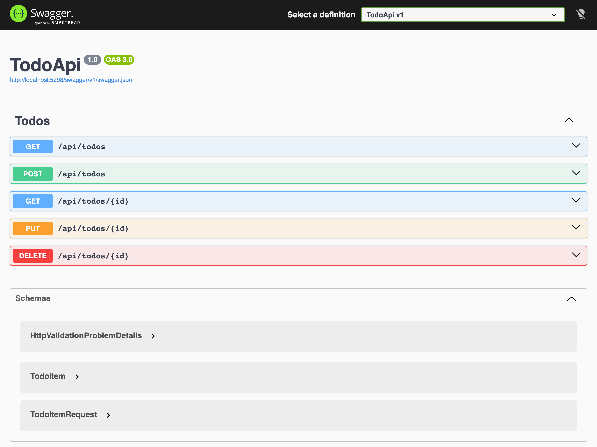
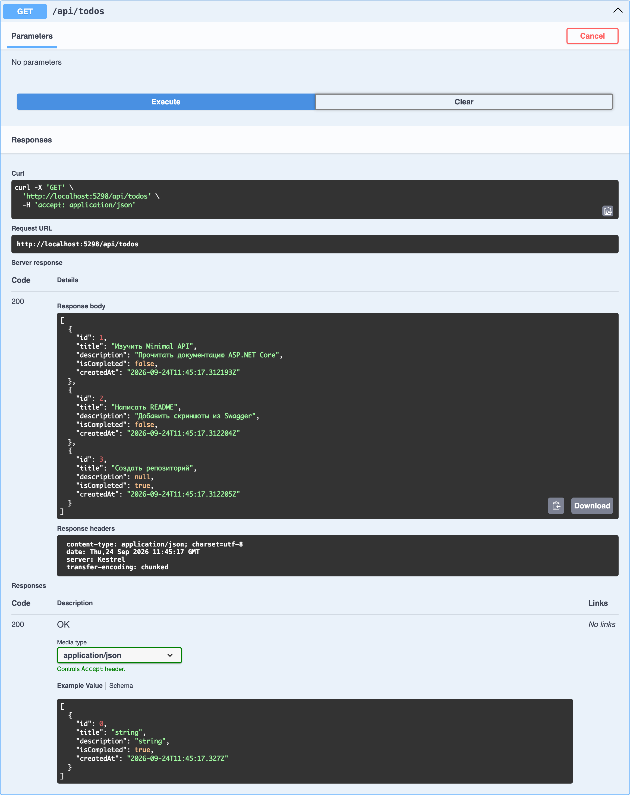
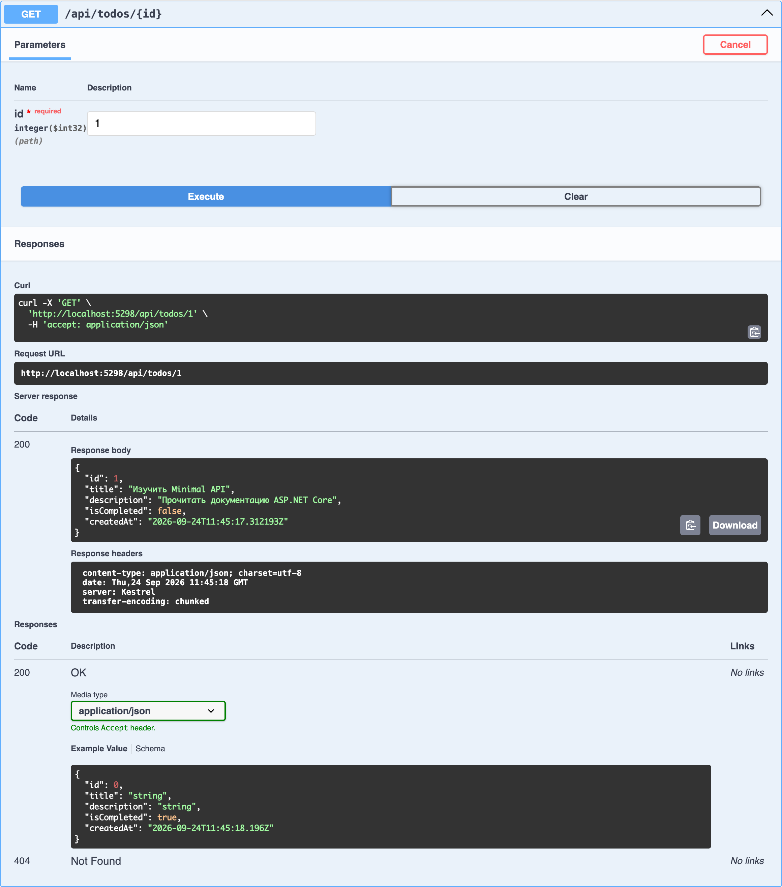
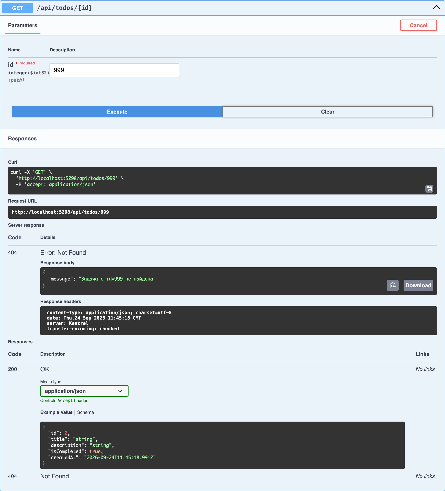
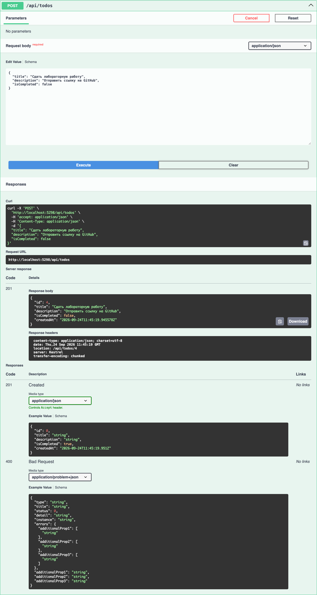
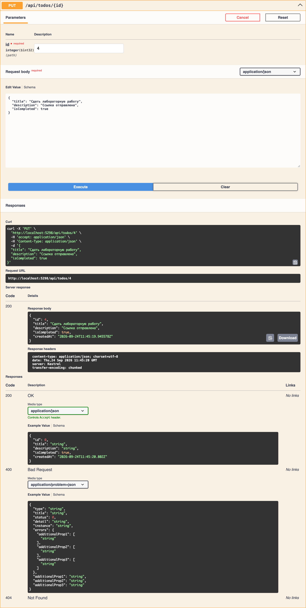
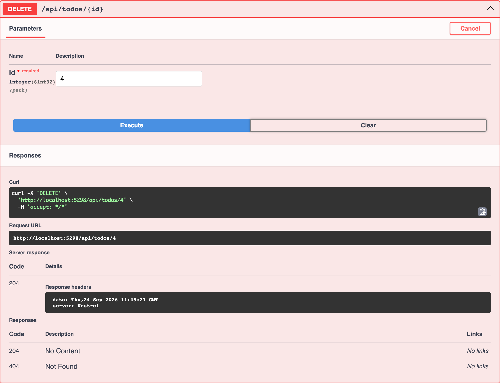

# Todo REST API (ASP.NET Core Minimal API)

## Задание

Разработать REST API на **ASP.NET Core Minimal API** для управления списком задач (Todo).
API должен поддерживать все базовые операции CRUD. Данные хранить в памяти (список).

**Что сдать:**
- ссылку на репозиторий GitHub с кодом;
- README.md с заданием и скриншотами (Postman/Swagger) минимум 5 операций с видимыми кодами ответов.

## Технологии

- .NET 10, ASP.NET Core Minimal API
- Swashbuckle.AspNetCore (Swagger UI)
- Хранилище: `List<TodoItem>` в памяти процесса (данные сбрасываются при перезапуске)

## Структура проекта

```
TodoApi/
├── Program.cs                  # настройка приложения и все эндпоинты /api/todos
├── Models/TodoItem.cs          # модель задачи и DTO запроса TodoItemRequest
├── Services/TodoRepository.cs  # потокобезопасное in-memory хранилище (List + lock)
└── Properties/launchSettings.json
screenshots/                    # скриншоты Swagger для отчёта
```

## Запуск

```bash
cd TodoApi
dotnet run
```

После запуска Swagger UI доступен по адресу **http://localhost:5298/swagger**
(корень `http://localhost:5298/` тоже перенаправляет на Swagger).

При старте в хранилище уже есть 3 демонстрационные задачи (id 1–3).

## Эндпоинты

| Метод  | URL                | Описание                      | Коды ответа     |
|--------|--------------------|-------------------------------|-----------------|
| GET    | `/api/todos`       | Список всех задач             | 200             |
| GET    | `/api/todos/{id}`  | Задача по id                  | 200, 404        |
| POST   | `/api/todos`       | Создать задачу                | 201, 400        |
| PUT    | `/api/todos/{id}`  | Обновить задачу               | 200, 400, 404   |
| DELETE | `/api/todos/{id}`  | Удалить задачу                | 204, 404        |

Модель задачи:

```json
{
  "id": 1,
  "title": "Изучить Minimal API",
  "description": "Прочитать документацию ASP.NET Core",
  "isCompleted": false,
  "createdAt": "2026-09-24T11:45:17.000Z"
}
```

Тело запроса для POST и PUT (`id` и `createdAt` задаёт сервер, `title` обязателен, иначе вернётся 400):

```json
{
  "title": "Сдать лабораторную работу",
  "description": "Отправить ссылку на GitHub",
  "isCompleted": false
}
```

## Чеклист

| Критерий                                       | Доля, % | Статус | Скриншот |
|------------------------------------------------|:-------:|:------:|----------|
| Проект запускается без ошибок                  | 10      | ✅     | [0](#0-проект-запущен-swagger-ui) |
| GET /api/todos → 200 со списком                | 10      | ✅     | [1](#1-get-apitodos--200) |
| GET /api/todos/{id} → 200 с задачей            | 10      | ✅     | [2](#2-get-apitodosid--200) |
| GET /api/todos/{id} → 404 для несуществующего  | 15      | ✅     | [3](#3-get-apitodosid--404) |
| POST /api/todos → 201 с созданной задачей      | 20      | ✅     | [4](#4-post-apitodos--201) |
| PUT /api/todos/{id} → 200 с обновлённой        | 15      | ✅     | [5](#5-put-apitodosid--200) |
| DELETE /api/todos/{id} → 204                   | 15      | ✅     | [6](#6-delete-apitodosid--204) |
| Код читаем, есть комментарии                   | 5       | ✅     | [исходники](TodoApi/) |
| **Итого**                                      | **100** |        |          |

## Скриншоты (Swagger UI)

### 0. Проект запущен, Swagger UI



### 1. GET /api/todos → 200

Возвращается список из трёх стартовых задач.



### 2. GET /api/todos/{id} → 200

Запрос задачи с `id = 1`.



### 3. GET /api/todos/{id} → 404

Запрос несуществующей задачи с `id = 999`.



### 4. POST /api/todos → 201

Создана задача с `id = 4`, в заголовке `Location: /api/todos/4`.



### 5. PUT /api/todos/{id} → 200

Задача `id = 4` обновлена: изменено описание, `isCompleted = true`.



### 6. DELETE /api/todos/{id} → 204

Задача `id = 4` удалена, тело ответа пустое.


